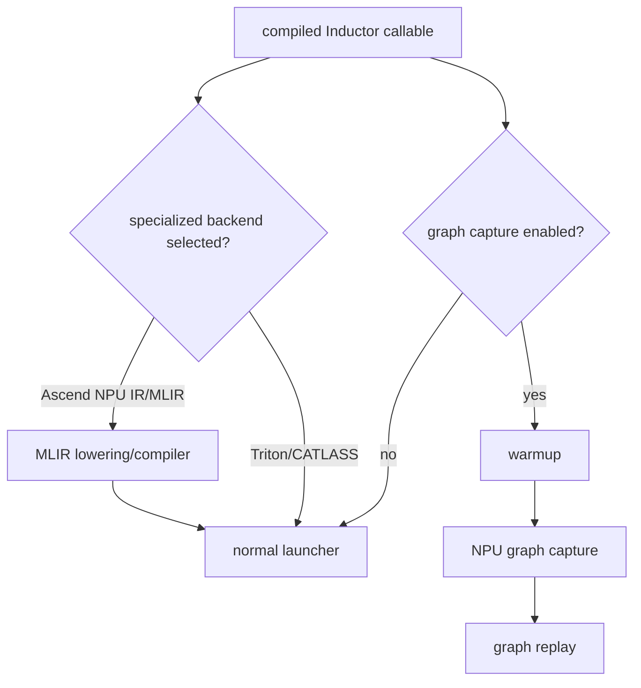

# NPU Graph Capture、MLIR 与 AOTI 分支

## 两条后端后路径



## Graph capture 源码入口

- `<workspace>/pytorch_new/torch_npu/utils/_graph_tree.py`：`npugraphify` 入口和 patch。
- `<workspace>/pytorch_new/torch_npu/npu/_graph_tree.py`：capture/replay implementation、static input 和
  graph lifecycle。

## MLIR/AOTI 源码入口

- `<workspace>/pytorch_new/torch_npu/_inductor/ascend_npu_ir/ascend_npu_ir/npu/npu_lowering.py`。
- `<workspace>/pytorch_new/torch_npu/_inductor/ascend_npu_ir/ascend_npu_ir/npu/codegen/`。
- `<workspace>/pytorch_new/torch_npu/_inductor/ascend_npu_ir/ascend_npu_ir/npu/mlir_compiler.py`。
- `<workspace>/pytorch_new/torch_npu/_inductor/ascend_npu_ir/ascend_npu_ir/npu/npu_inductor_plugin.py`。

## 源码入口

本专题的源码入口分为 graph capture 和 MLIR/AOTI 两组；上面的分组说明具体职责，下面列出完整范围。

- `<workspace>/pytorch_new/torch_npu/utils/_graph_tree.py`：Inductor patch 层 `npugraphify`。
- `<workspace>/pytorch_new/torch_npu/npu/_graph_tree.py`：tree manager、warmup、record、replay、alias 和
  liveness。
- `<workspace>/pytorch_new/torch_npu/_inductor/ascend_npu_ir/ascend_npu_ir/npu/npu_lowering.py`：NPU IR
  lowering。
- `<workspace>/pytorch_new/torch_npu/_inductor/ascend_npu_ir/ascend_npu_ir/npu/codegen/`：MLIR/wrapper
  emitters。
- `<workspace>/pytorch_new/torch_npu/_inductor/ascend_npu_ir/ascend_npu_ir/npu/mlir_compiler.py`：MLIR
  compile boundary。

## 练习

分别记录 normal launch、首次 warmup/capture 和 replay 的调用路径。对 MLIR 路径先确认 plugin registration
和实际 backend selection，再分析 lowering/codegen；不要把源码存在当成当前用例实际选中。

## 易错点

- graph capture 是编译后执行层，不能解释单个 kernel 的 lowering 错误。
- MLIR、Triton、CATLASS 和 DVM 是可能并存的路径，必须用配置和调用栈确认。

## 实现展开：npugraphify 的两层封装

NPU graph capture 在当前代码中分为两层：

### Inductor patch 层

`torch_npu/utils/_graph_tree.py:100` 的 `npugraphify()` 接收 compiled model、static input indexes、
device、placeholder 和 mutation metadata。它通过 closure 延迟第一次 capture：

```text
npugraphify(model, metadata)
  -> return run(new_inputs)
  -> first run: npugraphify_impl(model, new_inputs, static_input_idxs)
  -> cache compiled_fn
  -> later run: compiled_fn(new_inputs)
```

入口会根据 `config.triton.cudagraph_trees` 选择旧的 `npugraphify_impl` 或
`torch_npu.npu._graph_tree.npugraphify_impl`，所以配置决定实际实现。

### NPU graph-tree 层

`torch_npu/npu/_graph_tree.py:345` 的实现会先按 integer inputs 建 `fn_cache` key，再在 deferred function
中检查 static input 对齐、移除不能安全复用的 static index，最后调用 `npugraphify()`。manager 负责
warmup/record/replay、输入 copy、输出 alias 和 graph tree 生命周期。

## MLIR/AOTI plugin 的实际边界

`ascend_npu_ir/.../npu_inductor_plugin.py` 通过 `register_backend_for_device()` 注册 MLIR/AKG scheduling
和 wrapper；`npu_lowering.py` 将 Inductor/operator lowering 接到 Ascend IR；`codegen/mlir.py`、
`mlir_compiler.py` 负责生成和编译 MLIR。它与 Triton path 共享上游 graph/IR 入口，但 backend registration
和 emitter 不同。

分析 MLIR 问题时按下面顺序：

1. 确认 plugin 是否实际加载。
2. 确认当前 device registry 中的 scheduling/wrapper class。
3. 检查 NPU IR/lowering 是否已改变 shape/layout/operation。
4. 查看 MLIR source 和 compiler diagnostics。
5. 最后才检查 runtime launch/AOTI container。

## graph tree 的缓存与稳定性检查

`npu/_graph_tree.py:npugraphify_impl()` 为 integer inputs 构造 `int_key`，从 `fn_cache` 查找已经建立的 compiled graph。
未命中时先计算需要检查的 input indexes，调用 `remove_unaligned_input_idxs()` 删除不能安全假设静态地址的输入，再创建新的
graph function 并缓存。后续调用需要经过：

```text
int_key lookup
  -> static input data_ptr/shape/alignment check
  -> non-static input copy/update
  -> warmup/record/replay
  -> output alias/liveness handling
```

静态 input 变化可能触发 rerecord 或新 graph；dynamic shape 还可能使 `fn_cache` 出现多个 key。不能把“同一个 Python
callable”理解为只有一张 NPU graph。

## MLIR plugin 的编译边界

plugin 注册后，Inductor graph/IR 仍可能共享上游输入，但 `npu_lowering.py` 将 operator 改写为 Ascend IR；codegen 目录
把 IR 变成 MLIR/wrapper，`mlir_compiler.py` 再把 source 交给设备 compiler。定位时保留四份证据：device registry 当前
backend、NPU lowering 返回的 IR、生成的 MLIR、compiler diagnostics。缺少其中任一项，无法判断问题在共享 IR 还是 MLIR
emitter/compiler。
