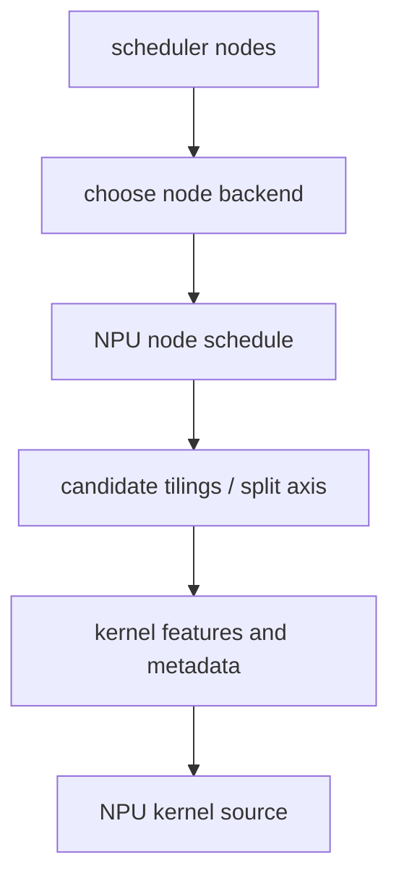

# NPU Scheduling、Tiling 与 Kernel Features

## 数据流



## 源码入口

- `<workspace>/pytorch_new/torch_npu/_inductor/codegen/npu_combined_scheduling.py`：backend choice、fusion、
  kernel generation。
- `<workspace>/pytorch_new/torch_npu/_inductor/codegen/scheduling.py`：`generate_node_schedule`、candidate
  tiling、codegen node schedule。
- `<workspace>/pytorch_new/torch_npu/_inductor/codegen/split_tiling.py`：split axis、tiling axis、dynamic
  axis、grouped feature。
- `<workspace>/pytorch/torch/_inductor/codegen/simd_kernel_features.py`：上游 kernel feature 对照。

## 练习

对 pointwise、reduction、dynamic shape 各记录 node schedule、axis、tiling、mask 和 kernel metadata。把
NPU 选择与上游 scheduler 的共享部分分开标注。

## 易错点

- `NPUCombinedScheduling` 继承上游类不代表所有方法行为相同；必须定位 override。
- grouped/symbolic feature 是 codegen metadata，不等于 runtime 已经选择最佳配置。

## 实现展开：NPUCombinedScheduling 的职责分层

`NPUCombinedScheduling`（`npu_combined_scheduling.py:33`）继承
`CUDACombinedScheduling` 和 `TritonScheduling`，但通过 override 把 NPU 的 backend choice、fusion 和
kernel generation 接到同一个 scheduler 接口：

- `choose_node_backend()`：按 node/template/device 条件选择具体 scheduling。
- `can_fuse_vertical/horizontal()`：在上游 dependency/fusion 之外加入 NPU 条件。
- `codegen_node()`：将 fused/single node 交给对应 backend emitter。
- `generate_kernel_code_from_nodes()`：生成源码，必要时进入 benchmark/code cache。
- `codegen_combo_kernel()`：处理组合 kernel 路径。

真正的 loop schedule 在 `codegen/scheduling.py` 中进一步生成：

```text
FusedSchedulerNode
  -> generate_node_schedule(nodes, numel, rnumel)
  -> group_fn(sizes)
  -> candidate_tilings(...)
  -> create_kernel_choices(...)
  -> codegen_node_schedule(kernel_features, nodes)
  -> NPU Triton kernel source
```

`NPUNoLinearTritonScheduling` 与 `NPUTritonScheduling` 是不同调度策略，不能只因为都叫 Triton 就认为
它们生成相同 loop。应从当前 node 的 backend choice 和 `kernel_features` 确认实际类。

## SplitTiling 的具体决策

`SplitTiling.select_split_tiling_axis()` 串联 `select_split_axis()`、`select_tiling_axis()` 和 grouped rewrite；
`NPUIndexTritonKernel._finalize_kernel_codegen_dims()` 随后单独调用 `select_no_loop_axis()`。每个选择都有
reduction/pointwise、low/high dimension、dynamic axis 和 stop condition。grouped rewrite 最终通过
`_build_group_features()` 生成 runtime/autotune 可消费的 feature。

排查时要把：原始 axis names、选择后的 split/tiling axis、grouped rewrite 后的 feature、generated kernel
program id 四项对齐，才能判断是 scheduler 轴选择错，还是 emitter 映射错。

## `NPUTritonScheduling` 的 override 边界

`generate_node_schedule()` 并非所有 NPU kernel 都走自定义实现：未启用 Welford 时直接调用上游；启用但 group
不含 Welford 时，重新取得原始 `(numel, rnumel)` 后仍调用上游；只有确实包含 Welford group 才进入
`_generate_npu_node_schedule()`。因此普通 pointwise/reduction 不应无条件归因于 NPU 自定义 schedule。

## NPU candidate tiling 的具体改动

`NPUTritonScheduling.candidate_tilings()` 与上游共享 stride scoring，但默认 `none` 候选保留原始 ranges，不先折叠
成单一乘积；`create_tiling()` 将 pointwise group 展平后从 `w/v/t/z/y/x` 分配前缀，reduction group 合并为一个 `r`。

后续 `SplitTiling` 再选择 grid split axis。candidate tiling 与 split axis 是两层决策：前者产生合法 layout/block
候选，后者决定 NPU program domain。性能问题要先确认属于哪一层。
