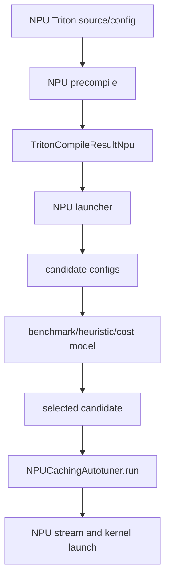

# NPU Triton Runtime、Autotune 与 Launcher

## 运行时链路



## 源码入口

- `<workspace>/pytorch_new/torch_npu/_inductor/runtime/triton_heuristics.py`：
  `TritonCompileResultNpu`、`NPUCachingAutotuner`、grid、precompile、launcher、run。
- `<workspace>/pytorch_new/torch_npu/_inductor/codegen/wrapper.py`：wrapper 传入的 NPU ABI。
- `<workspace>/pytorch_new/torch_npu/_inductor/codegen/npu/device_op_overrides.py`：stream/device 操作。

## 练习

在允许的 NPU 容器中记录一次 kernel 的 source/config、precompile、candidate、best launcher、stream 和
run。区分 autotune benchmark 时间与选定 kernel 的 steady-state 时间。

## 易错点

- launcher 正确不代表 generated kernel 语义正确。
- fallback 或单一 config 正确不能证明所有候选都正确。
- NPU、triton-ascend 和 torch_npu 版本变化可能改变 runtime path。

## 实现展开：NPUCachingAutotuner 的扩展点

`NPUCachingAutotuner`（`runtime/triton_heuristics.py:620`）继承上游 `CachingAutotuner`，但扩展了
NPU 编译、runtime block、launcher 和候选选择：

1. `precompile()` 准备多个 NPU config；可顺序或并行编译。
2. `_precompile_config()` 将 config 转成 `TritonCompileResultNpu`。
3. `_make_launchers()` 为每个 compile result 构造 NPU launcher。
4. `bench()`/`benchmark_all_configs()` 采集候选 runtime。
5. `_set_best_candidate()` 保存选中的 candidate/launcher。
6. `run()` 根据 args、runtime blocks、grid 和 stream 执行选中的 launcher。

`TritonCompileResultNpu.make_launcher()` 是 Python runtime 与 NPU kernel ABI 的关键边界；需要对照
wrapper 生成的参数顺序、grid 表达式和 `stream` 传入方式。`GridExprNpu` 则负责把静态/动态/grouped
metadata 转成运行时 grid。

## 普通、cost-model、symbolic-group 三类 runtime

当前实现还包括：

- `NPUCostModelAutotuner`：从 TTIR/runtime args 建立 cost-model bindings，优先缩小 candidate。
- `NPUSymbolicGroupedAutotuner`：根据 runtime feature input 解析 group，选择对应 plan/candidate。
- `NPUDebugAutotuner`：保留调试/筛选路径，便于定位 candidate。

这些类都继承或复用 `NPUCachingAutotuner`，但 `run()` 和 candidate preparation 可能不同。性能日志中
必须写明 autotuner class，否则无法复现 dispatch 行为。

## NPU runtime 的关键分支

`NPUCachingAutotuner.run()` 同时处理三种输入来源：

```text
wrapper args -> tensor/scalar ABI
GridExprNpu -> grid 或 runtime block
best candidate/launcher -> 已编译 kernel entry
```

普通路径直接使用 best launcher；cost-model 路径先从 TTIR/runtime args 建立 bindings；symbolic-group 路径先由 runtime
feature 得到 group，再物化该 group 的 plan。三者最后都必须回到同一 NPU stream launch ABI。

## `TritonCompileResultNpu.make_launcher()` 审计项

审查 launcher 时核对：参数顺序是否与 wrapper 的 pointer/size/stride/scalar 一致；`GridExprNpu` 维度顺序是否与
generated source 的 `tl.program_id(dim)` 一致；runtime block 是否覆盖动态尾部且与 mask 上界一致；stream/device
override 是否来自当前 NPU device；fallback 是否保留相同的输出 buffer 和 mutation 语义。轴顺序变更后，launcher/grid 和
source 必须同时变化，不能只改一侧。
