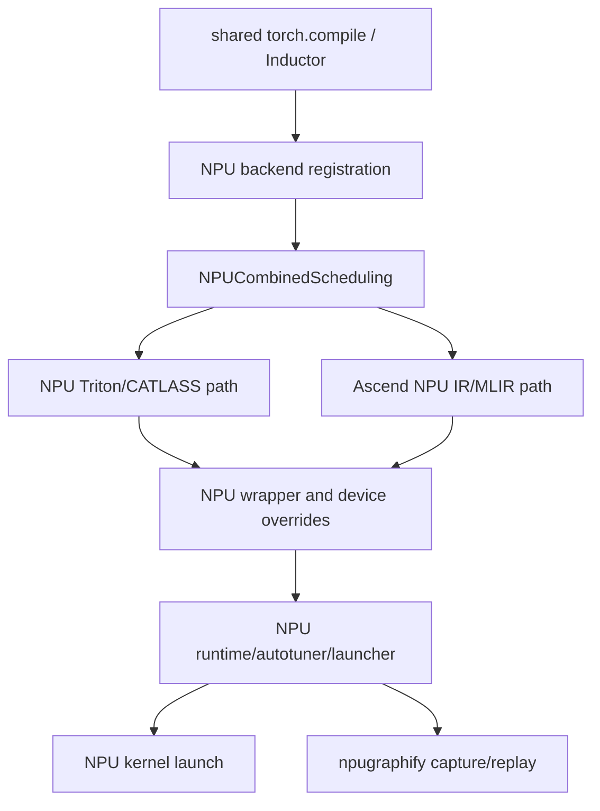

# Ascend NPU Codegen：Overview 与 Architecture

## Overview

Ascend NPU codegen 复用上游 `torch.compile`、Dynamo、AOTAutograd 和 Inductor 主干，在 backend
registration、scheduling、wrapper、runtime、graph capture 和专用 IR 处接管。阅读 NPU 代码时首先要
判断一个行为是共享上游逻辑、NPU override，还是当前配置选择的独立 backend。

## Architecture

## 数据流说明

- `torch_npu` 导入或首次 compile 时触发 NPU backend 注册和相关 patch。
- NPU scheduling 根据 node、layout、shape 和配置选择 Triton/CATLASS/MLIR 等路径。
- NPU wrapper 生成 device、stream、buffer、grid 和 launch ABI。
- `NPUCachingAutotuner` 负责编译候选、选择 launcher 和 runtime 执行。
- `npugraphify` 位于编译后 capture/replay 层，不等同于单 kernel lowering。

## 阅读方法

先拿到调用栈和 kernel metadata，确认 backend path；再对照上游同名类和 NPU override，最后验证 generated
kernel、wrapper、stream 和 eager/compiled 结果。没有 NPU 实机时只陈述源码调用关系，不声称 launch/性能
已经验证。
