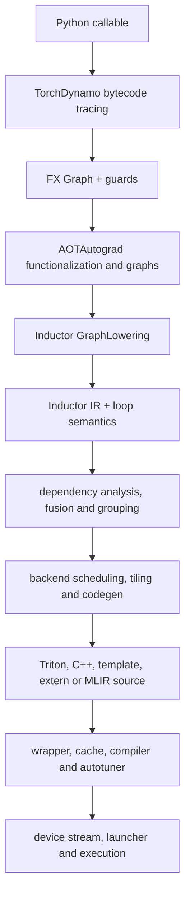

# PyTorch Inductor Codegen 学习路线

这套路线的目标不是记住一批文件名，而是建立一条可以反复使用的分析链：给定一个
`torch.compile` 用例，能够从 Python 语义追踪到 FX graph、Inductor IR、scheduler 决策、
generated kernel、wrapper 和 runtime launch，并能解释 Ascend NPU 在哪些接口上接管上游实现。

## 最终能力

完成全部目标后，应当能够独立回答下面的问题：

1. Python 函数何时被捕获成 FX graph，guard 和 graph break 为什么产生？
2. FX/ATen 节点如何 lowering 为 Inductor IR，layout、stride 和 mutation 如何表达？
3. scheduler 为什么融合或拆分节点，iteration/reduction domain 如何决定 kernel 结构？
4. Inductor 如何生成 Triton、C++ 或 MLIR，以及 kernel codegen 和 wrapper codegen 有何区别？
5. generated kernel 中的索引、mask、reduction 和 store 如何映射回张量语义？
6. dynamic shape 如何影响 guard、符号表达式、调度、autotune 和 runtime dispatch？
7. torch_npu 如何注册 NPU backend，并替换 scheduling、wrapper、runtime 和 graph capture？
8. 遇到编译失败或精度错误时，如何用最小复现和生成产物定位到具体阶段？

## 全链路地图



`codegen` 在狭义上指“从内部表示生成目标程序”，但排查 PyTorch codegen 问题时必须观察整条链。
上游 IR 或 scheduler metadata 出错，最终症状往往只在 generated kernel 中出现。

## 学习目标

| 顺序 | 目标 | 核心产出 | 建议时间 |
|---|---|---|---|
| 1 | [编译器基础](01-compiler-foundations/) | 能手算 shape、stride、索引与简单 tiling | 3 至 5 天 |
| 2 | [PyTorch 执行与 FX](02-pytorch-execution-and-fx/) | 能从 eager 语义读懂 ATen/FX graph | 4 至 6 天 |
| 3 | [Dynamo 与 AOTAutograd](03-dynamo-and-aotautograd/) | 能解释捕获、guard、graph break 和前后向图 | 5 至 7 天 |
| 4 | [Inductor IR 与 Lowering](04-inductor-ir-and-lowering/) | 能把 FX 节点映射到 IR 和 loop semantics | 5 至 7 天 |
| 5 | [Scheduler、融合与 Tiling](05-scheduler-fusion-and-tiling/) | 能解释 kernel 分组和循环域 | 7 至 10 天 |
| 6 | [Backend Codegen 与 Runtime](06-backend-codegen-and-runtime/) | 能机械阅读 kernel、wrapper 和 launch | 7 至 10 天 |
| 7 | [Dynamic Shapes](07-dynamic-shapes/) | 能解释符号形状、重编译与动态 kernel | 5 至 7 天 |
| 8 | [Ascend NPU Codegen](08-ascend-npu-codegen/) | 能对照上游定位 NPU 接管点和生成路径 | 7 至 10 天 |

建议按依赖顺序推进。已有编译器基础时可以加速目标 1，但不要跳过目标 4 和 5直接阅读最终 kernel。

## 贯穿全程的最小用例

先固定四组小函数，后续每个目标都复用它们：

```python
import torch


def pointwise(x, y):
    return (x + y).relu()


def reduction(x):
    return x.sum(dim=-1)


def strided(x):
    return (x.transpose(0, 1) + 1).relu()


def matmul_epilogue(x, w, bias):
    return (x @ w + bias).relu()
```

每个用例都保留以下观测结果：

```text
输入：shape、stride、dtype、device、dynamic/static
前端：FX graph、guards、graph breaks
中端：Inductor IR、read/write dependencies、scheduler nodes
后端：kernel 类型、iteration/reduction domain、tiling 和 generated source
运行时：wrapper、grid、参数、cache、autotune、stream
验证：eager/compiled 输出、重新编译次数、性能数据（仅在环境允许时）
```

## 推荐节奏

每个目标按相同循环学习：

1. 先读目录中的概念边界，确认术语不混用。
2. 只沿最小用例阅读列出的关键函数，不从头通读大文件。
3. 获取 graph、IR 或 generated code，建立输入到产物的映射。
4. 改变一个变量，例如 stride、reduction dim 或 dynamic shape，比较产物差异。
5. 完成验收清单；不能解释的结论记录为问题，而不是凭输出猜测。

每周建议安排为 40% 源码、40% 实验、20% 复盘。只读源码容易丢失数据流，只看生成代码又容易把
上游错误误判成 backend emitter 错误。

## 里程碑

### 里程碑 A：能跟通一条静态 pointwise 链路

使用 `pointwise()`，从 `torch.compile` 跟到一份 generated kernel 和 wrapper，解释每个参数与每次
load/store。这是目标 1 至 6 的综合验收。

### 里程碑 B：能解释 reduction 与 non-contiguous

使用 `reduction()` 和 `strided()`，解释 reduction axis、accumulator 生命周期、tail mask、stride
索引，以及 scheduler 为什么生成当前 kernel 边界。

### 里程碑 C：能比较 static 与 dynamic

对同一函数改变 batch size，比较 guards、symbolic expressions、generated source、grid 和编译次数，
区分“语义相同”与“生成策略相同”。

### 里程碑 D：能对照 CUDA/上游与 NPU

为同一 FX graph 画出共享主链和 NPU 分叉点，至少定位 backend registration、NPU scheduling、wrapper、
autotuner、launcher 和 `npugraphify`。

## 调试闭环

遇到 `torch.compile` 后的失败时，先分类阶段，再修改代码：

```text
Dynamo -> AOTAutograd -> lowering -> scheduling -> codegen
       -> kernel compile -> runtime launch -> accuracy/performance
```

准确性问题必须用同一组确定性输入对比 eager 和 compiled。优先拿到完整 generated kernel、FX graph、
scheduler metadata 和输入的 shape/stride；不要只根据最后一行异常推测根因。

生成 DSL 的阅读顺序固定为：

```text
shape/stride
  -> preserved axes 和 reduction axes
  -> program id / block offset
  -> address formula
  -> mask
  -> load 和中间 layout
  -> reduction
  -> store 作用域
```

## 环境边界

- 本地 CPU 环境足以学习 Dynamo、FX、AOTAutograd、Inductor IR 和 CPU C++ codegen。
- Triton CUDA 产物阅读可以基于已有 debug trace 或具备 GPU 的环境。
- NPU kernel、autotune、stream 和 graph capture 的行为必须在 NPU 环境验证。
- 远程 NPU 验证需要单独确认后，按工作区 `AGENTS.md` 的容器流程执行。

## 配套材料

- [Inductor Codegen 术语说明](../inductor-codegen-terms.md)
- [Inductor Pointwise 与 Elementwise 范围区别](../inductor-pointwise-vs-elementwise.md)
- [RMSNorm SIMD 多 reduction 轴问题复盘](../../../../issue-logs/codegen/rms-norm-simd-multi-reduction-codegen.md)
- [DLRM dynamic 与 static codegen 对比](../../../../issue-logs/dynamic-shape/dlrm-dynamic-vs-static-codegen-analysis.md)

源码路径统一以工作区为基准：社区 PyTorch 位于 `<workspace>/pytorch`，Ascend 适配位于
`<workspace>/pytorch_new`。函数行号会随版本变化，因此文档以文件和符号名作为稳定入口。

## 按问题直接进入实现

不需要每次从目标 1 顺序阅读。遇到具体实现问题时可直接进入：

- split axis 如何选择、何时多轴、static/dynamic 和 CUDA/NPU 差异：
  [Tiling、Split Axis 与 Kernel Features](05-scheduler-fusion-and-tiling/tiling-split-axis-and-features.md)
- reduction loop 为什么被打开/关闭、store 位于哪层：
  [Iteration Domain 与 Reduction Schedule](05-scheduler-fusion-and-tiling/loop-domain-and-reduction-schedule.md)
- 轴属性怎样变成 `program_id`、offset、loop 和 mask：
  [Triton Kernel Codegen](06-backend-codegen-and-runtime/triton-kernel-codegen.md)
- dynamic symbol、guard、runtime grid 和 grouped autotune：
  [Dynamic Shapes](07-dynamic-shapes/)
- NPU backend 接管点、调度和 launcher：
  [Ascend NPU Codegen](08-ascend-npu-codegen/)

技术文档按“源码入口、输入状态、判定顺序、状态变化、下游消费、可验证问题”组织；章节 `index.md` 负责学习顺序和
验收，不要求每篇正文重复导读。

## 内部流程索引

- 字节码如何变成 FX、graph break 如何续接：
  [Dynamo frame capture](03-dynamo-and-aotautograd/dynamo-frame-capture.md)，看 `step/run` 和
  `compile_subgraph`。
- operator 为什么走 Meta、fallback 或 lowering：
  [Dispatcher 与 ATen](02-pytorch-execution-and-fx/dispatcher-aten-and-meta.md) 和
  [Lowering registry](04-inductor-ir-and-lowering/lowering-registry-and-operator-mapping.md)，看
  `dispatch` 和 `call_function`。
- dynamic symbol、guard、runtime scalar 如何传递：
  [ShapeEnv](07-dynamic-shapes/shapeenv-symint-and-metadata.md) 和
  [Dynamic IR](07-dynamic-shapes/dynamic-ir-sizevars-and-indexing.md)，看 `create_symbol`、
  `produce_guards`、`SizeVarAllocator`。
- Pointwise/Reduction 如何定义 output/reduction domain：
  [Inductor IR](04-inductor-ir-and-lowering/inductor-ir-buffer-and-loop.md)，看 `store_output` 和
  `store_reduction`。
- view 何时 lazy、何时变成 ComputedBuffer：
  [Layout/View/Realization](04-inductor-ir-and-lowering/layout-view-and-realization.md)，看
  `TensorBox.create` 和 `StorageBox.realize`。
- dependency、fusion、reduction loop 如何决定：
  [Scheduler](05-scheduler-fusion-and-tiling/dependency-and-scheduler.md) 和
  [Fusion](05-scheduler-fusion-and-tiling/fusion-strategies.md)，看 `compute_dependencies`、
  `can_fuse`、`generate_node_schedule`。
- split axis、多轴、dynamic/static、CUDA/NPU 差异：
  [Split Axis 与 Tiling](05-scheduler-fusion-and-tiling/tiling-split-axis-and-features.md)，看
  `select_split_axis` 和 `candidate_tilings`。
- axis 标记如何变成 program id、mask、reduction code：
  [Triton Kernel Codegen](06-backend-codegen-and-runtime/triton-kernel-codegen.md)，看
  `codegen_header`、`codegen_index`、`codegen_body`。
- wrapper、cache、autotune、grid、launcher 如何协作：
  [Wrapper ABI](06-backend-codegen-and-runtime/wrapper-codegen-and-abi.md) 和
  [Runtime](06-backend-codegen-and-runtime/cache-compile-and-autotune.md)，看
  `generate_kernel_call` 和 `run`。
- NPU backend 在哪里接管、graph capture 如何缓存：
  [NPU Registration](08-ascend-npu-codegen/npu-backend-registration.md) 和
  [NPU Graph](08-ascend-npu-codegen/npu-graph-capture-and-mlir.md)，看 `_load_triton_backend`、
  `npugraphify_impl`。

表中的“关键实现符号”是源码阅读入口，不是概念标签；正文会说明它的输入、分支、修改的数据结构和下游消费者。
