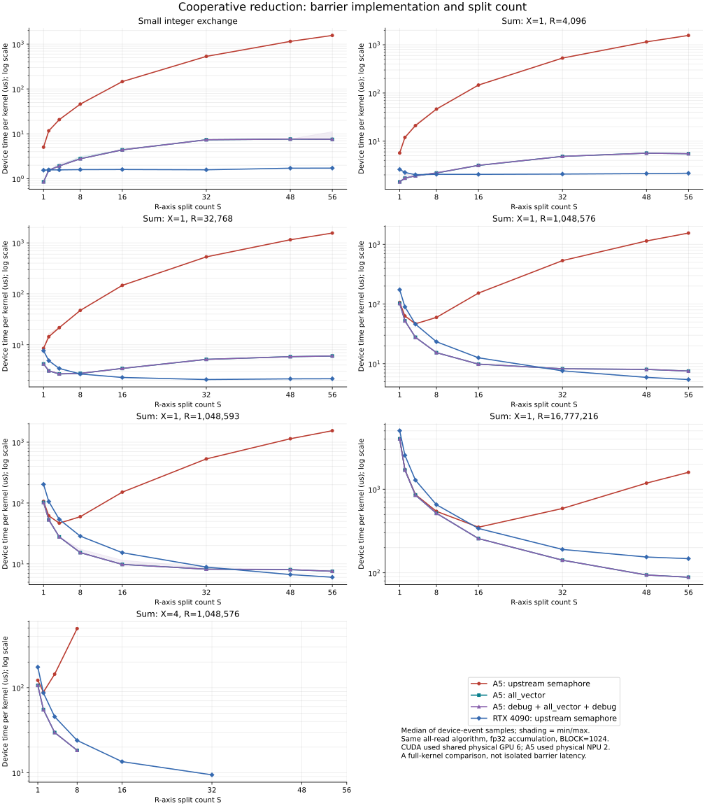
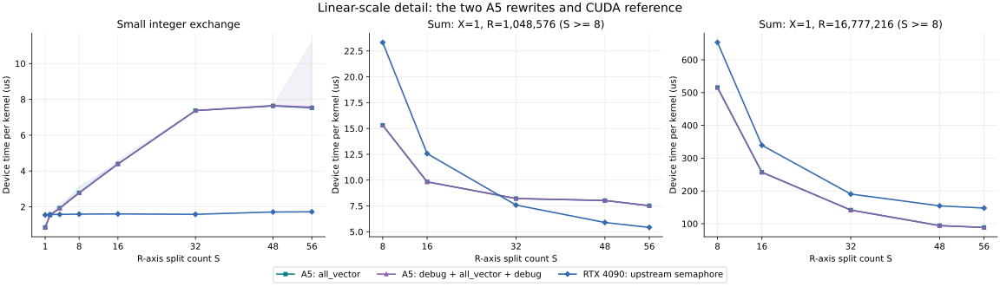
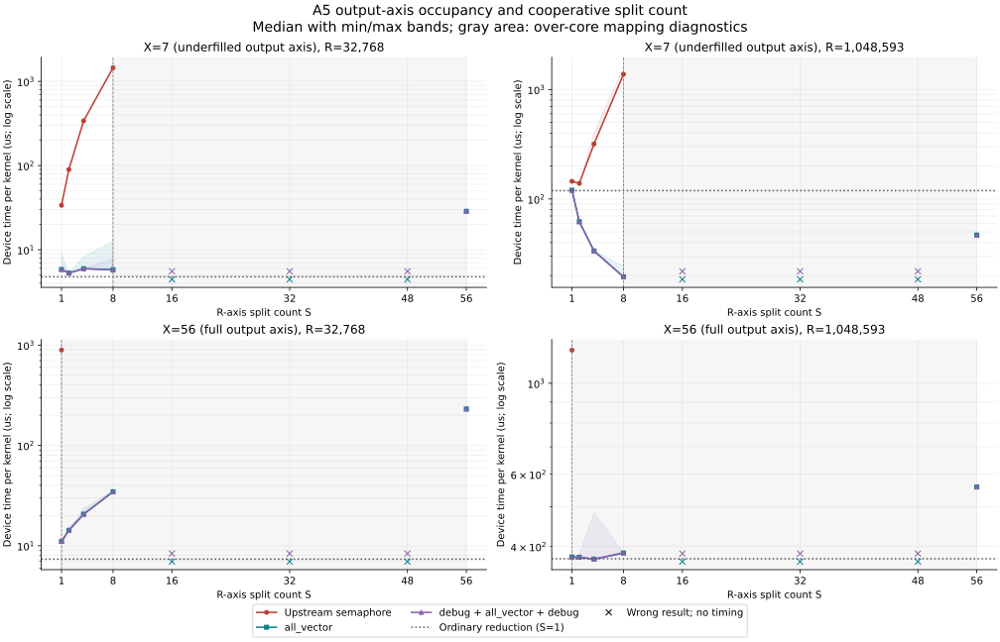

# 三种 x_grid_barrier 的 A5 与 RTX 4090 验证

实验日期：2026-11-21；输出并行度矩阵于 2026-11-22 解除过滤后重测，均为北京时间。本文作为
[Cooperative Reduction 需求分析](requirements.md)和[方案设计](design.md)的验证依据。

**结论：两种 all_vector 改写在核数内、统一参与的已测配置中精度正常，第 4 节同地址耗时中位数几乎一致；
它们都不能作为通用 x_grid_barrier 的完整替换。** 默认自动分核将单行的 112 个分片
映射到 56 核时，两种版本均正常返回却产生错误结果；两侧本核屏障不能解决这一问题。
第 6.4 节新增 A5/RTX 4090 未满核与满核对照：A5 的错误取决于同一输出的分片是否跨执行批次，
不能只看总 program 数。11 月 22 日解除过滤后，NPU 的 100 点全部尝试：64 通过、24 错误且已计时、
12 个原版配置在首次 sum 超时；GPU 的 54 点中 40 通过、14 个 cooperative launch 规模超限。
两端均无 SKIP；数值错误点保留耗时，未完成的调用不虚构耗时。
多进程多流提交检查通过，设备指令真正重叠时的事件隔离尚未确认。

## 1. 评估对象

三种实现采用相同的调用形式 `x_grid_barrier(sem)`：

| 脚本名称 | NPU 实现 | CUDA 对照 | 同步范围 |
| --- | --- | --- | --- |
| `original` | 安装包中的上游协议 | 同一协议 | 相同 y/z 下的全部 x program；每组独立 semaphore |
| `native` | 此前改写的直接 all_vector 版本 | 无 CANN 对应实现 | 本次 kernel 的全部参与 Vector 核 |
| `debug` | 用户提供的两侧本核屏障版本 | 无 CANN 对应实现 | 同上；额外增加两次本核屏障 |

`original` 在本核屏障后，用带 release 的 atomic 登记到达，保留 atomic 返回的旧值，
再用带 acquire 的 atomic 轮询 semaphore 的最高位，直到本组全部到达，最后执行本核屏障。
两端安装包内该函数的源码 SHA256 相同，均以 `c9fa8ee90b54adc6` 开头。

两个 NPU 改写的实际代码如下，均未读取或修改 `sem`：

```python
@triton.jit
def x_grid_barrier(sem):
    extension.sync_block_all("all_vector", 0)


@triton.jit
def x_grid_barrier_debug(sem):
    tl.debug_barrier()
    extension.sync_block_all("all_vector", 0)
    tl.debug_barrier()
```

其中，`tl.debug_barrier()` 表达 block 内同步；`all_vector` 表达参与 Vector 核之间的会合。
本核屏障无法恢复上游的按 y/z 分组语义。完整代码见
[被测 helper](../../../scripts/tests/cooperative_reductions/npu_triton_helpers.py)。

## 2. 环境与版本

下表对应最初 210 个性能点；第 6.4 节重测使用同一软件栈，NPU 为物理卡 5，GPU 为共享物理卡 6。

| 项目 | NPU | GPU |
| --- | --- | --- |
| 服务器 | NPU_A5 | GPU_4090 |
| 实验位置 | Docker 内 `/home/l30023782/PTA_213/torch-learn` | 唯一指定容器 `pytorch-dev-gpu67` 内 `/home/gaojg/dev/torch-learn` |
| Python 环境 | `pta_213_case` | 容器原有 Python 3.12 |
| 设备 | 物理 NPU 2，Ascend950PR_9579，56 Vector / 28 Cube | 物理 GPU 6，RTX 4090，128 SM |
| 设备选择 | `ASCEND_RT_VISIBLE_DEVICES=2`，ACL 反查物理编号 | `CUDA_VISIBLE_DEVICES=GPU-528f4e79-58c0-e843-bf5e-0b40c2671cd7` |
| 占用情况 | 开始前无运行进程，符合夜间使用限制 | 共享使用；其他进程常驻约 13.4 GiB，检查时利用率 0% |
| PyTorch | `2.13.0+cpu`，通过 torch_npu 使用 NPU | `2.13.0+cu126` |
| torch_npu | `2.13.0+git93d7d01` | — |
| Triton / TA | `3.6.0` / `3.6.0+dev20261112182052` | `3.7.1` |
| NPUIR / CUDA | bishengir-compile 2.0.0，提交 `395c9c5646f9`，LLVM 19.1.7 | CUDA 12.6，驱动 535.183.01 |
| 编译选项 | `compile_mode="simd"`、4 warps | 4 warps |

两端均传入 `launch_cooperative_grid=True`，它是被测配置的一部分；NPU 上该字段存在不等于
自动证明了驻留、分核和全核屏障条件。性能采集代码提交为
`e352232967947b1b11a64dbfeb7c8128816e78b3`，两端脚本 SHA256 均以
`506523767a3a98b4` 开头。功能扩展与并发的各次提交、参数和源码摘要保留在各自 manifest 中。

环境明细：[NPU manifest][npu-manifest]、[GPU manifest][gpu-manifest]。
GPU 数据反映本次共享环境及固定 kernel 的结果，不能直接作为设备峰值或生产准入阈值。

## 3. 用例和计时方法

### 3.1 固定算法后比较 helper

`S` 表示 R 轴分片数，`X` 表示输出行数，`R` 表示每行归约长度。每个 program 负责一片。
本次固定以下算法，三种 NPU 实现及 CUDA 对照仅切换同步 helper：

1. 每片循环加载自己的数据，计算 fp32 局部和。
2. 将 partial 写到 GM workspace。
3. 调用被测 helper。
4. 每片读取本行全部 partial，计算完整结果，仅第 0 片写最终输出。

这是 **all-read 合并**：每个分片都读取最终合并所需的数据。每行有 `S` 个读取者，每人读取
`S` 个 partial，总读取量随 `S²` 增长。选择该算法是为了覆盖同步后的跨核读取，并与上游
各分片可能继续使用完整归约结果的场景对应；owner-only、只由一个分片合并的优化另行评估。

| 工作负载 | 数据和规模 | 目的 |
| --- | --- | --- |
| 小整数交换 | 每片写一个 int32，屏障后读取并求和 | 减少归约计算的干扰，精确检查可见性 |
| fp32 sum | `(a.float()+b.float()).sum(-1)`；`X=1`，`R=4096/32768/1048576/1048593/16777216` | 短轴、收益转折、长轴、尾块和大输入 |
| 多行 sum | 同一公式，`X=4,R=1048576` | 检查多个 y 组共享全 Vector 屏障时的行为 |

分片数为 `1,2,4,8,16,32,48,56`，局部 `BLOCK=1024`。常规性能点要求 `X*S` 不超过
本设备核数，因此 NPU 有 156 点，CUDA 有 54 点；多行曲线的终点随设备核数变化。
手写 kernel 读取 partial 时使用 `next_power_of_2(S)` 大小的 tile，并 mask `peer<S`，
因此可以测 48/56 等分片数；Inductor 生成这些候选仍需检查自身 codegen 的要求。
`S=1` 仍调用 helper，表示单分片的同算法参考，不能当作已经优化掉屏障的普通归约性能。

### 3.2 Device 侧计时

每点先做结果校验，再预热 5 次，将连续 32 次 kernel 调用捕获为一个 Graph。
Graph 再预热 3 次，随后采样 7 组，每组用 device Event 包围 10 次 Graph replay：

```text
每个样本的单 kernel 耗时 = Event 测得的设备时间 / (32 × 10)
展示值 = 7 个样本的中位数
```

NPU 使用 `NPUGraph`，CUDA 使用 `CUDAGraph`。每点计时结束后再次校验结果。
图中的纵轴是上述 **完整 kernel 的 device 侧平均耗时**，包含加载、加法、局部归约、
partial 交换、同步、合并和输出；编译时间、CPU 参考计算不计入。
小整数交换也包含写入和读取，不能用其数值直接命名为“纯 barrier 延迟”。

同一 `X/R/S` 下三种 NPU 实现复用完全相同的输入、workspace、输出与 semaphore 分配，
每个 helper 校验前重置 workspace、输出及 semaphore；记录实际地址，确认没有重新分配输入。
这样避免把各版本输入地址和缓存状态的差异当成同步实现的效果。
每个分片配置轮换 NPU helper 的执行顺序。全部样本、最小/最大值及精度误差均保存，
图中浅色区域表示该点的样本最小值到最大值。

### 3.3 功能检查的判定

整数交换使用严格相等；workspace 先填入哨兵值，制造先读后写时可识别的错误。
重复同步检查每次执行 16 个 phase，每 phase 写入不同值、交换结果，再增加一次屏障保护
读者结束后才能覆盖 workspace；还使用 3 个不同 epoch 和按分片变化的计算量。

浮点检查覆盖 fp32/fp16/bf16 输入的 `sum/mean/amax`，prologue、partial 和合并均使用 fp32，
输出为 fp32；CPU 对同一组输入先做 fp32 加法，再以 fp64 归约作为参考。
`mean` 先合并局部和，再除以真实 `R`，尾块及空片不增加分母。
这套低精度输入用例显式定义了 fp32 prologue，不等同于所有 ATen 半精度加法的舍入规则。

sum 容限为 `atol=0.02,rtol=2e-4`；mean/amax 为 `atol=2e-5,rtol=2e-4`。
同时记录实际误差，不将容限本身当作测量结果。整数交换为同步正确性的独立检查。

## 4. 性能结果

NPU 156 点和 CUDA 54 点全部通过计时前后校验。所有曲线按实际测量值绘制，没有插补缺失点。



总图使用对数纵轴，以同时显示微秒级改写与毫秒级原始协议。下面用线性纵轴放大两种改写
和 CUDA 对照；长轴子图展示 `S>=8`，完整分片范围保留在总图中。



### 4.1 代表性测量值

单位均为 µs，表示完整 kernel 耗时。

| 负载 | S | NPU original | NPU native | NPU debug | CUDA original |
| --- | ---: | ---: | ---: | ---: | ---: |
| 小整数交换 | 1 | 5.044 | 0.851 | 0.848 | 1.545 |
| 小整数交换 | 32 | 532.121 | 7.373 | 7.372 | 1.581 |
| 小整数交换 | 56 | 1562.487 | 7.526 | 7.559 | 1.721 |
| X=1,R=4096 | 1 | 5.691 | 1.429 | 1.431 | 2.595 |
| X=1,R=4096 | 56 | 1564.536 | 5.495 | 5.497 | 2.160 |
| X=1,R=1048576 | 1 | 106.528 | 102.270 | 102.266 | 173.674 |
| X=1,R=1048576 | 16 | 152.731 | 9.830 | 9.834 | 12.562 |
| X=1,R=1048576 | 32 | 534.695 | 8.216 | 8.219 | 7.584 |
| X=1,R=1048576 | 56 | 1548.014 | 7.520 | 7.527 | 5.421 |
| X=1,R=16777216 | 32 | 588.863 | 141.618 | 141.609 | 190.441 |
| X=1,R=16777216 | 56 | 1595.645 | 88.558 | 88.576 | 147.686 |
| X=4,R=1048576 | 8 | 495.194 | 18.295 | 18.291 | 23.942 |

原始数据：[NPU 全部性能点][npu-bench]、[CUDA 全部性能点][gpu-bench]；
便于比较的 [CSV](assets/barrier-comparison/timings.csv)包含各点中位数、最小值和最大值。

### 4.2 对分片选择的含义

**NPU 原始 semaphore 协议的开销随分片数明显增加。** 小整数交换从 1 片的 5.044 µs
增至 32 片的 532.121 µs、56 片的 1562.487 µs；两种改写在后两个点约为 7～8 µs。
此前的分量实验已发现当前 SIMD 对使用返回旧值的 atomic 采用软件锁和扫描，
代码及归因见[需求分析中的 atomic 分量证据](requirements.md#61-已有性能证据及边界)。
本次改写同时改变了同步原语及其后端编译路径，不能将前后差值全部解释为某一条指令的耗时。

**两种改写仍需按每片工作量控制 S。** `R=4096` 时 native 在 `S=1` 为 1.429 µs，
拆至 56 片为 5.495 µs；`R=32768` 时最小测量值出现在 `S=4`，约 2.666 µs；
`R=1048576` 时 32～56 片进入约 7.5～8.3 µs 区间；`R=16777216` 时 native 的最小值
为 `S=56` 的 88.558 µs。同步和 all-read 合并的成本随 S 增加，局部归约成本随分片减小，
二者共同决定转折位置。

**CUDA 对照说明两端策略不能直接共用。** 本次小整数交换的 CUDA 原始协议约 1.5～1.7 µs，
在本范围内随 S 变化较小；NPU 改写在大 S 下仍有几微秒的交换开销。对 `R=1048576,S=56`，
CUDA 为 5.421 µs、NPU native 为 7.520 µs；对更大输入 `R=16777216,S=56`，两者分别为
147.686 µs、88.558 µs。这里同时受访存、局部 reduction、资源映射和共享环境影响，
不能用整段 kernel 的设备差值单独判断屏障或芯片的优劣。

这些数据支持 NPU 独立建立小输出/长轴的收益判断，并对合法的 `S/BLOCK` 候选测优。
它们尚不足以直接确定生产阈值：当前只有连续输入、固定 BLOCK 和手写 all-read 算法，
GPU 也为共享使用，正式接入还需要真实 Inductor 图和普通归约对照。

## 5. 本核屏障在编译产物中的体现

对性能用例 `X=1,R=1048576,S=32` 的实际 adapter 和 metadata 做仅编译导出，
native 的 partial store 与 peer load 之间已经存在以下操作，地址和类型在此省略：

```text
call @store_ubuf_to_gm_1d_float(...)
hivm.hir.set_flag[<PIPE_MTE3>, <PIPE_MTE2>, <EVENT_ID0>]
hivm.hir.pipe_barrier[<PIPE_ALL>]
hivm.hir.sync_block_set[<VECTOR>, <PIPE_MTE3>, <PIPE_S>] flag = 0
hivm.hir.sync_block_wait[<VECTOR>, <PIPE_MTE3>, <PIPE_S>] flag = 0
hivm.hir.wait_flag[<PIPE_MTE3>, <PIPE_MTE2>, <EVENT_ID0>]
call @load_gm_to_ubuf_1d_float_nocache(...)
```

MTE3 搬出本片 partial，`PIPE_ALL` 等待本核前序流水，跨核 set/wait 等待所有参与者，
随后 MTE2 读取 peer 数据。这是当前 native 已实现本核完成和跨核会合的设备证据。

两种版本的 adapter 差异是 `sync_block` 两侧各增加一条 `gpu.barrier`。
到最终 LLVM IR 仍保留了两条额外指令，核心差异如下：

```diff
 call void @llvm.hivm.BARRIER(i64 6)
+call void @llvm.hivm.BARRIER(i64 6)
 call void @llvm.hivm.SET.CROSS.CORE(i64 5, i64 1)
 call void @llvm.hivm.WAIT.FLAG.DEV.PIPE.IMM(i64 0, i64 0)
+call void @llvm.hivm.BARRIER(i64 6)
```

其中 native 原有的本核屏障由同步原语的 lowering 生成，当前编译路径不依赖 DSL 再补写
`tl.debug_barrier()`。接口契约、固定 lowering 规则及 Inductor/TA/NPUIR 的责任说明见
[方案中的同步机制分析](design.md#13-kernel-内协议与运行流程)。
完整证据：[native 最终 MLIR][native-mlir]、[debug 最终 MLIR][debug-mlir]、
[native LLVM IR][native-llvm]、[debug LLVM IR][debug-llvm]。

`debug` 的额外屏障没有恢复按组同步、改变事件编号或解决任意 program 映射问题。
最终同地址对照中两者几乎重合，例如 `R=16777216,S=2` 分别为 1697.866/1697.706 µs，
`S=8` 为 515.560/515.581 µs，`S=32` 为 141.618/141.609 µs。
初次各版本单独分配输入时，前两个配置曾分别得到 1510.476/1761.919 µs 和
514.315/436.185 µs；调整为同地址控制后，差异显著收敛。初次记录仅作为
[分配控制实验][allocation-control]保留，正文曲线和表格全部使用最终同地址测量。
目前没有缓存/访存计数器证据进一步拆分地址和缓存效应，也没有为两条额外指令单独测出净耗时。
这组证据支持“当前用例增加本核屏障的收益不明显”，不支持挑选个别点宣称某版本总是更快。

## 6. 功能、分核与并发结果

### 6.1 基础与重复同步

| 检查 | NPU original / native / debug | CUDA original |
| --- | --- | --- |
| 性能点计时前后校验 | 52 / 52 / 52 点全部 PASS | 54 点全部 PASS |
| 重复整数交换 | 每种 13 个 Grid、3 个 epoch、每次 16 phase，全部 PASS | 同一矩阵 PASS |
| 整数校验量 | 三种共 54,000 个值，严格相等 | 18,000 个值，严格相等 |
| sum/mean/amax 扩展 | 每种 27 组，每组连续运行 3 次，全部 PASS | 27 组全部 PASS |
| 尾块与空分片 | `R=1048593,S=32`、`R=17,S=32`、`X=4,R=32771,S=8` | 同一矩阵 PASS |
| 输入 dtype | fp32、fp16、bf16，均使用 fp32 prologue/累加/输出 | 同一矩阵 PASS |

整数 Grid 包含 `(S,1,1)` 的全部 8 个 S，以及 `(4,2,1)`、`(8,4,1)`、`(7,4,2)`、
`(14,2,2)`、`(28,2,1)`。最后三种 Grid 均有 56 个 program；覆盖了非二次幂分片、
多输出组、三维 program ID 展开和满核参与。本轮各组按相同次数进入屏障。

下表是这批 27 组浮点扩展的最大绝对误差，相对于同输入的 CPU fp64 归约参考：

| 算子 | NPU original | NPU native | NPU debug | CUDA original |
| --- | ---: | ---: | ---: | ---: |
| sum | 2.8302e-4 | 2.8302e-4 | 2.8302e-4 | 4.6612e-4 |
| mean | 4.9086e-8 | 4.9086e-8 | 4.9086e-8 | 1.9284e-8 |
| amax | 0 | 0 | 0 | 0 |

包含更大输入的性能扫描中，NPU sum 最大绝对误差为 `0.0056521`，也在本次容限内。
相同配置下两种 NPU 改写的已记录浮点输出一致。mean 使用分片和与全局元素数，
本轮未发现错误计数或额外的精度损失；这不代替方差、极端值和抵消输入的独立数值验收。
完整记录：[NPU 功能检查][npu-check]、[CUDA 功能检查][gpu-check]。

### 6.2 分核边界

| 配置 | native | debug | 实际 metadata |
| --- | --- | --- | --- |
| 默认分核，核数内的 13 种 Grid | PASS | PASS | `auto_blockify_enabled=True` |
| 关闭自动分核，Grid=(7,4,2)，共 56 program | PASS | PASS | `auto_blockify_enabled=False` |
| 默认分核，Grid=(112,1,1)，共 112 program | **错误结果** | **错误结果** | `auto_blockify_enabled=True` |

关闭分核的两项使用独立编译缓存；开关仅在诊断进程内临时设置，metadata 确认实际关闭。
112 用于显式构造两批等长 program 的分核诊断，不代表上游默认会选择 112 片；
本小节不将这项结果外推为全部超核 Grid 的实际表现；其他组形态的补充结果见第 6.4 节。
两项超核诊断均完成编译和运行，随后因整数校验失败以状态 1 退出，没有触发超时。
每项均有 **1736/1792 个值不相等，最大绝对差 9717988**。关键观测如下：

| 输出位置 | 期望值 | native 实际值 | debug 实际值 |
| --- | ---: | ---: | ---: |
| phase 0，program 0 | 1250200 | -67788 | -67788 |
| phase 0，program 56 | 1250200 | 9650200 | 9650200 |
| phase 15，program 0 | 18050200 | 8332212 | 8332212 |
| phase 15，program 56 | 18050200 | 18050200 | 18050200 |

**原因是物理核的会合不能代替尚未执行的逻辑 program。** 失败配置的最终 MLIR 中，
AutoBlockify 生成了步长为 56 的 program 循环，屏障保留在循环内部。下面是实际循环骨架，
省略了地址、计算及同步指令：

```text
%19 = llvm.mlir.constant(56 : i32) : i32
%36 = hivm.hir.get_block_idx -> i64
%37 = llvm.trunc %36 : i64 to i32
cf.br ^bb1(%37 : i32)
^bb1(%39: i32):
  %40 = arith.cmpi slt, %39, %35 : i32
  // 本 logical program 的全部 phase、partial 写入、全 Vector 屏障和 peer 读取
^bb8:
  %89 = arith.addi %39, %19 overflow<nsw> : i32
  cf.br ^bb1(%89 : i32)
```

也就是每个核先完成 program `p` 的全部 16 个 phase，之后才执行 `p+56`。
前 56 个 program 在 phase 0 会合时，后 56 个尚未写入 partial；读取 112 片时仍会读到
workspace 初始哨兵。此时前半部分的和为 623532，后半部分仍是 `56*(-12345)`，
相加正好为观测到的 `-67788`。后半部分 program 随后执行时，又会读到前半部分较晚 phase
留下的值。两条本核屏障只能等待已经发出的本核操作，无法使后一批 program 提前完成。

这把风险从推测收敛为可复现边界：**当前全 Vector helper 与这种同组跨批的 program 循环不能直接组合。**
Inductor/TA 必须在发射、预运行和 autotune 前确认映射合法，限制或拒绝跨批次参与的配置；
不能仅靠 `launch_cooperative_grid=True`、编译成功或额外本核屏障保证正确性。
本节 11 月 21 日的探针没有执行超核 original，也没有计时错误点；
11 月 22 日已放开这两类配置重测，最新测量与异常见第 6.4 节。
设备检查结束时物理卡 2 为 Health OK、无运行进程。

证据：[native 失败及错误计数][mapping-native]、[debug 失败及错误计数][mapping-debug]、
[实际输出与 metadata][mapping-values]、[失败配置最终 MLIR][mapping-mlir]。

### 6.3 多进程与多流

使用 spawn 创建独立进程，各进程初始化自己的 NPU/CUDA context。每条流独占输入、
workspace 和 semaphore。初始化完成后统一起跑，每条流用一个线程提交，连续运行 32 轮；
每轮先运行长 sum，再运行两 phase 的整数交换，所有输出保留到同步后逐一校验。
整数 epoch 按进程、流和轮次变化，用于识别旧 partial 或跨流干扰。

| 设备与 helper | 进程数 × 每进程流数 | S | 结果 | 校验的 sum / 整数交换调用数 |
| --- | --- | ---: | --- | ---: |
| NPU original | 1×2、2×1、2×2 | 16 | 全部 PASS | 256 / 256 |
| NPU native | 1×2、2×1、2×2 | 16 | 全部 PASS | 256 / 256 |
| NPU debug | 1×2、2×1、2×2 | 16 | 全部 PASS | 256 / 256 |
| NPU native | 2×2 | 56 | PASS | 128 / 128 |
| NPU debug | 2×2 | 56 | PASS | 128 / 128 |
| CUDA original | 2×2 | 16 | PASS | 128 / 128 |

NPU 共 11 组并发配置，校验 1024 次 sum 和 1024 次变化 epoch 的整数交换，
整数误差为 0，sum 最大绝对误差为 `4.1861e-4`。CUDA 校验 128 次 sum 和 128 次整数交换，
整数误差为 0，sum 最大绝对误差为 `1.9427e-4`。
各子进程均正常退出，没有修改安装包、设备全局状态或其他用户进程。

这说明当前运行时下，多进程、多流提交以及各自临时空间的使用通过了本轮检查。
本轮没有采集设备时间线，不能证明多个 kernel 的设备指令发生了重叠；
运行时可能串行调度。因此“跨 kernel 真正重叠执行时事件 0 的隔离”仍需另行确认。
同一 kernel 内另一跨核协议占用核间事件 0 的情况也未覆盖，不能由进程/流测试代替。
前述本核流水的 `EVENT_ID0` 属于不同同步通路，不能只按数值同为 0 判断冲突。
明细见[并发配置结果索引][concurrency-index]、[GPU 并发结果][gpu-concurrency]。

### 6.4 非规约轴未满核与满核

#### 场景与对照方法

新增未满核与满核两类输入，计算均为 fp32 `(a+b).sum(-1)`。普通路径每个 program 处理一行；
cooperative 路径将每行拆成 S 个 program。A5 有 56 个 Vector 核，RTX 4090 有 128 个 SM，
因此相同 X 在两台设备上的输出并行度状态可能不同：

| 输出行数 X | A5：不拆 R 时 | RTX 4090：不拆 R 时 | 选择理由 |
| ---: | --- | --- | --- |
| 7 | 未满核，7 个任务 | 未满核，7 个任务 | 共同的低输出并行度场景；在 A5 上拆成 8 片恰好产生 56 个任务 |
| 56 | 满核，56 个任务 | 未满核，56 个任务 | 对照相同 shape，区分它在两台设备上的并行度状态 |
| 128 | 未测试 | 满核，128 个任务 | 补充 GPU 自身的满核场景，不与 A5 的 X=56 错配 |

这里“满核”指输出任务数量足够分配给全部核，不表示实测硬件利用率持续为 100%。
真实 Inductor 还需考虑输出 tile：若每个 program 处理 `XBLOCK` 行，应看
`Q=ceil_div(X,XBLOCK)`，不能仅凭输出元素数 X 判断并行度。

每类分别测试 `R=32768` 和带尾块的长轴 `R=1048593`，扫描
`S=1,2,4,8,16,32,48,56`，固定 `BLOCK=1024`。
增加 `plain` 对照：一个 program 循环完成一行，无 partial workspace 交换或屏障。
它是固定 BLOCK 的手写普通归约，不是实际 Inductor 生成或 autotune 后的最优实现。
NPU 测三种 helper，GPU 测原始 `x_grid_barrier`；均沿用第 3 节的 all-read 算法。
`S=1` 仍调用 helper。
**上游实际 codegen 会在没有 R 拆分时省去协作屏障，因此图中的 original S=1 耗时不能代表
普通 Inductor 归约。** 判断分片收益时应对照 `plain`。

这些是显式构造的性能与边界用例，并不表示上游会自动选择全部配置：按
[v2.13.0 的选择规则](requirements.md#22-cuda-上游如何选择)，`X=56/128` 不进入 cooperative，
`X=7,R=32768` 也未达到长轴阈值。本轮按用户要求解除两项限制：

- `--allow-over-core`：不再因 NPU 的 `X*S>56` 或 GPU 的 `X*S>128` 跳过 original。
  超预算的 original 配置在独立子进程中实际启动，记录启动失败、超时或完成结果。
- `--time-wrong-results`：sum 数值错误时仍计时，保留错误状态及计时前后检查。
  获得耗时后再执行整数交换检查，避免后续检查失败时丢失已完成的 sum 测量。

两端都没有修改安装包或生产后端。超核与错误点用于性能、映射边界诊断，不能直接加入正式 autotune 候选。
每点先将 partial/output 填为 NaN，清零 semaphore，检查首次 sum；计时后再次检查 sum，
并用 4 phase、变化 epoch 与分片工作量的整数交换检查同步。sum 参考为 CPU fp64，
容限 `rtol=2e-4,atol=2e-2`，整数交换要求完全相等。

NPU 于 2026-11-22 在 NPU_A5 Docker 的 `pta_213_case` 环境运行，使用物理卡 5；
开始时 Health OK、采样利用率 0%、无驻留进程。实际 Vector 限额在 device 和目标 stream 上均为 56，
没有设置 `NPU_DEVICE_LIMIT`。脚本前 19 个记录来自 `90d2475`，其余由 `62512a8` 继续执行；
每个记录的 `run_manifest` 保留实际版本与参数。首个未返回的 original 点限时 300 秒，
其后改为每点 60 秒，均为包含初始化、编译、执行与检查的**子进程墙钟时限**。
只有本次子进程被终止，后续点仍继续执行；这不是设备 kernel 的耗时测量。
矩阵完成后将 X=56/S=16 的两个 original 点延长至 180 秒复测，均通过；
最新结果替换这两点，原 100 点记录与两次来源完整保留。全部设备计算于 19:02 前结束，
物理卡 5 最终 Health OK、无运行进程。

短 NPU kernel 沿用 32 次调用的 NPUGraph、10 次 replay、7 个 device Event 样本取中位数。
原版极慢的点先测一次，再用 `--max-sample-ms 500` 减少 batch/replays；实际参数写入每点记录。
最少仍需调用一次，因此单个 kernel 超过 500 ms 时，样本也会超过此目标。
同一进程中的 helper 复用相同输入、workspace、输出及 semaphore 地址；隔离子进程则独立分配，
保持相同随机种子与 shape，不能称为全部版本同地址对照。

GPU 于 **11 月 22 日 18:17～18:20** 在 GPU_4090 的 `pytorch-dev-gpu67` 中补测，使用共享物理卡 6，
通过 UUID 核对映射到所选逻辑卡 0。启动前约 10.2 GiB 空闲显存、采样利用率 0%。
实际软件为 PyTorch `2.13.0+cu126`、CUDA `12.6`、Triton `3.7.1`，驱动 `535.183.01`，
脚本提交 `4cf4918`。使用 32 次调用、10 次 replay、7 个样本与 CUDA Graph/device Event，
超预算 original 子进程时限 120 秒；原始 helper 源码摘要与 NPU 完全一致，均来自 PyTorch v2.13.0。

#### 性能结果



横向基线为对应 shape 的 `plain`；灰色区域为 NPU 超过核数预算的分核诊断，
竖向虚线为各设备的 Grid 预算。
实线与实心点表示通过，空心虚线表示数值错误或检查未完成但已取得耗时；
底部叉号表示启动失败或超时且没有耗时。不能把叉号的图上位置读成执行时间。
NPU 与 GPU 的通过、错误与未完成配置都按真实结果展示，完整 154 点保留在 CSV 中。
NPU 最终 **64 PASS、24 FAIL_WRONG_RESULT、12 FAIL_TIMEOUT**，其中 88 点取得耗时；
GPU 为 **40 PASS、14 FAIL_EXECUTION**，40 点取得耗时，均没有 SKIP。
图中 X=7/56 叠加相同 shape 的两设备数据，X=128 单独展示 GPU 的满核结果。
下表为本轮 NPU native 的中位数，单位 µs，均为完整 sum kernel 耗时；所列点全部通过检查。

| X | R | plain | native S=1 | S=2 | S=4 | S=8 | S=56 |
| ---: | ---: | ---: | ---: | ---: | ---: | ---: | ---: |
| 7 | 32768 | 80.433 | 95.328 | 71.157 | 71.611 | 103.179 | 448.071 |
| 7 | 1048593 | 2270.143 | 2286.058 | 1183.420 | 883.233 | 499.059 | 737.306 |
| 56 | 32768 | 150.117 | 219.934 | 219.225 | 311.025 | 504.320 | 3363.148 |
| 56 | 1048593 | 4864.451 | 4933.997 | 4942.200 | 4965.154 | 5093.524 | 7429.561 |

`X=7` 长轴的 native S=8 相对同轮 plain 约加速 **4.55 倍**；短轴 S=2 约 **1.13 倍**，
继续拆分无收益。`X=56` 的长短轴均未优于 plain，满核时增加 R 分片只增加了本轮工作量和同步成本。
debug 与 native 接近，例如未满核长轴 S=8 为 498.180 / 499.059 µs。

**本轮物理卡 5 的绝对耗时明显高于 11 月 21 日物理卡 4 的数据。** 为检查是否由新增预测计时造成，
在同一 `pta_213_case` 中关闭 `--max-sample-ms`、保留 32/10/7 计时参数，独立复测 X=7 的 plain：
短轴为 81.096 µs，长轴为 3025.420 µs，仍明显高于前轮；软件包版本及 device/stream 限额一致。
因此当前证据不能将差异归因于预测计时，也尚未确定硬件或运行环境中的具体原因。
本节只用**本轮相同 shape 的 plain**计算倍率，并保留 min/max 与复核数据；
不混用前轮 119.210 µs 的基线，也不将 4.55 倍直接固化为生产阈值。

以下是此前因数值错误未计时的全部 24 个点，每格为 `native / debug`，单位 µs。
它们都已运行并取得耗时，状态仍为 `FAIL_WRONG_RESULT`，这些数值仅反映当前错误实现的执行成本。

| X | R | S=16：native / debug | S=32：native / debug | S=48：native / debug |
| ---: | ---: | ---: | ---: | ---: |
| 7 | 32768 | 140.367 / 140.328 | 248.684 / 248.666 | 363.080 / 363.923 |
| 7 | 1048593 | 516.362 / 516.831 | 567.548 / 567.824 | 682.416 / 681.409 |
| 56 | 32768 | 907.856 / 907.459 | 1828.717 / 1829.516 | 2593.174 / 2593.239 |
| 56 | 1048593 | 5424.375 / 5424.695 | 6255.000 / 6255.314 | 6984.314 / 6983.889 |

错误配置中，X=7 长轴 S=16/32/48 的 native 耗时分别对应 plain 的 4.40/4.00/3.33 倍；
它们均未优于本轮正确的 S=8，不能用错误点替代合法候选。X=56 的这些错误点也都慢于 plain。
后续增加正确性保障后，仍需重新测量，不能承诺保留当前错误实现的耗时。

原版此前跳过的 22 个 NPU 点也全部实际启动：**10 个通过，12 个在首次 sum 未完成**。
下表 original 单位为 **ms**，以便呈现其量级；S=1/2/4/8/16 所列点全部通过 sum 与整数交换。

| X | R | original S=1 | S=2 | S=4 | S=8 | S=16 | S=32/48/56 |
| ---: | ---: | ---: | ---: | ---: | ---: | ---: | --- |
| 7 | 32768 | 0.495 | 1.025 | 3.694 | 16.481 | 55.747 | 三者均超时 |
| 7 | 1048593 | 2.560 | 2.035 | 4.070 | 16.451 | 55.496 | 三者均超时 |
| 56 | 32768 | 11.283 | 42.334 | 159.900 | 634.969 | 2528.572 | 三者均超时 |
| 56 | 1048593 | 15.702 | 46.401 | 166.479 | 633.047 | 2528.982 | 三者均超时 |

X=56/S=16 的初轮在 60 秒内完成了 sum 计时，但没有完成后续整数交换；延长至 180 秒后全套检查通过，
sum 仍约 2.53 秒，属于极慢配置。不能把此前的进程超时等同于该点必然死锁。
其余 12 点停在首次 `sum_launch`，首个点等待 300 秒，其余等待 60 秒仍未完成；
没有精度结果和完成耗时。运行时配置的 5000 ms 超时没有使这些点及时返回，最终由独立进程时限终止。
该阶段包含首次编译、启动与同步，仅凭最后阶段记录不能断言所有超时点均为设备死锁。
它们已尝试执行，无法作为“已测出速度收益”的点；图表保留真实未完成状态，不再跳过。

GPU 原始 `x_grid_barrier` 在 **11 月 22 日解除预算过滤**后的结果如下，单位 µs。
“启动失败”均为 `too many blocks in cooperative launch`，发生在 `sum_launch`，没有完成耗时；
这与已运行并产生错误数值的点不同。

| X | R | plain | S=1 | S=2 | S=4 | S=8 | S=16 | S=32 |
| ---: | ---: | ---: | ---: | ---: | ---: | ---: | ---: | ---: |
| 7 | 32768 | 5.750 | 7.738 | 4.845 | 3.427 | 2.777 | 2.505 | 2.505 |
| 7 | 1048593 | 213.130 | 209.574 | 105.706 | 55.155 | 28.586 | 17.001 | 15.260 |
| 56 | 32768 | 6.336 | 8.278 | 5.836 | 5.331 | 5.542 | 6.093 | 启动失败 |
| 56 | 1048593 | 572.867 | 571.693 | 498.720 | 499.459 | 496.182 | 515.952 | 启动失败 |
| 128 | 32768 | 8.778 | 9.871 | 9.356 | 9.571 | 9.926 | 启动失败 | 启动失败 |
| 128 | 1048593 | 1141.130 | 1142.163 | 1190.691 | 1191.347 | 1231.258 | 启动失败 | 启动失败 |

X=7 的 S=48/56 也通过：短轴为 2.784/2.979 µs，长轴为 15.939/15.597 µs。
X=56/128 的 S=48/56 均启动失败。54 个配置全部尝试，**40 个通过并计时、14 个启动失败，
没有 SKIP、数值错误或进程级超时**。此前跳过的 32 个点中，18 个通过、14 个启动失败。

这组对照得到以下结果：

- **低输出并行度的长轴仍有额外收益。** X=7 长轴在 S=32 时约加速 **13.97 倍**，
  比本轮 S=16 的 12.54 倍更快；短轴 S=16/32 均约 2.30 倍，继续增加分片不再改善。
- **已有较多输出任务时，继续拆 R 的收益有限。** GPU 的 X=56 尚未满 128 个 SM，
  短轴 S=4 约 1.19 倍，长轴 S=8 约 1.15 倍。满核 X=128 的 S=2/4/8 均能执行，
  但短轴和长轴都没有优于对应 plain。
- **SM 数预算不等于实际 cooperative launch 上限。** X=56/S=16 的 896 个 program 通过，
  S=32 的 1792 个失败；X=128/S=8 的 1024 个通过，S=16 的 2048 个失败。
  CUDA 的实际约束是 kernel 每个 SM 可同时驻留的 block 数乘 SM 数，见
  [cooperative launch 官方约束][cuda-cooperative-occupancy]；上游 v2.13.0 采用更保守的候选预算。

这些是显式指定分片的手写 kernel，不表示上游会自动为这些 shape/S 启用 cooperative。
本轮固定 all-read 算法与 BLOCK，未测试实际 Inductor 或 owner-only 合并，不能直接固化启用阈值。

#### 正确性与分核解释

NPU 的 60 个通过的 helper 点共检查 87192 个整数输出，误差为 0；加上 4 个 plain，
64 个通过点在计时前后检查 sum，最大绝对误差为 `0.00218261`，满足本轮约定容限。
88 个已计时配置各保留 7 个样本，共 616 个；其中包含 24 个错误点的耗时。

本轮 24 个 native/debug 错误点均在首次 sum 读到 NaN partial，整数交换也不正确，
属于同步/映射错误，不是浮点舍入差异。固定输入重复计时后，这 24 点的 sum 全部变为通过：
上一次调用的 partial 仍留在 workspace，可能掩盖本次未写齐的问题，不能据此将状态改为 PASS。
因此计时同时保留首次检查与变化数据的整数检查，错误点的耗时只作诊断参考。
下表为两个 R、native/debug 各点的错误数量；X=7/S=32 的首次错误行数有 2～3 行波动，
其余所列计数一致：

| S | X=7：错误 sum 输出 | X=7：错误整数输出 | X=56：错误 sum 输出 | X=56：错误整数输出 |
| ---: | ---: | ---: | ---: | ---: |
| 16 | 1 / 7 | 56 / 448 | 8 / 56 | 448 / 3584 |
| 32 | 2～3 / 7 | 336 / 896 | 24 / 56 | 2688 / 7168 |
| 48 | 5 / 7 | 840 / 1344 | 40 / 56 | 6720 / 10752 |

例如 `X=7,R=32768,S=16` 的第 3 行实际为 NaN，参考值约为 `-45.06831`。
但超核配置也有通过点：`X=56,S=2` 共 112 个 program 通过，`X=7,S=56` 共 392 个、
`X=56,S=56` 共 3136 个 program 也通过。原因需要结合分片所属的行来解释。

当前映射以分片为最快维度，线性编号为 `p=shard+S*row`。
11 月 21 日从实际执行的 adapter/metadata 重新编译导出的最终 IR 中，S=2 与 S=16 都保留了步长为 56
的外层 program 循环，以及循环内部的跨 Vector 同步：每核先完成 program p 的全部 phase，
再执行 p+56。它们不是将全部逻辑 program 同时放到物理核上运行。

```text
X=56，S=2：
  第 1 批 56 个 program = 第 0～27 行的全部分片
  第 2 批 56 个 program = 第 28～55 行的全部分片
  每行所需的两个 partial 均能在同一批内写好，本轮通过。

X=56，S=16：
  第 1 批 = 第 0～2 行各 16 片 + 第 3 行的前 8 片
  第 3 行后 8 片要到第 2 批才执行
  第 1 批的全 Vector 屏障无法等待尚未执行的后 8 片，读取时得到旧值/哨兵。
```

因此，“总 program 数超过 56”不足以单独判定这组改写是否出错；关键是一个归约组是否跨批、
各核执行的屏障次数和次序是否一致。本轮 S 能整除 56 的完整批次配置通过，**不构成任意映射、
不完整批次、分支或 phase 数变化时的通用保证**，也不能据此恢复上游任意 y/z 组独立会合的语义。
首期仍按已经确认的单批映射准入；若后续放开多批映射，需要 TA/NPUIR 明确保证组完整性和参与者。

original 与 native/debug 也存在编译映射差异。当前 TA 的 AutoBlockify 黑名单包含
`tt.atomic_rmw` / `tt.atomic_cas`；原版保留 atomic 操作，因此运行 metadata 的
`auto_blockify_enabled=False`，两个原生版本均为 `True`。
这说明原版 X=7/S=16 通过与原生版本错误并不矛盾；
不能假设三种 helper 在超核情况下采用相同的物理执行映射，也不能把全部耗时差归于一条屏障指令。
TA/NPUIR 仍需明确原版的执行前进条件及原生版本的合法分核契约。
黑名单规则及编译条件见本轮只读保存的
[TA utils](../../../artifacts/cooperative-barrier-unfiltered-20261122/npu/installed-ta-utils.py)和
[TA compiler](../../../artifacts/cooperative-barrier-unfiltered-20261122/npu/installed-ta-compiler.py)。

详细证据：[全部 100 个配置与误差][output-axis-data]、
[执行版本与参数][output-axis-manifest]、[完整 CSV](assets/barrier-comparison/output-axis.csv)、
[S=2 最终 IR][output-axis-ir-s2]、[S=16 最终 IR][output-axis-ir-s16]。
上述最终 IR 为 11 月 21 日的映射证据，来自实际执行 adapter 的仅编译导出，摘要一致，
未将导出产物再次启动运行。本轮重新导出的 TTIR/adapter 与运行 metadata 保留在原始数据的 `ir/` 中。
两点复测合并、独立计时复核及原始日志入口见
[本轮数据说明](../../../artifacts/cooperative-barrier-unfiltered-20261122/README.md)。

GPU 的 34 个 original 配置均通过 4 phase 整数交换，共检查 38600 个值，误差为 0；
40 个通过点在计时前后校验 sum，最大绝对误差为 `0.00249652`，满足相同容限。
每点保留 7 个 device Event 样本，共 280 个；6 个 plain/original S=1 对照组的输入、workspace、
semaphore 和输出地址一致，隔离子进程使用独立地址。
主进程最终退出码为 1，原因是 14 个已保存的启动失败，54 点矩阵全部执行完毕。
例如 GPU 的 X=7/S=32 共 224 个 program 也通过，不能将 A5 的组跨批错误推广到 GPU。
完整数据为[GPU 54 个配置与误差][output-axis-gpu-data]、[执行环境与源码摘要][output-axis-gpu-manifest]。

GPU 补测前出现过容器设备访问故障，仅重启指定容器后恢复；诊断及恢复证据见
[容器访问检查](#101-gpu-容器访问检查)。当前图表已导入本轮 GPU 数据，第 4 节此前的 X=1/4
数据继续独立展示。其他 GPU 的采集与同名 SVG 更新方式见
[GPU 补测说明](../../../scripts/tests/cooperative_reductions/GPU_README.md)。

## 7. 接入范围判断

### 7.1 v2.13.0 中哪些路径实际调用 x_grid_barrier

对 PyTorch `v2.13.0`，提交 `cf30153c4c131c8164ee7798e5022d810682e2cb`，执行全仓
`git grep -n x_grid_barrier v2.13.0`，共找到 5 处文本引用：helper 定义、一个生产代码发射点、
两处测试断言和一处 runtime 注释。**该版本唯一的生产代码发射点在 cooperative reduction；
没有发现其他独立的生产调用路径。** 这不表示任意手写 Triton kernel 都不能使用该 helper。

发射条件是 `self.cooperative_reduction` 为真，且该归约阶段有待合并或待输出的结果；
生成代码再由 `HAS_RSPLIT = RSPLIT > 1` 控制是否真正执行屏障：

```python
# 上游 codegen 生成的关键顺序；省略与本问题无关的语句
# 先写本片 partial
if HAS_RSPLIT:
    triton_helpers.x_grid_barrier(semaphores + tl.program_id(1))
# 再读取同组 partial、合并及输出
```

这里的 `program_id(1)` 标识输出 tile；每个 tile 的 R 分片构成独立同步组。
一次调用对应一次归约阶段的交换，不一定对应整个 kernel 唯一一次屏障。

| 实际场景 | 是否使用及含义 |
| --- | --- |
| cooperative 的 sum/mean/prod/min/max、布尔归约、var/std 等 | 共用该发射点；合并状态可以是标量、索引或 Welford 元组 |
| cooperative softmax、连续归约及广播消费者 | 每个需要交换的阶段调用；不能只按单次 sum 验证 |
| persistent / non-persistent cooperative、固定配置和调优候选 | 仍由同一 codegen 入口发射，所选候选必须分别合法 |
| 普通 reduction 或 `RSPLIT=1` | 不执行该跨 program 屏障 |
| split scan | 专用 kernel 显式关闭 cooperative，使用自己的前缀依赖协议 |
| combo/foreach | 构建 kernel 时设置 `override_cooperative_reduction=False` |

具体测试依据：`test_reduction_fns` 覆盖 sum、mean、prod、amin/amax、min/max、var_mean、std、
softmax；布尔测试检查 6 个输出的 owner 分支均位于屏障之后。`test_chained_reductions` 连续执行
8 次 `x = x + softmax(x, 1)`，在同一生成代码中检查 8 次屏障；关闭 online softmax 时检查 16 次。
因此改写的影响范围还包括多次同步、多个结果和 workspace 重用，不能仅限于单输出 sum。
本地 `pytorch_new/torch_npu` 中没有新增的直接调用点，NPU 接入仍需审查继承的上游路径。

代码依据：[生产发射点][upstream-barrier-call]、[算子与连续归约测试][upstream-coop-tests]、
[split scan 禁用入口][scan-kernel]、[combo 禁用入口][upstream-combo-disable]。

### 7.2 原生全 Vector 同步的适用边界

**两个改写均不具备上游 helper 的通用等价语义。** 上游允许不同 y/z 组独立会合，
all_vector 要求参与 Vector 核执行相同的屏障序列。例如：

```python
if tl.program_id(1) == 0:
    x_grid_barrier(sem_for_this_row)
```

只要第 0 行的全部 x 分片到达，上游按组屏障可完成；全 Vector 屏障还会等待其他没有调用
屏障的行。给两侧增加本核屏障也不改变这一点。这个反例由同步范围直接推出，
本轮不在设备上故意运行这一不满足 all_vector 前提的分支。

建议将改写保留为专用 NPU 全 Vector helper，由 choices/schedule/codegen 和 TA/NPUIR
共同保证适用条件；普通归约和未准入场景继续沿用原有路径。需要明确的条件包括：

- 所有参与者按相同次数、相同顺序调用屏障，尾块只 mask 数据访问；
- 物理分核、program 循环与屏障参与者一致，不能只凭 `X*S` 或 launch 字段推断；
- 同一 kernel 内事件 0 的复用没有与另一同步协议冲突；
- workspace/semaphore 的存储与生命周期满足流、Graph 和重复调用的要求。

当前手写探针还没有覆盖完整 Inductor 自动选择、动态 shape、非连续输入、Welford、索引归约、
NaN/Inf、混合 Cube/Vector、其他编译模式、C++/AOT 等组合。这些仍按需求矩阵独立验收。
本次结论限定于记录的软件栈、A5 SIMD 和实际运行的配置。

由本轮结果得到的周边依赖如下，属于现有接入责任的具体化：

| 组件 | 需要适配或确认的内容 | 本轮依据 |
| --- | --- | --- |
| Inductor choices/schedule/autotune | 先检查全参与、统一 phase 和合法映射，再形成 S 候选；force 仍遵守条件 | 单组跨批出错，输出满核时继续拆分无明显收益 |
| TA 分核与 launcher | 识别全核同步与 program 循环的关系；给出合法映射或明确拒绝不合法组合 | native/debug 仍开启 AutoBlockify，循环步长为 56 |
| NPUIR 同步 lowering | 保留本核完成、跨核会合及读取依赖；优化后维持语义 | 当前 PIPE_ALL、MTE3 set/S wait 已有实现证据 |
| TA/NPUIR 性能 | 分析大 S 的全核交换与 all-read 合并开销，分别优化访存和同步 | 32 片整数交换 NPU native 7.373 µs，CUDA 1.581 µs |
| Runtime/同步接口契约 | 明确事件在 task/context/stream 间的隔离和实际重叠执行条件 | 提交并发通过，设备重叠与同核事件竞争未覆盖 |

### 7.3 限核后如何约束分片数

这里的“核数”应是**本次 kernel 实际可用的 Vector 核数**，记为 `C_eff`，不能继续使用整卡的
56，也不能将 Cube 核数直接代入。`NPU_DEVICE_LIMIT` 的格式是 `Cube,Vector`；本卡配比为 1:2，
因此限制到 8 个 Vector 核对应 `NPU_DEVICE_LIMIT=4,8`；`8,16` 则是 16 个 Vector 核。
环境变量应在设备初始化前设置，不能靠初始化后修改字符串更新已有编译计划。

对首期采用的“每个 program 对应一个参与核、所有输出及分片在同一批执行”的方案，定义：

```text
X = 非规约元素数
XBLOCK = 一个输出 program 处理的非规约元素数
Q = ceil_div(X, XBLOCK)       # 输出 program 数，首期 XBLOCK=1
S = RSPLIT                  # 每个输出 tile 的 R 分片数

Q * S <= C_eff
S <= floor(C_eff / Q)
```

| 有效 Vector 核数 | 非规约元素数 X | XBLOCK | 输出 program 数 Q | 单批方案的 S 上限 |
| --- | --- | --- | --- | --- |
| 8 | 1 | 1 | 1 | 8 |
| 8 | 2 | 1 | 2 | 4 |
| 8 | 2 | 2 | 1 | 8；仅说明公式，首期不采用该输出 tile |

上述是核数预算上限；仍需满足分片工作量、资源、映射和同步参与者等条件，并不表示上限配置
一定有性能收益。当 `Q>=C_eff` 时，首期没有继续沿 R 增加并行度的空间。

**这不是逻辑分片数的数学上限。** 若后端保证每批包含完整的归约组，例如 `C_eff=8,Q=2,S=8`，
可以第一批执行第 0 行的全部 8 片，第二批执行第 1 行的全部 8 片；每组都在本批完成。
这需要另一套明确的多批映射准入，不能直接放宽上述单批规则。第 6.4 节实测的
`C=56,X=56,S=2` 共 112 个 program 通过，正是总 program 数超核、但组未跨批的现有例子。
8 核限核下的这些例子目前是方案推导，**尚未进行设备验证**。

现有组件已有部分限核基础：NPU Inductor 的 `_obtain_and_limit_cube_vector_core_num()`
读取并校验环境限制；TA 也将受限 Vector 核数用于设备属性和 launcher，并通过
`--custom-aiv-number` 传给 NPUIR。因此 cooperative 的 choices、候选、编译、launcher
必须使用同一个 `C_eff`，而不是仅修改一处 `RSPLIT` 上限。
另外还有 device/stream 限核 API 和 `limit_core_num` scope；不能仅凭环境变量推定这些
运行时状态已自动传入 cooperative 计划。实际生效的限制应按目标 stream/runtime 契约确定；
本轮未确认这些限制的覆盖优先级，不直接假设取最小值即可。

限核状态改变后，需要重新校验计划、映射及缓存复用条件；无法保证一致时回退到已验证路径。
后续限核测试至少记录整卡 Vector 数、实际限额、编译限额和最终 program 映射，并检查
`Q=1,S=8/16` 与 `Q=2,S=4/8`，避免仅记录物理设备属性 56 后误判预算。
代码依据：[Inductor 限核配置][npu-core-limit-config]、[device/stream 限核 API][npu-core-limit-api]、
[TA 受限设备属性与 launcher][ta-core-limit-driver]、[传给 NPUIR 的编译参数][ta-core-limit-compiler]。

### 7.4 sync_block_all 版增加什么逻辑才能保证正确

11 月 22 日已解除超核过滤，原版也有实际通过、启动失败或未返回的结果，见第 6.4 节。
例如 A5 的 `X=7,S=16` 原版通过，而 `X=7,S=32` 在首次 sum 阶段达到 300 秒超时；
CUDA 则有超过 128 个 CTA 仍通过的配置，也有 cooperative launch 规模超限而启动失败的配置。
因此原版的适用边界应按实际映射和启动资源判断，不能由此前的 SKIP 推定，也不能概括为任意超核均可执行。
CUDA 上游的 SM 数限制是候选策略；按组计数本身不能代替执行前进条件。

对受限 cooperative 场景，可以围绕 `sync_block_all` 补齐准入及执行协议；需要保障的是：

1. 在预运行和 autotune 前拒绝不合法的 `Q/S/C_eff` 与物理映射，force 也不绕过。
2. 每片写入唯一 partial；尾块 mask 输入、空片写 identity，但所有参与者仍执行一致的屏障序列。
3. 通过具有 GM 顺序保证的原语完成本核写回、跨核会合及同步后的读取依赖；编译优化保留该契约。
4. 所有参与者到达屏障后，再由唯一 owner 合并/输出；不能为了减少读取把屏障也放进 owner 分支。
5. 多阶段重用 workspace 前保证旧读者已完成：保留经证明的轮换生命周期，或在需要处增加
   读后写屏障；同时保证事件复用、重复调用和 stream/Graph 生命周期正确。

这些约束可以使**明确支持范围内的归约结果**正确，并不恢复通用 helper 的独立分组语义。
上游 `CooperativeReductionWorkspaceCache` 将空间延后两次归约循环再复用，说明不能忽略第 5 项；
也不应不经分析就在每次 `tl.load` 后机械添加屏障。

单靠 helper 内多加一次 `tl.debug_barrier()`、清零 workspace 或登记计数，无法修正组跨批问题。
例如 `C_eff=8,Q=1,S=16`，若整个“partial → 屏障 → combine”按 8 核分两批执行，
第一批返回屏障时第 8～15 片根本未计算；清零会将漏算掩盖成错误的部分和，等待计数到 16
则可能让当前 8 核一直等待，而它们无法进入下一批。

若确实需要一组逻辑分片跨多批，需改变任务组织。一个供后续评估的单 kernel 结构是：

```python
# 方案伪代码，尚未实现/验证；所有启动的 worker 均参加屏障
for partial_task in tasks_assigned_to_this_worker:
    compute_and_store_partial(partial_task)

sync_all_vector_workers()  # 在全部 partial 任务循环之外

for output_tile in outputs_owned_by_this_worker:
    combine_and_store(output_tile)
```

即先由固定参与核循环完成全部 partial，再统一同步，最后合并；不能继续让 AutoBlockify
把包含“同步和合并”的整个逻辑 program 放入原来的逐批循环。这涉及 Inductor schedule/codegen
和 TA/NPUIR 的任务映射，已经超出 helper 内局部修改。更多分片只表示每核处理更多任务，
不会增加实际并行核数，其性能价值仍需另测。首期继续采用单批方案，不将此结构视为已交付能力。

如果还要求不同输出组可独立进入/退出屏障，现有全 Vector API 没有分组参数；
增加不同 event ID 也不会改变“等待全部 Vector 参与者”的范围。需要保留合法的按组 semaphore
协议，或由下层提供真实的分组同步。多输出统一 phase 的受限支持与通用等价替换应分别评审。
代码依据：[CUDA 预算约束][upstream-coop-budget]、[workspace 复用][upstream-workspace]、
[TA 全核同步接口][ta-sync-all]。

本节讨论的跨批错误是同步与输入完整性错误；修正它不代表浮点计算与未分片版本逐 bit 一致。
浮点归约树改变后的误差仍按需求第 5.4 节单独验收。

## 8. Split scan 的场景与 cooperative 的关系

Split scan 面向长轴的前缀计算，例如 `torch.cumsum(x, dim=-1)`、`torch.cumprod(x, dim=-1)`。
它保留轴上的全部输出，区别于将整条轴合并成一个值的 reduction：

```text
输入                [1, 2, 3, 4]
sum 输出            10
cumsum 输出         [1, 3, 6, 10]
```

若将 cumsum 切成两块，第一块 `[1,2]` 的局部前缀为 `[1,3]`，第二块 `[3,4]` 的局部前缀为
`[3,7]`。第二块还需要前面全部块的和 3，才能输出 `[6,10]`；仅做各块局部 scan 不够。
长轴、小行数时，将一条 scan 分给多个 program 可以增加并行度。

PyTorch `v2.13.0`，提交 `cf30153c4c131c8164ee7798e5022d810682e2cb` 的实现如下：

- `cumsum/cumprod` lowering 创建 `ir.Scan`；`Scan.num_splits()` 复用 `Reduction.num_splits()`
  的形状选择逻辑，并传入 `reduction_type="scan"`。满足拆分与支持条件时创建 `ir.SplitScan`。
- `TritonSplitScanKernel` 在一个 kernel 内分块，通过清零的 GM scratch 发布块和与完成状态。
  `exclusive_scan_decoupled_lookback*` 向前查找块和或已完成前缀，再补到当前块的局部 scan 上。
  这是前缀依赖协议，没有调用 `x_grid_barrier` 让全部 program 会合。
- `TritonSplitScanKernel.should_use_cooperative_reduction()` 直接返回 False；普通 scan 的
  `create_kernel_choices()` 也设置 `override_cooperative_reduction=False`。

因此，**split scan 与 cooperative reduction 都涉及跨 program 数据依赖，但在该版本是独立
执行路径，不能将 split scan 当作 cooperative reduction 的一种，也不能用 all_vector 直接
替换它的前缀协议。** `num_splits()` 中对 scan 的特殊处理，是为了让 scan 仍可选择专用拆分路径，
不因 cooperative 相关 backend capability 而被错误禁用。
Split scan 自身仍有 atomic、数据可见性和执行前进性要求；本轮没有验证 NPU 的 split scan。

代码依据：
[scan lowering][scan-lowering]、
[Scan 选择][scan-choice]、
[专用 kernel][scan-kernel]、
[scan 禁用 cooperative][scan-cooperative-override]。

## 9. TA 官方 al 接口能否替换 x_grid_barrier

核对范围为用户指定的
[官方 al 文档目录](https://github.com/triton-lang/triton-ascend/tree/main-dev/docs/zh/triton_api_extension/al)。
2026-11-21 获取的 `main-dev` 提交为 `20ebbba9c695d5353488d3516d54f1d5f3c43310`；
以下结论同时核对该提交的接口实现，不将最新文档直接当作已安装 TA 的能力保证。
该目录共有 10 篇接口文档，其中涉及同步的接口及模式如下：

| 接口或模式 | 文档与实现表达的同步对象 | 对当前 Vector cooperative 的判断 |
| --- | --- | --- |
| `al.sync_block_all("all_vector", event_id)` | 全部参与 Vector 核，解决共享 GM 读写依赖 | 当前受限改写所用原语；仍有分组与分核限制 |
| 同接口的 `"all_cube"` / `"all"` | Cube，或 Cube 与 Vector | 改变参与核类型，未增加按逻辑 y/z 分组的能力 |
| 同接口的 `"all_sub_vector"` | Vector 子块 | 不能表达任意输出行的全部 R 分片会合 |
| `al.sync_block_set/wait` | 分离模式下 Cube 与 Vector 的配对通知 | 不是任意 Vector 核之间的分组屏障 |
| `al.debug_barrier(SYNC_IN_VF.*)` | VF 中 Vector/Scalar load/store 指令之间的顺序 | 解决局部指令依赖，不是跨 program 会合 |

NPU_A5 的 `pta_213_case` 安装包也提供这四个函数；实际安装源码中的 `create_sync_block()`
包含相同的同类型端点拒绝逻辑，见
[已安装 TA 源码](../../../artifacts/cooperative-barrier-output-axis-20261121/npu/installed-ta-core.py)。

`sync_block_set/wait` 的约束比“可自定义 event_id”更关键：sender/receiver 只接受
`"cube"`、`"vector"`，且两者必须不同。`core.py::create_sync_block()` 明确拒绝同类型端点：

```python
if sender == receiver:
    raise ValueError(f'Unexpected pair: {sender} -> {receiver}, only supports cube -> vector or vector -> cube')
```

接口没有提供逻辑 program 的成员列表、按 y/z 分组或任意到达人数。按这些参数与约束判断，
它不能直接构造这里需要的 Vector→Vector R 分片屏障。为每行换一个 `event_id` 也没有定义该行
究竟包含哪些物理参与者，因此不能据此恢复上游按组会合语义。

`all_sub_vector` 只适合作为另一种局部协作映射的待评估方向：需先明确所有 R 分片确实位于
同一个受支持的 Vector 子块同步域。当前按 program ID 切片的代码没有建立这一映射，
本轮没有据此替换或测速；不能将它当作任意 Vector 核分组的现成接口。

`al.debug_barrier` 还应与 `tl.debug_barrier()` 区分：前者接受 `SYNC_IN_VF`，描述 VF 内具体
Vector/Scalar 访存指令的依赖；文档约束在 `scope` 内使用。它不是另一种跨核屏障。
目录其余的 scope、copy、地址空间、subview、sub_vec_id 等接口也未定义这样的会合协议。
最终 IR 中的 `hivm.hir.sync_block_set/wait[<VECTOR>, ...]` 是 `sync_block_all` 的内部 lowering，
不能因名字相似就认为用户层 `al.sync_block_set/wait` 也开放了 Vector→Vector 端点。

**在这个文档目录和对应实现中，没有发现另一个可直接等价替换上游 x_grid_barrier 的接口。**
当前可继续评估的仍是有明确准入条件的全 Vector 专用路径；若要提供通用按组语义，需 TA/NPUIR
进一步给出分组成员、到达计数、GM 可见性、重复 phase 和 program 映射的接口或协议契约。
本节没有运行不满足端点约束的 set/wait，也未将文档示例的“编译成功”当作设备性能证据。

官方依据：
[sync_block_all][ta-sync-all]、
[sync_block_set][ta-sync-set]、
[sync_block_wait][ta-sync-wait]、
[接口约束实现][ta-sync-constraints]。
本地还保留了
[官方版本与源码摘要](../../../artifacts/cooperative-barrier-output-axis-20261121/ta-main-dev/manifest.json)。

## 10. 复现入口

共用测试脚本为 [barrier_suite.py](../../../scripts/tests/cooperative_reductions/barrier_suite.py)，
阶段、设备选择、结果目录和命令说明见
[实验脚本 README](../../../scripts/tests/cooperative_reductions/README.md#三种-helper-的分片扫描与并发验证)。
绘图使用标准 Matplotlib，脚本为
[plot_barrier_suite.py](../../../scripts/tests/cooperative_reductions/plot_barrier_suite.py)。

```bash
python scripts/tests/cooperative_reductions/plot_barrier_suite.py \
  --npu artifacts/cooperative-barrier-comparison-20261121/npu/bench-shared/bench.json \
  --cuda artifacts/cooperative-barrier-comparison-20261121/cuda/bench-shared/bench.json \
  --out docs/requirements-design/cooperative-reduction/assets/barrier-comparison
```

新增输出轴场景使用 [output_axis_cases.py](../../../scripts/tests/cooperative_reductions/output_axis_cases.py)，
运行方式见[脚本说明](../../../scripts/tests/cooperative_reductions/README.md#非规约轴未满核与满核)。
图表可从归档结果重新生成：

```bash
python scripts/tests/cooperative_reductions/plot_output_axis_cases.py \
  --npu artifacts/cooperative-barrier-output-axis-20261121/npu/output-axis.json \
  --cuda artifacts/cooperative-barrier-output-axis-20261121/cuda/output-axis.json \
  --out docs/requirements-design/cooperative-reduction/assets/barrier-comparison
```

上述命令重建包含 GPU 曲线、普通归约基线和 GPU 自身满核子图的 SVG/PNG/CSV。
仅绘图不需要 GPU，详细依赖与便携包说明见
[GPU 补测说明](../../../scripts/tests/cooperative_reductions/GPU_README.md)。

### 10.1 GPU 容器访问检查

2026-11-21 18:26～18:28（北京时间）重新检查 GPU_4090 的指定容器。
补测前存在设备初始化故障，以下是重启前的诊断结果：

| 检查位置 | 实际结果 | 说明 |
| --- | --- | --- |
| 宿主机 GPU 6/7 | 两张 RTX 4090 均可由 `nvidia-smi` 查询，驱动 `535.183.01` | 宿主机仍可访问这两张 GPU |
| 容器设备文件 | `/dev/nvidia6`、`nvidia7`、`nvidiactl`、`nvidia-uvm` 存在，权限均为 `666` | 设备节点存在且普通文件权限允许读写 |
| 容器普通用户及 root | 上述四个设备的 `os.open(..., os.O_RDWR)` 均返回 `errno=1: Operation not permitted` | 访问在设备打开阶段被拒绝，切换用户不能解决 |
| 容器 CUDA/NVML | `cuInit(0)=100`，NVML 为 `Failed to initialize NVML: Unknown Error` | 失败早于 Triton 编译、kernel 启动和性能采集 |
| 容器 cgroup | Docker 使用 `systemd`、cgroup v2；目标 scope 的 `DevicePolicy=strict` | 还需要满足内核设备白名单，不能仅检查文件权限 |
| 生效的设备规则 | BPF 程序 15876 没有放行主设备号 195、509 的读写；分别对应本机 NVIDIA 控制/GPU、UVM 设备 | 该规则直接阻断本次设备打开 |

其中 BPF 是内核执行的过滤程序；这里的 cgroup device 程序决定容器能否打开指定设备。
容器配置仍保留 NVIDIA 设备请求和设备节点，但后加载的严格白名单拒绝了设备访问。
程序 15876 加载于 **2026-11-21 06:08:44 +08:00**，晚于容器启动时间；具体触发操作尚未确认。

NVIDIA 官方说明，传统 runtime hook 注入的 GPU 权限可能在容器更新或 systemd reload 后丢失，
产生相同 NVML 错误。这能解释本机观察到的状态，但目前没有证据确定本次由哪一种操作触发，
见[NVIDIA 容器故障说明][nvidia-gpu-access]。
经用户授权，于 **18:33:33** 仅重启 `pytorch-dev-gpu67`，没有重建容器或调整宿主机配置。
18:34 的恢复检查确认 NVIDIA 控制、GPU 6、UVM 设备均可打开，`cuInit(0)=0`，
CUDA 识别到所选的一张 GPU，UUID 与物理卡 6 一致，`sum(arange(16))=120`。
随后完成当日的 54 个配置，22 PASS、32 按预算跳过；由实际计算确认恢复成功。
11 月 22 日补测前再次出现 NVML 初始化错误、CUDA 设备数为 0，仅重启同一指定容器后恢复。
本轮重启时间为北京时间 18:13:26，恢复后 `sum(arange(16))=120`，随后取得第 6.4 节的
40 PASS、14 个 cooperative launch 规模超限结果。

完整命令、设备打开结果及 BPF 指令保留在
[容器诊断记录][gpu-container-diagnostics]；用户名、进程 ID、完整容器 ID 和工作目录已替换或省略。
[重启记录][gpu-container-restart]与[恢复后的设备检查][gpu-container-recovered]保留实际时间和结果。
测试代码已通过 Git bundle 同步至 `94e7b6459e015476351ef1a98c0ad30c37d51ac3`。

[npu-manifest]: ../../../artifacts/cooperative-barrier-comparison-20261121/npu/bench-shared/manifest.json
[gpu-manifest]: ../../../artifacts/cooperative-barrier-comparison-20261121/cuda/bench-shared/manifest.json
[npu-bench]: ../../../artifacts/cooperative-barrier-comparison-20261121/npu/bench-shared/bench.json
[gpu-bench]: ../../../artifacts/cooperative-barrier-comparison-20261121/cuda/bench-shared/bench.json
[native-mlir]: ../../../artifacts/cooperative-barrier-comparison-20261121/npu/final-native/module.hivm.opt.mlir
[debug-mlir]: ../../../artifacts/cooperative-barrier-comparison-20261121/npu/final-debug/module.hivm.opt.mlir
[native-llvm]: ../../../artifacts/cooperative-barrier-comparison-20261121/npu/final-native/kernel.ll
[debug-llvm]: ../../../artifacts/cooperative-barrier-comparison-20261121/npu/final-debug/kernel.ll
[allocation-control]: ../../../artifacts/cooperative-barrier-comparison-20261121/npu/bench/bench.json
[npu-check]: ../../../artifacts/cooperative-barrier-comparison-20261121/npu/check/correctness.json
[gpu-check]: ../../../artifacts/cooperative-barrier-comparison-20261121/cuda/check/correctness.json
[concurrency-index]: ../../../artifacts/cooperative-barrier-comparison-20261121/README.md
[gpu-concurrency]: ../../../artifacts/cooperative-barrier-comparison-20261121/cuda/concurrent-epochs/concurrency.json
[mapping-native]: ../../../artifacts/cooperative-barrier-comparison-20261121/npu/mapping-auto-native-112/mapping.json
[mapping-debug]: ../../../artifacts/cooperative-barrier-comparison-20261121/npu/mapping-auto-debug-112/mapping.json
[mapping-values]:
  ../../../artifacts/cooperative-barrier-comparison-20261121/npu/mapping-auto-native-112/mapping-observations.json
[mapping-mlir]: ../../../artifacts/cooperative-barrier-comparison-20261121/npu/final-mapping112/module.hivm.opt.mlir
[output-axis-data]: ../../../artifacts/cooperative-barrier-unfiltered-20261122/npu/output-axis.json
[output-axis-manifest]: ../../../artifacts/cooperative-barrier-unfiltered-20261122/npu/manifest.json
[output-axis-gpu-data]: ../../../artifacts/cooperative-barrier-unfiltered-20261122/cuda/output-axis.json
[output-axis-gpu-manifest]: ../../../artifacts/cooperative-barrier-unfiltered-20261122/cuda/manifest.json
[output-axis-ir-s2]: ../../../artifacts/cooperative-barrier-output-axis-20261121/npu/final-x56-s2/module.hivm.opt.mlir
[output-axis-ir-s16]: ../../../artifacts/cooperative-barrier-output-axis-20261121/npu/final-x56-s16/module.hivm.opt.mlir
[gpu-container-diagnostics]: ../../../artifacts/cooperative-barrier-output-axis-20261121/gpu-container-diagnostics.json
[gpu-container-restart]: ../../../artifacts/cooperative-barrier-output-axis-20261121/gpu-container-restart.json
[gpu-container-recovered]:
  ../../../artifacts/cooperative-barrier-output-axis-20261121/cuda/device-access-after-restart.json
[nvidia-gpu-access]: https://docs.nvidia.com/datacenter/cloud-native/container-toolkit/latest/troubleshooting.html
[scan-lowering]: https://github.com/pytorch/pytorch/blob/cf30153c4c131c8164ee7798e5022d810682e2cb/torch/_inductor/lowering.py#L7490
[scan-choice]: https://github.com/pytorch/pytorch/blob/cf30153c4c131c8164ee7798e5022d810682e2cb/torch/_inductor/ir.py#L2853
[scan-kernel]: https://github.com/pytorch/pytorch/blob/cf30153c4c131c8164ee7798e5022d810682e2cb/torch/_inductor/codegen/triton_split_scan.py#L20
[scan-cooperative-override]: https://github.com/pytorch/pytorch/blob/cf30153c4c131c8164ee7798e5022d810682e2cb/torch/_inductor/codegen/triton.py#L7436
[ta-sync-all]: https://github.com/triton-lang/triton-ascend/blob/20ebbba9c695d5353488d3516d54f1d5f3c43310/docs/zh/triton_api_extension/al/sync_block_all.md
[ta-sync-set]: https://github.com/triton-lang/triton-ascend/blob/20ebbba9c695d5353488d3516d54f1d5f3c43310/docs/zh/triton_api_extension/al/sync_block_set.md
[ta-sync-wait]: https://github.com/triton-lang/triton-ascend/blob/20ebbba9c695d5353488d3516d54f1d5f3c43310/docs/zh/triton_api_extension/al/sync_block_wait.md
[ta-sync-constraints]: https://github.com/triton-lang/triton-ascend/blob/20ebbba9c695d5353488d3516d54f1d5f3c43310/third_party/ascend/language/cann/extension/core.py#L251
[upstream-barrier-call]: https://github.com/pytorch/pytorch/blob/cf30153c4c131c8164ee7798e5022d810682e2cb/torch/_inductor/codegen/triton.py#L5948
[upstream-coop-tests]: https://github.com/pytorch/pytorch/blob/cf30153c4c131c8164ee7798e5022d810682e2cb/test/inductor/test_cooperative_reductions.py#L243
[upstream-combo-disable]: https://github.com/pytorch/pytorch/blob/cf30153c4c131c8164ee7798e5022d810682e2cb/torch/_inductor/codegen/triton_combo_kernel.py#L514
[upstream-coop-budget]: https://github.com/pytorch/pytorch/blob/cf30153c4c131c8164ee7798e5022d810682e2cb/torch/_inductor/runtime/triton_heuristics.py#L4650
[upstream-workspace]: https://github.com/pytorch/pytorch/blob/cf30153c4c131c8164ee7798e5022d810682e2cb/torch/_inductor/codegen/triton.py#L2716
[npu-core-limit-config]: https://gitcode.com/luqichao/pytorch_new/blob/961b95d9acb79551c52a77e991db9dd2613d6d86/torch_npu/_inductor/config.py#L47
[npu-core-limit-api]: https://gitcode.com/luqichao/pytorch_new/blob/961b95d9acb79551c52a77e991db9dd2613d6d86/torch_npu/npu/npu_config.py#L227
[ta-core-limit-driver]: https://github.com/triton-lang/triton-ascend/blob/20ebbba9c695d5353488d3516d54f1d5f3c43310/third_party/ascend/backend/driver.py#L101
[ta-core-limit-compiler]: https://github.com/triton-lang/triton-ascend/blob/20ebbba9c695d5353488d3516d54f1d5f3c43310/third_party/ascend/backend/compiler.py#L964

[cuda-cooperative-occupancy]: https://docs.nvidia.com/cuda/cuda-runtime-api/group__CUDART__EXECUTION.html
