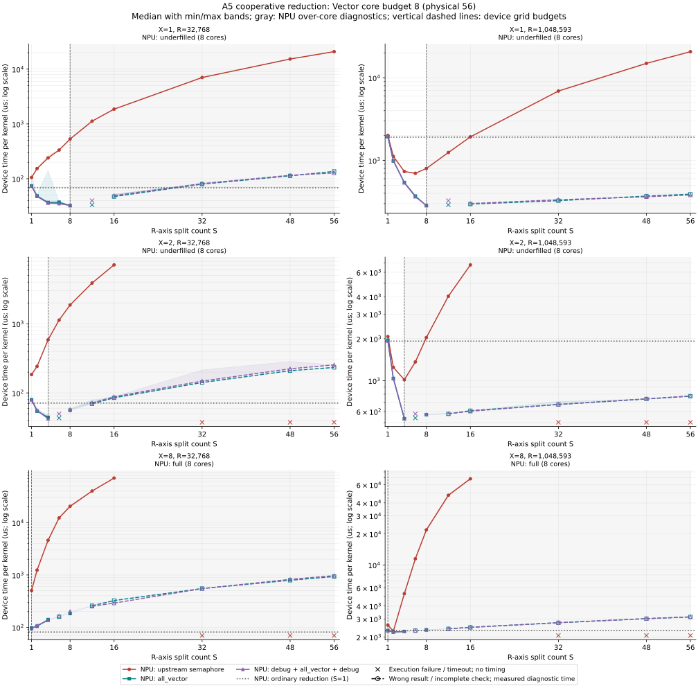
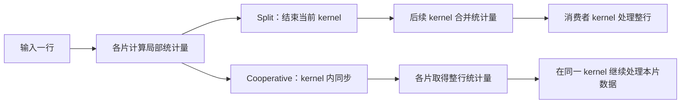
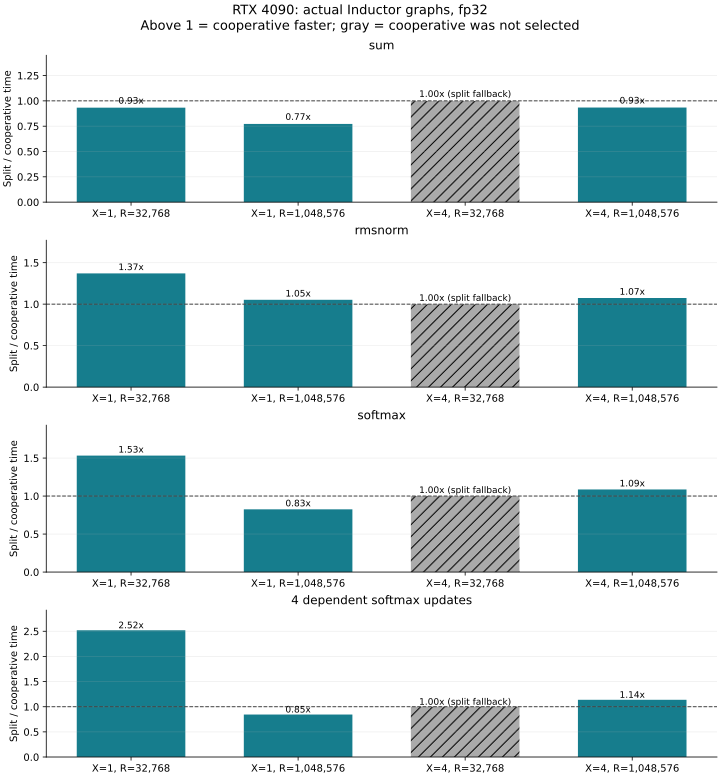
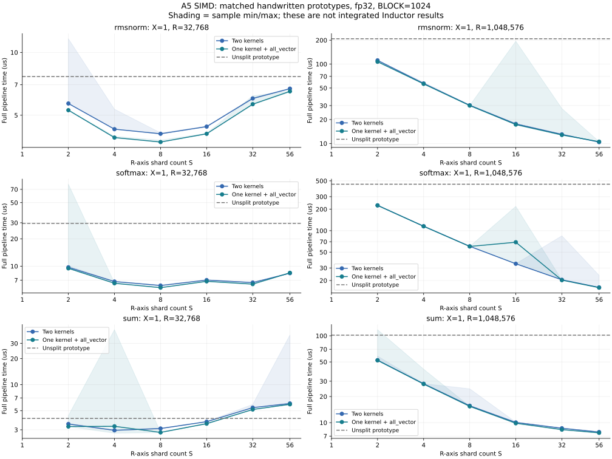

# 三种 x_grid_barrier 的 A5 与 RTX 4090 验证

验证范围：2026-11-20～23 的 A5 SIMD 与 RTX 4090 实测。本文为
[需求分析](requirements.md)和[方案设计](design.md)提供同步、性能及分核边界证据。

**all_vector 可作为受限 cooperative 场景的 NPU 专用同步方案，但不能全局替换上游 x_grid_barrier。**
核数内的同地址对照中，两种原生改写耗时接近；额外本核屏障没有解决 8/56 核映射中的组跨批问题，
也没有恢复按输出组独立同步的语义。

性能选择需要同时考虑输出任务数与每片工作量。已测低输出并行度长轴中，NPU native 相对同组普通归约约为
4.55 倍，CUDA original 约为 13.97 倍。限制为 8 核后，单输出长轴的 native 约为 6.74 倍；
输出任务已满核的已测场景没有稳定的大幅收益，仍需按有效核数分别判断。
错误配置的耗时保留为性能参考，启动失败和未完成调用单独标明，详见第 4 节。

本文还包含实际 Inductor 的 split/cooperative 整图对照。**Split 可以处理归约后的整行计算**，
cooperative 的价值在于满足资源条件时减少阶段边界并复用本片数据，而非获得 split 缺少的数学能力。
4090 的短轴连续 softmax 达到 2.52 倍；单行长轴 softmax 则慢于 split。
显式两层组合可以执行，但已测两点均无额外收益，见第 4.5 节。

## 1. 评估对象

三种实现保持相同的调用形式 `x_grid_barrier(sem)`，同步语义与编译路径如下：

| 实现 | 同步范围 | NPU 编译映射 | CUDA 对照 |
| --- | --- | --- | --- |
| `original` | 同一 y/z 下的全部 x program；每组独立 semaphore | atomic 命中黑名单，`auto_blockify_enabled=False` | 上游相同协议 |
| `native` | 本次 kernel 全部参与的 Vector 核 | `auto_blockify_enabled=True` | 无对应 all_vector 实现 |
| `debug` | 与 native 相同；两侧各增加一次本核屏障 | `auto_blockify_enabled=True` | 无对应 all_vector 实现 |

original 先完成本核屏障，用带 release 的 atomic 登记到达并取得旧值，再以带 acquire 的 atomic
轮询 semaphore，直到同组到齐，最后执行本核屏障。NPU 使用安装包 helper，CUDA 输出并行度扫描使用
PyTorch `v2.13.0` 的固定快照；两者源码 SHA256 相同，均以 `c9fa8ee90b54adc6` 开头。

两个 NPU 改写均忽略 `sem`，实际代码为：

```python
@triton.jit
def x_grid_barrier(sem):
    extension.sync_block_all("all_vector", 0)


@triton.jit
def x_grid_barrier_debug(sem):
    tl.debug_barrier()
    extension.sync_block_all("all_vector", 0)
    tl.debug_barrier()
```

`tl.debug_barrier()` 表达 block 内同步；all_vector 表达参与 Vector 核之间的会合。
保留调用签名没有保留独立分组语义。代码见[被测 helper](../../../scripts/tests/cooperative_reductions/npu_triton_helpers.py)。

当前 TA 的 AutoBlockify 黑名单包含 `tt.atomic_rmw` / `tt.atomic_cas`，运行 metadata 与上表一致。
切换 helper 同时改变了同步和编译映射，因此完整 kernel 的耗时差不能全部归于一条屏障指令。
规则及编译条件见[TA utils][ta-installed-utils]和[TA compiler][ta-installed-compiler]。

## 2. 环境与数据范围

| 项目 | NPU | GPU |
| --- | --- | --- |
| 服务器与执行位置 | NPU_A5 Docker，`pta_213_case` | GPU_4090，唯一指定容器 `pytorch-dev-gpu67` |
| 设备 | Ascend950PR_9579，56 Vector / 28 Cube | RTX 4090，128 SM，物理 GPU 6 |
| PyTorch / torch_npu | `2.13.0+cpu` / `2.13.0+git93d7d01` | `2.13.0+cu126` |
| Triton / TA | `3.6.0` / `3.6.0+dev20261112182052` | `3.7.1` |
| 实际设备编译器 / runtime | BiShengIR 2.0.0，NPUIR `395c9c5646f9`，LLVM 19.1.7 | CUDA 12.6，驱动 `535.183.01` |
| 编译选项 | SIMD、4 warps、`launch_cooperative_grid=True` | 4 warps、`launch_cooperative_grid=True` |
| 同步实现扫描、功能与并发 | 11 月 21 日，物理卡 2 | 11 月 21 日，物理卡 6 |
| 输出并行度扫描 | 11 月 22 日，物理卡 5；device/stream 有效 Vector 限额均为 56 | 11 月 22 日，物理卡 6 |
| 限核矩阵与同卡对照 | 11 月 23 日，物理卡 5；8 Vector 主矩阵、56 Vector 对照 | 无对应限核实验；上行 GPU 对照保持 128 SM |
| split/cooperative 整图对照 | 11 月 23 日，物理卡 1；56 Vector 的手写匹配原型 | 11 月 23 日，物理卡 6；实际 CUDA Inductor |
| 设备与占用核对 | ACL 反查物理编号；物理卡 2/5 开始时无驻留进程，结束时 Health OK | 通过 UUID 选择逻辑卡 0；共享使用，采样利用率 0% |

GPU 6 UUID 为 `GPU-528f4e79-58c0-e843-bf5e-0b40c2671cd7`，输出并行度扫描开始时约有 10.2 GiB
空闲显存。11 月 22 日 NPU 扫描未设置 `NPU_DEVICE_LIMIT`；11 月 23 日主矩阵设置 `4,8`，
同卡对照设置 `28,56`。主矩阵的 TA 设备属性、runtime device 和当前 stream 均确认 Vector 限额为 8，
物理核数仍为 56。NPU 的 cooperative launch 字段不能自动证明实际驻留、program 映射或全核同步条件合法。

同步实现扫描脚本提交为 `e352232`，使用 156 个 NPU 点与 54 个 CUDA 点，环境见
[NPU manifest][npu-manifest]、[GPU manifest][gpu-manifest]。输出并行度扫描的 NPU 脚本为
`90d2475` / `62512a8`，GPU 为 `4cf4918`；每条记录保留实际版本、参数和源码摘要，见
[NPU manifest][output-axis-manifest]、[GPU manifest][output-axis-gpu-manifest]。
8 核矩阵分阶段使用 `4e47f34`、`302c530`、`ed5eef8`，数学算法和 helper 不变；
每点的 `run_manifest` / `worker_manifest` 保留实际执行版本、命令与源码摘要，
预算与同卡对照见[限核实验说明][core-limit-readme]。
分量实验采用相同包版本与实际 NPUIR，配置及源码对应关系见[atomic 分量证据][atomic-evidence]。
整图对照的 GPU 主矩阵脚本为 `6925163`，组合实验为 `2712491`；NPU 原型为 `e5356bd`。
NPU 物理卡 1 经授权共享，开始时采样利用率为 0%、有约 516 MB 驻留进程；GPU 同样共享使用。
两端脚本、输入、配置、误差和生成产物见[整图实验记录](../../../artifacts/cooperative-strategy-20261123/README.md)。
主矩阵保存生成代码，组合实验另保存实际选中配置；这些共享卡的热数据测量不能直接作为生产阈值。

## 3. 用例和计时方法

### 3.1 计算、形状与普通归约基线

`X` 是输出行数，`R` 是每行归约长度，`S` 是每行的 R 分片数。固定计算为 fp32 `(a+b).sum(-1)`，
每片循环读取自己的输入并计算局部和，写 partial 到 GM workspace，经过 helper 后读取本行全部 partial，
最后仅由第 0 片写输出。

这是 **all-read 合并**：每行的 S 个分片各读 S 个 partial，逻辑读取量随 `S²` 增长。
选择该算法是为了覆盖同步后的跨核读取；它也对应后续每片都要使用完整归约结果的场景。
owner-only 合并尚未实施或测速，不计入本页收益。

| 用例集合 | 输入与配置 | 要回答的问题 |
| --- | --- | --- |
| 同步实现与工作量扫描 | 小整数交换；X=1、R=4096/32768/1048576/1048593/16777216；X=4、R=1048576 | helper 成本、每片工作量与 S 的关系 |
| 输出并行度扫描 | X=7/56；GPU 另测 X=128；R=32768/1048593 | 输出未满核与满核时，拆 R 是否优于普通归约 |
| 8 Vector 限核矩阵 | X=1/2/8；R=32768/1048593；S=1/2/4/6/8/12/16/32/48/56 | 覆盖单批预算、组完整多批、组跨批及不完整尾批的耗时和正确性 |
| 功能与映射检查 | 16 phase 整数交换；sum/mean/amax、尾块、空片、二维/三维 Grid、自动分核 | 同步、计数、映射和状态重用是否正确 |
| 并发提交检查 | 独立进程/context、独立流和 workspace，统一起跑 | 多进程、多流提交及状态隔离 |

未限核的两组性能扫描固定 `BLOCK=1024`、`S=1,2,4,8,16,32,48,56`；8 核矩阵另加入 S=6/12。partial 读取使用
`next_power_of_2(S)` 的 tile 并 mask `peer<S`，因此可以显式测试 48/56 片。
同步实现扫描限定 `X*S` 不超过设备核数；输出并行度扫描实际尝试全部配置，包括超核与数值错误点。
这些显式指定的配置不代表上游会自动选择它们。

输出并行度扫描另测 `plain`：一个 program 循环完成一行，没有 partial 交换和屏障。
它是固定 BLOCK 的手写普通归约。上游在 `RSPLIT=1` 时会省去协作屏障，而扫描中的 helper S=1 仍调用屏障，
**判断协作收益统一使用 plain，不能使用 helper S=1。** 两者都不能代替实际 Inductor 最优配置的同图验收。

### 3.2 Device 侧计时与异常记录

正式计时前预热 5 次，将连续 batch 次调用捕获为 Graph，再预热 3 次 Graph replay。
采集 7 个 device Event 样本，每个样本包围 replays 次回放：

```text
每个样本的单 kernel 耗时 = Event 设备时间 / (batch × replays)
表与曲线 = 7 个样本的中位数，并保留最小/最大值
默认 batch=32，replays=10
```

NPU 使用 NPUGraph，CUDA 使用 CUDAGraph。计时包含加载、加法、局部归约、partial 交换、同步、合并和输出；
编译、CPU 参考计算和结果回传不计入。整数交换也包含写读，不能将其直接称为纯 barrier 延迟。
NPU 慢 kernel 使用 `--max-sample-ms 500`，根据一次额外测量减少 batch/replays，并保留实际参数；
至少仍调用一次，单 kernel 超过 500 ms 时样本也会超过该目标。

同一进程内的 helper 复用输入、workspace、输出及 semaphore 地址，每点前重置状态并轮换执行顺序。
超核 original 在独立子进程中运行，采用相同种子和 shape、独立分配地址，不能称为全部版本同地址对照。
8 核矩阵按 helper 分阶段执行，阶段之间独立分配地址；同一阶段的预算内点复用输入，
三种 helper 的超预算点均放在独立子进程，避免任一种屏障不返回时中断后续配置。
因此本组不能称为三种 helper 的同地址对照。

数值检查失败仍保留 sum 耗时和错误状态。original 的超核调用设子进程墙钟时限，覆盖初始化、编译、
执行及检查；达到时限后只终止该子进程，继续下一配置。它与 device Event 耗时含义不同。
11 月 22 日 NPU 扫描时限为首个 300 秒、其余 60 秒；X=56/S=16 的两个慢点延长至 180 秒后完成全部检查。
CUDA 时限为 120 秒，没有触发进程超时。
8 核矩阵的超预算点每个设 30 秒墙钟时限；已取得的 Event 耗时无论后续检查是否完成都予以保留。

### 3.3 正确性判定

输出并行度扫描每点先把 partial/output 填为 NaN、清零 semaphore，检查首次 sum；计时后再次检查，
再执行变化 phase、epoch 和分片工作量的严格整数交换。该扫描使用 4 phase，基础重复同步检查使用 16 phase。
多 phase 在读者结束后另加一次屏障，避免下一轮提前覆盖 workspace。

8 核矩阵还在计时后原地址连续更换三组随机输入，保留上一次的 partial 和 semaphore，
每轮将输出重新填为 NaN，再与该轮 CPU 参考比较；检查结束后恢复初始输入。
最终 PASS 要求首次、计时后、三轮换输入和严格整数交换全部通过。
该矩阵只测 fp32 sum；换输入值不等同于动态 shape，也不代表限核下的 mean/amax 已验收。

浮点扩展覆盖 fp32/fp16/bf16 输入的 sum/mean/amax，prologue、partial、合并和输出均为 fp32。
CPU 对同输入先做 fp32 加法，再做 fp64 归约；sum 容限为 `atol=0.02,rtol=2e-4`，
mean/amax 为 `atol=2e-5,rtol=2e-4`。mean 合并局部和后除以真实 R，尾块和空片不增加分母。
该 prologue 不等同于所有 ATen 半精度加法的舍入规则，不能推广为全部算子的精度标准。

## 4. 性能结果

### 4.1 结果总览

| 测量集合 | NPU 结果 | CUDA 结果 |
| --- | --- | --- |
| 输出并行度扫描 | 100 点：64 通过、24 个结果错误、12 个超时；88 点已计时 | 54 点：40 通过、14 个启动失败；40 点已计时 |
| 8 Vector 限核矩阵 | 186 点：106 通过、60 个结果错误、20 个超时；166 点取得耗时 | 未做 GPU 限核实验 |
| 56 Vector 同卡对照 | 16 点全部通过并计时，与 8 核矩阵使用相同精度检查 | 无对应实验 |
| 同步实现与工作量扫描 | 156 点全部通过并计时 | 54 点全部通过并计时 |

未限核输出并行度扫描没有 SKIP，24 个错误点都保留耗时；8 核矩阵的 60 个错误点也全部计时。
下文分别回答“是否值得拆 R”和“同步实现成本在哪里”；
各组使用各自的输入、设备与基线，不混用绝对耗时或相减计算屏障净开销。

<a id="64-非规约轴未满核与满核"></a>

### 4.2 非规约轴未满核与满核

A5 有 56 个 Vector 核，RTX 4090 有 128 个 SM。X=7 在两端均未满核；X=56 在 A5 满核、在 GPU 未满核；
X=128 用于 GPU 自身的满核对照。“满核”指输出任务数足够分给所有核，不代表实测利用率一直为 100%。
真实 Inductor 应看输出 program 数 `Q=ceil_div(X,XBLOCK)`，这里固定 XBLOCK=1，故 Q=X。

**各场景与 plain 的对照如下，耗时单位均为 µs。** NPU 统一选择 native，CUDA 选择 original，
只在 S>1 且全部检查通过的点中取最小值；“通过”不等同于已经满足首期的单批映射准入。

| X | R | A5 plain | A5 native：S / 耗时 / 加速比 | RTX 4090 plain | CUDA original：S / 耗时 / 加速比 |
| ---: | ---: | ---: | --- | ---: | --- |
| 7 | 32768 | 80.433 | 2 / 71.157 / 1.13× | 5.750 | 16 / 2.505 / 2.30× |
| 7 | 1048593 | 2,270.143 | 8 / 499.059 / 4.55× | 213.130 | 32 / 15.260 / 13.97× |
| 56 | 32768 | 150.117 | 2 / 219.225 / 0.68× | 6.336 | 4 / 5.331 / 1.19× |
| 56 | 1048593 | 4,864.451 | 2 / 4,942.200 / 0.98× | 572.867 | 8 / 496.182 / 1.15× |
| 128 | 32768 | 未测 | 未测 | 8.778 | 2 / 9.356 / 0.94× |
| 128 | 1048593 | 未测 | 未测 | 1,141.129 | 2 / 1,190.691 / 0.96× |

X=7 的长轴在两端都有收益，但最优已测 S 分别为 8 和 32；短轴的 NPU 收益较小，不能照搬 GPU 分片数。
X=56 在 GPU 尚未满核，收益约 1.15～1.19 倍；NPU 的 X=56、GPU 的 X=128 都已满核，继续拆 R 没有收益。
这支持按 Q、每片工作量和所选同步协议分别校准 NPU 的准入与候选。


横线为各自 plain，实心实线为通过点，空心虚线为已计时的错误点；底部叉号只标记没有完成耗时的失败或超时。
灰色区域是 NPU 超核诊断，竖向虚线是核数/SM 数预算。图与下列统一扫描表使用相同的 154 个配置，
不插补未完成点，不将它们填成 0 µs。

统一扫描表单位为 µs，`†` 表示结果错误但已计时；“超时”和“启动失败”均没有完成耗时。
X=128 的 NPU 列为未测。S=1 是仍调用 helper 的参考，plain 基线已列在上表。

#### 短轴：R=32768

| X | S | NPU original | NPU native | NPU debug | GPU original |
| ---: | ---: | ---: | ---: | ---: | ---: |
| 7 | 1 | 494.626 | 95.328 | 95.281 | 7.738 |
| 7 | 2 | 1,025.493 | 71.157 | 71.209 | 4.845 |
| 7 | 4 | 3,694.485 | 71.611 | 71.462 | 3.427 |
| 7 | 8 | 16,481.193 | 103.179 | 102.964 | 2.777 |
| 7 | 16 | 55,746.758 | 140.367† | 140.328† | 2.505 |
| 7 | 32 | 超时 | 248.684† | 248.666† | 2.505 |
| 7 | 48 | 超时 | 363.080† | 363.923† | 2.784 |
| 7 | 56 | 超时 | 448.071 | 448.456 | 2.979 |
| 56 | 1 | 11,283.231 | 219.934 | 219.948 | 8.278 |
| 56 | 2 | 42,334.381 | 219.225 | 219.177 | 5.836 |
| 56 | 4 | 159,900.319 | 311.025 | 311.211 | 5.331 |
| 56 | 8 | 634,968.872 | 504.320 | 504.251 | 5.542 |
| 56 | 16 | 2,528,572.266 | 907.856† | 907.459† | 6.093 |
| 56 | 32 | 超时 | 1,828.717† | 1,829.516† | 启动失败 |
| 56 | 48 | 超时 | 2,593.174† | 2,593.239† | 启动失败 |
| 56 | 56 | 超时 | 3,363.148 | 3,365.502 | 启动失败 |
| 128 | 1 | 未测 | 未测 | 未测 | 9.871 |
| 128 | 2 | 未测 | 未测 | 未测 | 9.356 |
| 128 | 4 | 未测 | 未测 | 未测 | 9.571 |
| 128 | 8 | 未测 | 未测 | 未测 | 9.926 |
| 128 | 16 | 未测 | 未测 | 未测 | 启动失败 |
| 128 | 32 | 未测 | 未测 | 未测 | 启动失败 |
| 128 | 48 | 未测 | 未测 | 未测 | 启动失败 |
| 128 | 56 | 未测 | 未测 | 未测 | 启动失败 |

#### 长轴与尾块：R=1048593

| X | S | NPU original | NPU native | NPU debug | GPU original |
| ---: | ---: | ---: | ---: | ---: | ---: |
| 7 | 1 | 2,559.943 | 2,286.058 | 2,286.053 | 209.574 |
| 7 | 2 | 2,034.728 | 1,183.420 | 1,183.585 | 105.706 |
| 7 | 4 | 4,069.781 | 883.233 | 883.263 | 55.155 |
| 7 | 8 | 16,451.010 | 499.059 | 498.180 | 28.586 |
| 7 | 16 | 55,496.048 | 516.362† | 516.831† | 17.001 |
| 7 | 32 | 超时 | 567.548† | 567.824† | 15.260 |
| 7 | 48 | 超时 | 682.416† | 681.409† | 15.939 |
| 7 | 56 | 超时 | 737.306 | 737.754 | 15.597 |
| 56 | 1 | 15,702.245 | 4,933.997 | 4,933.832 | 571.693 |
| 56 | 2 | 46,401.004 | 4,942.200 | 4,941.324 | 498.720 |
| 56 | 4 | 166,478.592 | 4,965.154 | 4,966.266 | 499.459 |
| 56 | 8 | 633,046.509 | 5,093.524 | 5,094.043 | 496.182 |
| 56 | 16 | 2,528,981.934 | 5,424.375† | 5,424.695† | 515.952 |
| 56 | 32 | 超时 | 6,255.000† | 6,255.314† | 启动失败 |
| 56 | 48 | 超时 | 6,984.314† | 6,983.889† | 启动失败 |
| 56 | 56 | 超时 | 7,429.561 | 7,430.561 | 启动失败 |
| 128 | 1 | 未测 | 未测 | 未测 | 1,142.163 |
| 128 | 2 | 未测 | 未测 | 未测 | 1,190.691 |
| 128 | 4 | 未测 | 未测 | 未测 | 1,191.347 |
| 128 | 8 | 未测 | 未测 | 未测 | 1,231.258 |
| 128 | 16 | 未测 | 未测 | 未测 | 启动失败 |
| 128 | 32 | 未测 | 未测 | 未测 | 启动失败 |
| 128 | 48 | 未测 | 未测 | 未测 | 启动失败 |
| 128 | 56 | 未测 | 未测 | 未测 | 启动失败 |

**错误、超时与启动边界的含义：**

- NPU native/debug 在 S=16/32/48 共 24 点错误；X=7 长轴的 native 为 516.362/567.548/682.416 µs，
  都未快于正确的 S=8。它们是当前错误实现的成本参考，补齐正确性逻辑后仍需重测。
- NPU original 在 S≤16 的已测点均完成检查；X=56/S=16 的完整 sum 约 2.53 秒。
  此类慢点原先在后续整数交换阶段达到 60 秒总时限，延长至 180 秒后通过，不能称为必然死锁。
- NPU original 的 12 个 S=32/48/56 点停在首次 `sum_launch`：首个 300 秒、其余 60 秒内未完成。
  该阶段包含编译、启动和同步，没有结果或 Event 耗时；5000 ms 的运行时超时未使其及时返回，最终由子进程时限终止。
  仅凭最后阶段不能断言所有点均为设备死锁。
- CUDA 的 14 个失败均为 `too many blocks in cooperative launch`，发生在首次 sum 启动。
  X=56/S=16 的 896 个 program 通过，而 S=32 的 1792 个失败；X=128/S=8 的 1024 个通过，S=16 的 2048 个失败。
  实际上限取决于 kernel 每个 SM 可同时驻留的 block 数乘 SM 数；128 SM 预算只是保守策略，
  见[CUDA cooperative launch 约束][cuda-cooperative-occupancy]。

**NPU 绝对耗时的适用边界：** 物理卡 5 的 plain 明显慢于物理卡 4 的测量。
在相同 `pta_213_case` 中关闭预测计时、保留 32/10/7 参数复核，X=7 短/长轴仍为 81.096/3025.420 µs，
没有恢复较早的水平，具体原因尚未确定。这里的倍率仅使用物理卡 5 同一组 plain，
不混用物理卡 4 的 119.210 µs 长轴基线，也不把结果视为生产阈值或芯片峰值。

原始结果为[NPU 100 点][output-axis-data]、[GPU 54 点][output-axis-gpu-data]与
[完整 CSV](assets/barrier-comparison/output-axis.csv)。两点慢调用复测、计时复核和执行日志见
[数据说明][output-axis-readme]。按[v2.13.0 选择规则](requirements.md#22-cuda-上游如何选择)，
这些手写配置并不都会进入上游 cooperative，性能还需实际 Inductor 同图校准。

#### 8 Vector 核限制下的完整分片扫描

这里在同一张物理卡 5 上将预算改为 `NPU_DEVICE_LIMIT=4,8`，物理核数仍为 56，
TA 设备属性、runtime device 和当前 stream 的 Vector 限额均为 8。X=1/2 是未满核场景，
X=8 是输出任务已满核场景；额外加入 S=6/12，覆盖不能整除 8 的归约组和不完整尾批。
三种 helper 各 60 点，加 6 个 plain，共 **186 点：106 通过、
60 个结果错误、20 个超时，166 点取得耗时**，没有 SKIP。
三种 helper 的超预算点均逐个隔离，错误结果继续计时；超时不填为 0 µs。
其中 native 的 X=1/S=12、original 的 X=2/S=32 在 R=32768 下复用已有编译缓存，
将时限延长至 120 秒，均仍停在等待首次 sum 完成的 `sum_synchronize`，没有输出或 Event 耗时。
其余超时点保留主矩阵的 30 秒边界，不将代表点的复核结论推广为全部配置的硬件停点证明。

以下只在 S>1 且全部正确性检查通过的 native 配置中选择最小耗时，单位 µs：

| X | R | 8 核 plain | 8 核 native：S / 耗时 / 加速比 |
| ---: | ---: | ---: | --- |
| 1 | 32768 | 68.415 | 8 / 32.343 / 2.12× |
| 1 | 1048593 | 1,913.779 | 8 / 283.769 / 6.74× |
| 2 | 32768 | 71.524 | 4 / 44.481 / 1.61× |
| 2 | 1048593 | 1,922.688 | 4 / 532.416 / 3.61× |
| 8 | 32768 | 81.425 | 2 / 104.913 / 0.78× |
| 8 | 1048593 | 2,307.374 | 2 / 2,240.090 / 1.03× |

X=1/2 的长轴最优已测 S 为 8/4，相对各自 plain 为 6.74/3.61 倍。
X=2 的 S=8 虽然通过，但短/长轴分别为 56.238/569.461 µs，均慢于 S=4；
可执行不等于值得增加分片。X=8 长轴 S=2 的约 1.03 倍差异较小，短轴反而慢于 plain，
不足以据此默认放开满核场景；还需完整 Inductor 的重复测量和选择策略。



灰色区域表示超出单批预算 `X*S<=8`，不表示这些点一律无法执行。
实线实心为通过点，空心虚线为已计时的错误或检查未完成点，底部叉号表示未取得耗时。
**下面同时列出耗时与正确性状态**：`†` 为结果错误，`‡` 为已测 sum 但后续检查未完成；
“超时”表示在子进程墙钟时限内没有取得 Event 耗时。所有耗时均为完整 kernel，单位 µs。

##### 8 核短轴：R=32768

| X | S | original | native | debug |
| ---: | ---: | ---: | ---: | ---: |
| 1 | 1 | 105.542 | 73.943 | 73.583 |
| 1 | 2 | 153.402 | 48.549 | 47.577 |
| 1 | 4 | 239.591 | 36.891 | 35.924 |
| 1 | 6 | 333.419 | 37.253 | 35.153 |
| 1 | 8 | 530.013 | 32.343 | 32.484 |
| 1 | 12 | 1,123.691 | 超时 | 超时 |
| 1 | 16 | 1,863.536 | 47.320† | 49.284† |
| 1 | 32 | 7,038.144 | 79.708† | 81.392† |
| 1 | 48 | 15,319.283 | 112.940† | 115.557† |
| 1 | 56 | 20,897.502 | 136.175† | 127.655† |
| 2 | 1 | 184.674 | 79.715 | 79.962 |
| 2 | 2 | 241.998 | 54.614 | 55.911 |
| 2 | 4 | 585.774 | 44.481 | 42.359 |
| 2 | 6 | 1,128.424 | 超时 | 超时 |
| 2 | 8 | 1,868.294 | 56.238 | 58.382 |
| 2 | 12 | 3,882.091 | 69.653† | 71.595† |
| 2 | 16 | 7,103.445 | 85.124† | 88.092† |
| 2 | 32 | 超时 | 141.428† | 148.426† |
| 2 | 48 | 超时 | 209.475† | 223.454† |
| 2 | 56 | 超时 | 233.723† | 254.570† |
| 8 | 1 | 503.315 | 96.881 | 94.529 |
| 8 | 2 | 1,239.614 | 104.913 | 109.012 |
| 8 | 4 | 4,598.010 | 140.428 | 135.304 |
| 8 | 6 | 12,284.671 | 158.996† | 164.642† |
| 8 | 8 | 20,472.696 | 184.261 | 203.498 |
| 8 | 12 | 40,159.159 | 258.978† | 252.425† |
| 8 | 16 | 71,031.507 | 324.818† | 290.381† |
| 8 | 32 | 超时 | 551.218† | 548.854† |
| 8 | 48 | 超时 | 792.377† | 824.388† |
| 8 | 56 | 超时 | 934.346† | 972.324† |

##### 8 核长轴与尾块：R=1048593

| X | S | original | native | debug |
| ---: | ---: | ---: | ---: | ---: |
| 1 | 1 | 2,007.087 | 1,935.120 | 1,958.003 |
| 1 | 2 | 1,118.389 | 985.508 | 995.657 |
| 1 | 4 | 733.510 | 540.153 | 534.777 |
| 1 | 6 | 698.199 | 369.502 | 363.192 |
| 1 | 8 | 798.528 | 283.769 | 283.918 |
| 1 | 12 | 1,246.493 | 超时 | 超时 |
| 1 | 16 | 1,928.050 | 296.019† | 300.133† |
| 1 | 32 | 6,921.361 | 325.335† | 333.721† |
| 1 | 48 | 14,970.116 | 370.056† | 362.680† |
| 1 | 56 | 20,737.885 | 390.032† | 381.684† |
| 2 | 1 | 2,071.853 | 1,951.438 | 1,923.237 |
| 2 | 2 | 1,246.638 | 1,036.681 | 1,039.300 |
| 2 | 4 | 1,014.863 | 532.416 | 534.846 |
| 2 | 6 | 1,363.660 | 超时 | 超时 |
| 2 | 8 | 2,040.109 | 569.461 | 572.565 |
| 2 | 12 | 4,038.418 | 577.986† | 579.202† |
| 2 | 16 | 6,775.675 | 608.640† | 603.476† |
| 2 | 32 | 超时 | 674.277† | 675.390† |
| 2 | 48 | 超时 | 738.579† | 740.400† |
| 2 | 56 | 超时 | 773.516† | 777.276† |
| 8 | 1 | 2,614.111 | 2,314.638 | 2,308.561 |
| 8 | 2 | 2,282.664 | 2,240.090 | 2,239.296 |
| 8 | 4 | 5,270.936 | 2,264.050 | 2,264.208 |
| 8 | 6 | 11,498.459 | 2,310.517† | 2,310.601† |
| 8 | 8 | 21,894.801 | 2,351.352 | 2,351.818 |
| 8 | 12 | 47,383.221 | 2,405.458† | 2,404.274† |
| 8 | 16 | 68,522.103 | 2,486.251† | 2,487.698† |
| 8 | 32 | 超时 | 2,754.638† | 2,758.547† |
| 8 | 48 | 超时 | 3,018.262† | 3,019.662† |
| 8 | 56 | 超时 | 3,136.325† | 3,139.802† |

同卡另以 `NPU_DEVICE_LIMIT=28,56` 测 X=1/2、两种 R、plain 及 native S=4/8/16，
共 16 点，全部通过相同的首次、计时后、三轮换输入和整数检查。
例如 X=1/S=16 在 56 核预算下短/长轴为 44.140/168.526 µs，均正确；
8 核预算下为 47.320/296.019 µs，均错误。
两组使用独立编译缓存，没有验证同一缓存中动态切换限核状态。
这说明需要把实际预算和执行映射纳入准入，不能只按物理 56 核或逻辑 S 判断。

原始协议与原生改写还有 launcher 差异：当前 metadata 下 original 关闭 AutoBlockify，
提交 `block_dim=X*S`；native/debug 开启 AutoBlockify，提交 `min(X*S,8)`。
`block_dim` 是提交 block 数，不等于同时使用的物理核数；未采集设备时间线，不能据此反推 original 的驻留数。
因此 original 的超预算结果仍按实际状态保留，但不能当作与 native 相同物理映射的屏障净开销对照。
具体错误检查、组跨批和尾批分析见[限核边界](#73-限核后如何约束分片数)。

数据、命令、源码摘要、同卡对照和超时复核见[8 核实验说明][core-limit-readme]；
完整记录为[186 点 JSON][core-limit-data]和[186 点 CSV][core-limit-csv]。
本组仅做 NPU 限核实验；前面的 RTX 4090 对照仍是 128 SM，不能解释成 8 核限额下的 GPU 数据。

### 4.3 同算法比较三种同步实现

本组只扫描核数内配置，用于观察相同计算量下的 helper 差异，不将 helper S=1 当成普通归约基线。
NPU 156 点、CUDA 54 点全部通过计时前后检查。


总图用对数坐标呈现原始协议与原生同步的量级差异，以下线性图放大原生改写和 CUDA 对照；长轴展示 S≥8。


单位为 µs，均为完整 kernel 耗时：

| 负载 | S | NPU original | NPU native | NPU debug | CUDA original |
| --- | ---: | ---: | ---: | ---: | ---: |
| 小整数交换 | 1 | 5.044 | 0.851 | 0.848 | 1.545 |
| 小整数交换 | 32 | 532.121 | 7.373 | 7.372 | 1.581 |
| 小整数交换 | 56 | 1562.487 | 7.526 | 7.559 | 1.721 |
| X=1,R=4096 | 1 | 5.691 | 1.429 | 1.431 | 2.595 |
| X=1,R=4096 | 56 | 1564.536 | 5.495 | 5.497 | 2.160 |
| X=1,R=1048576 | 1 | 106.528 | 102.270 | 102.266 | 173.674 |
| X=1,R=1048576 | 16 | 152.731 | 9.830 | 9.834 | 12.562 |
| X=1,R=1048576 | 32 | 534.695 | 8.216 | 8.219 | 7.584 |
| X=1,R=1048576 | 56 | 1548.014 | 7.520 | 7.527 | 5.421 |
| X=1,R=16777216 | 32 | 588.863 | 141.618 | 141.609 | 190.441 |
| X=1,R=16777216 | 56 | 1595.645 | 88.558 | 88.576 | 147.686 |
| X=4,R=1048576 | 8 | 495.194 | 18.295 | 18.291 | 23.942 |

native/debug 在同地址控制下接近。native 的短轴 R=4096 从 S=1 的 1.429 µs 增到 S=56 的 5.495 µs，
而 R=1048576 在 S=32～56 进入约 7.5～8.3 µs 区间；同步和 all-read 合并成本与局部计算共同决定最优 S。
CUDA 小整数交换约 1.5～1.7 µs，NPU 大 S 的原生交换仍有几微秒开销，但两端完整 kernel 差值还包含
访存、局部归约、映射与共享环境，不能单独解释为屏障或芯片的优劣。

数据见[NPU 性能点][npu-bench]、[CUDA 性能点][gpu-bench]与
[同算法 CSV](assets/barrier-comparison/timings.csv)。

### 4.4 原始 semaphore 协议为什么在 A5 SIMD 上慢

**当前主要差距来自返回旧值的 atomic 所触发的软件锁路径。** 到达时的原子加法与轮询时的“加 0”
都需要返回旧值，受测 NPUIR 为它们引入软件锁。移除 sum 后，32 个 program 的原始 helper 仍为
530.478 µs，原生同步为 7.412 µs，说明局部求和不是数百微秒开销的主要来源。

以下均为固定 SIMD、4 warps、Graph + Event 五组中位数的完整探针调用，单位 µs：

| program 数 | atomic 不使用返回值 | atomic 使用旧值 | 使用旧值、独立地址 | original 交换 | 原生交换 |
| ---: | ---: | ---: | ---: | ---: | ---: |
| 1 | 0.634 | 3.946 | 3.662 | 5.189 | 0.828 |
| 2 | 0.973 | 7.475 | 7.452 | 12.368 | 1.485 |
| 8 | 1.503 | 27.192 | 28.459 | 47.194 | 2.791 |
| 32 | 4.012 | 278.324 | 278.238 | 530.478 | 7.412 |

前两列均对同一计数器加 1、使用 release，区别是是否使用旧值；独立地址列的地址间隔为 128 字节。
后者仍很慢，而且两种 atomic 的 AutoBlockify 都关闭，普通同地址竞争或该映射开关不足以解释这组差距。
原生同步在自动映射开启/关闭时分别为 7.412/7.579 µs，也远小于原始 helper。

源码与最终 LLVM IR 给出的路径一致：

```text
sync_block_lock_unordered
→ load_gm_to_ubuf_1d_int32_t_nocache：读取旧值
→ store_ubuf_to_gm_1d_int32_t：atomic 写回
→ sync_block_unlock_unordered
```

目标版本 `DecomposeAtomicSync.cpp` 在被使用的旧值读取前加锁、atomic 后解锁。
锁按静态编译位置组织，不使用返回值时无锁布局，使用旧值的 atomic 为 1 个无序锁，原始 helper 为 2 个，
对应到达和轮询位置，不能靠改变数据地址消除。
无序锁使用 Bakery 排队算法：读取各参与者排队号、取号、等待轮到自己；锁体有两个参与者扫描循环，
GM 状态访问伴随 `dcci` 缓存维护和 `PIPE_ALL`。全体状态检查工作至少随参与者数平方增长，重试还会增加访问；
这是工作量解释，不是 kernel 延迟公式。

轮询的 `atomic_add(sem, 0, sem="acquire")` 同样取旧值，32 个 program 的独立探针为 278.319 µs。
加计数器的诊断版记录外层轮询为每个 program 1～4 次，因此高成本也可来自少量轮询内部的软件锁，
不能仅按外层迭代数判断。该次数不作为原始 helper 每次执行的固定值。

TA/NPUIR 若要直接复用 semaphore，需要解决返回值 atomic、高效 acquire 读取或分组同步的成本。
原生同步可以避开这条路径，但必须遵守全体参与及映射限制。隐式初始化、锁体、缓存维护、内部等待与
流水屏障的各自占比尚未量化，表中数值不能称为裸 atomic 或裸 barrier 延迟。

证据：[分量测量与版本][atomic-evidence]、[返回值 atomic 同步处理][atomic-source]、
[无序锁实现][lock-source]、[长 sum LLVM IR][atomic-sum-llvm]、[atomic LLVM IR][atomic-llvm]、
[轮询计数][poll-counts]。

### 4.5 Split 与 cooperative：整图对照与分层组合

#### 两种策略在哪一层互斥

对**同一条规约**，PyTorch `v2.13.0` 默认在多 kernel split 和单 kernel cooperative 之间选择。
`Reduction.num_splits()` 在 cooperative 选择条件成立时关闭该规约的 `should_split`；同时开启
`split_reductions` 和 `triton.cooperative_reductions` 不会自动变成两级分片。
未命中 cooperative 的其他规约仍可走 split，不能理解成整个图关闭 split。
代码依据：[配置说明][strategy-config]、[逐规约选择][strategy-ir-choice]。

两者共有的思路是沿 R 分片，区别在于各阶段如何衔接：



图展示 softmax 等整行消费者的典型阶段，不要求所有计算固定生成 3 个 kernel。
实际 split 的实现创建并 realize 中间 partial，再创建合并规约；中间数组通常只有
`X×分片数` 个统计量，不必写出整个输入大小的临时张量。源码见[多阶段规约构造][strategy-multilayer]。

同一个图中，两种策略可以分别服务于不同规约。例如实际测试：

```python
# a、b 均为 (32, 32768)
return (a + b).sum(), (a - b).sum(-1)
```

全局 sum 的 `X=1,R=1048576` 命中 cooperative；逐行 sum 的 `X=32` 不命中，仍 split。
生成产物确实为 **1 个 cooperative kernel + 2 个 split kernel**，精度通过。
但共存不等于加速：纯 split 为 5.242 µs，共存为 9.414 µs。
纯 split 的首个 kernel 融合了 add/sub 两支的 partial，共存版将这两支分开；
这说明策略改变还会影响图内融合，不能简单累加单规约收益。
证据：[共存生成代码](../../../artifacts/cooperative-strategy-20261123/cuda-mixed/mixed-x32-r32768-cooperative/output_code_0.py)、
[纯 split 生成代码](../../../artifacts/cooperative-strategy-20261123/cuda-mixed/mixed-x32-r32768-split/output_code_0.py)。

#### 整行消费者：Split 可以处理，cooperative 是否更快要实测

本组使用真实 `torch.compile(fullgraph=True, dynamic=False)`，不替换 CUDA codegen 或 helper。
比较关闭两种分片的 plain、仅开启 split、开启 cooperative 且保留未命中时 split 回退三种策略，
`force_cooperative_reductions=False`。完整计算为：

```python
z = a + b
sum_result = z.sum(-1)
rmsnorm_result = z * torch.rsqrt((z * z).mean(-1, keepdim=True) + 1e-5)
softmax_result = torch.softmax(z, -1)
# chain 是另一个独立函数，从 z=a+b 开始
for _ in range(4):
    z = z + torch.softmax(z, -1)
```

RMSNorm 是“求每行平方均值，再用同一个缩放系数乘回该行全部元素”的例子；
chain 是 4 次存在前后依赖的整行更新，不能将 4 次归约同时独立求出。
以下均为 fp32 连续输入、Graph + device Event 的完整调用中位数，单位 µs。
倍率为 split/cooperative，大于 1 表示 cooperative 快：

| 计算 | X | R | split | cooperative 开关开启 | 倍率 | 计算 kernel 数：split → 开启后 |
| --- | ---: | ---: | ---: | ---: | ---: | --- |
| sum | 1 | 32768 | 2.794 | 2.995 | 0.93× | 2 → 1 |
| sum | 1 | 1048576 | 4.128 | 5.344 | 0.77× | 2 → 1 |
| sum | 4 | 32768 | 2.845 | 2.848 | 1.00× | 2 → 2，回退 split |
| sum | 4 | 1048576 | 9.744 | 10.432 | 0.93× | 2 → 1 |
| RMSNorm | 1 | 32768 | 3.894 | 2.841 | 1.37× | 3 → 1 |
| RMSNorm | 1 | 1048576 | 8.176 | 7.769 | 1.05× | 3 → 1 |
| RMSNorm | 4 | 32768 | 4.157 | 4.159 | 1.00× | 3 → 3，回退 split |
| RMSNorm | 4 | 1048576 | 21.552 | 20.058 | 1.07× | 3 → 1 |
| softmax | 1 | 32768 | 4.982 | 3.251 | 1.53× | 3 → 1 |
| softmax | 1 | 1048576 | 8.544 | 10.355 | 0.83× | 3 → 1 |
| softmax | 4 | 32768 | 5.190 | 5.190 | 1.00× | 3 → 3，回退 split |
| softmax | 4 | 1048576 | 23.075 | 21.226 | 1.09× | 3 → 1 |
| 4 次 softmax 更新 | 1 | 32768 | 18.170 | 7.210 | 2.52× | 9 → 1 |
| 4 次 softmax 更新 | 1 | 1048576 | 24.070 | 28.477 | 0.85× | 9 → 1 |
| 4 次 softmax 更新 | 4 | 32768 | 18.765 | 18.781 | 1.00× | 9 → 9，回退 split |
| 4 次 softmax 更新 | 4 | 1048576 | 59.312 | 52.144 | 1.14× | 9 → 1 |

主矩阵共 48 组全部通过：4 种计算 × 4 个 shape × 3 种策略。
X=4/R=32768 不满足未强制时的 `R>=32768*X`，所以灰色回退点只说明两个开关保留相同路径。
表中“1 个 kernel”指 Triton 计算 kernel；cooperative wrapper 还发射 semaphore 清零操作，
已包含在计时中，不应称为整个调用只有一次设备任务。
精度为 3 组变化随机输入加计时后检查，参考是相同设备上的 eager fp32；sum 使用
`atol=0.02,rtol=3e-4`，RMSNorm/chain 为 `3e-5,3e-4`，softmax 为 `1e-8,3e-4`。
它验证这些有限输入下的数值一致性，不覆盖 NaN/Inf、动态 shape、训练或全部 dtype。
这里的时间覆盖完整图捕获的设备序列；Python 调度、CPU 内存分配和非 Graph 调用延迟另待测量。
CUDA 的计时后精度检查是另一次 compiled 调用，未单独保留最后一次 Graph replay 的输出。



**生成代码给出的收益依据与边界：**

- 短轴 RMSNorm 的 cooperative 是 persistent，输入 `tmp2=a+b` 在同步前算出、同步后直接乘
  `rsqrt(mean+eps)`，没有重新 load 输入。Split 则为 partial、合并、整行缩放三个 kernel，
  最后一阶段重新读输入。这是本片数据跨归约保留的具体例子。
- 短轴 chain 的 cooperative 在同一计算 kernel 内保留本片值、执行 4 轮跨片同步；
  split 实际为 9 个计算 kernel。减少阶段边界并保留片内状态，给出了 2.52 倍的实测收益。
- 长轴 softmax 的 cooperative 采用循环，统计后仍重新读取 a、b；split 也只保存小型
  `(max,exp_sum)` 数组和行统计量，再重读输入。此时单 kernel 并不自动省去一轮输入读取，
  且同步、分片数、重复合并和资源选择都会影响时间。当前测量不能把退化精确归因于某一项。

可直接对照
[短轴 RMSNorm](../../../artifacts/cooperative-strategy-20261123/cuda/rmsnorm-x1-r32768-cooperative/output_code_0.py)、
[短轴 chain](../../../artifacts/cooperative-strategy-20261123/cuda/chain-x1-r32768-cooperative/output_code_0.py)、
[长轴 softmax 的 split](../../../artifacts/cooperative-strategy-20261123/cuda/softmax-x1-r1048576-split/output_code_0.py)
与[cooperative](../../../artifacts/cooperative-strategy-20261123/cuda/softmax-x1-r1048576-cooperative/output_code_0.py)。
所有原始样本、误差与实际 profiler 设备事件见
[CUDA 结果](../../../artifacts/cooperative-strategy-20261123/cuda/results.json)。

#### 显式分层：外层 split，组内 cooperative

这需要主动构造两个阶段，默认开关不会自动完成。对同一个 sum，本次实验保持数学计算不变，
先将一行分成 G=4 组，每组内部使用 cooperative 求和，再用第二个 kernel 合并 4 个组 partial：

```python
# 两个独立 torch.compile callable，阶段间确有 kernel 边界
def partial(a, b):
    return (a + b).reshape(1, 4, R // 4).sum(-1)  # (1,4)

def finish(group_partial):
    return group_partial.sum(-1)                # (1,)
```


实际第一阶段的配置为 `XBLOCK=1,RSPLIT=32`，共 `4×32=128` 个逻辑 block，
确实包含 cooperative decorator 与一次 `x_grid_barrier`；第二阶段是普通小归约。
不分外层组的 cooperative 则使用 `RSPLIT=64`。组合与两种基线在同一批次实测，单位 µs：

| R，X=1 | 仅 split | 仅 cooperative | 外层 4 组 + 组内 cooperative | 相对 split | 精度 |
| ---: | ---: | ---: | ---: | ---: | --- |
| 1048576 | 4.131 | 5.344 | 5.916 | 0.70× | 三者通过 |
| 8388608 | 16.528 | 17.888 | 18.608 | 0.89× | 三者通过 |

**能够组合，但本次没有额外收益。** 组合仍需要一次跨片同步和第二次 launch，
多一级分组本身不会创造收益；同时开启两个开关也不等同于这段显式分层代码。
只有分组确实改善资源/并行布局、减少昂贵的全局 partial 处理，或组内连续归约可复用数据时，
才有进一步研究价值。这些是待验证条件，不能从当前两点声称已找到获益 shape。
本次结果支持先研究整行消费者的融合价值，暂不增加自动分层策略。

NPU 若实现这种组合，仍需使第一阶段所有组的参与者符合 all_vector 的预算和映射约束；
不能因为每组单独小于核数，就允许同一个 kernel 的总参与集合超预算。
原始数据及选中配置见[分层对照](../../../artifacts/cooperative-strategy-20261123/cuda-hybrid/results.json)，
第一、第二阶段代码分别保存在各 hybrid case 的 `output_code_0.py`、`output_code_1.py`。

#### NPU 对照的含义

NPU 尚无实际 Inductor cooperative 接入，因此本次对 sum、RMSNorm、softmax 使用手写匹配原型：
split 为“局部统计量 kernel + 合并/整行输出 kernel”，cooperative 保持相同分片、BLOCK、
统计/合并/输出算法，在同一个 kernel 中以 `all_vector` 衔接。
RMSNorm 与 softmax 两个原型都重读输入，尚未实现 CUDA 短轴 persistent 的片内数据保留，
不能把 CUDA 的 1.37/1.53/2.52 倍直接当作 NPU 预期。
脚本为 [npu_strategy_compare.py](../../../scripts/tests/cooperative_reductions/npu_strategy_compare.py)。

矩阵为 X=1，R=32768/1048576，S=1/2/4/8/16/32/56，三种计算，共 78 条记录全部通过精度检查。
S=1 是不分片、无屏障的 plain；下面分别从 S>1 中选择各策略最快的正确配置，单位 µs：

| 计算 | R | plain | split：S / 时间 | cooperative：S / 时间 | split / cooperative |
| --- | ---: | ---: | --- | --- | ---: |
| sum | 32768 | 4.063 | 4 / 2.957 | 8 / 2.798 | 1.06× |
| sum | 1048576 | 101.726 | 56 / 7.801 | 56 / 7.638 | 1.02× |
| RMSNorm | 32768 | 7.661 | 8 / 4.075 | 8 / 3.719 | 1.10× |
| RMSNorm | 1048576 | 208.470 | 56 / 10.401 | 56 / 10.533 | 0.99× |
| softmax | 32768 | 29.516 | 8 / 6.122 | 8 / 5.802 | 1.06× |
| softmax | 1048576 | 448.351 | 56 / 15.990 | 56 / 15.870 | 1.01× |

**这组 NPU 原型中，split 已取得大部分归约分片收益。** 短轴 RMSNorm 的 cooperative
相对 split 约为 1.10 倍，softmax 约为 1.06 倍；长轴基本接近。
它们并未复现 CUDA 短轴 persistent/多阶段融合的大幅收益，后续应验证片内数据跨同步保留、
UB/寄存器用量和连续归约融合，而非仅用 all_vector 将两 kernel 合成一个。
这是一项待实现/测量的性能方向，不能由当前原型推断为 TA/NPUIR 缺少该功能。
两种策略的 metadata 均为 `auto_blockify_enabled=True`，本组未引入 atomic 软件锁路径。

计时为 NPU Graph 每图 16 次调用、每样本 10 次 replay、7 组中位数，精度方法与上述 GPU 一致，
参考改为 NPU eager fp32。S 的完整曲线与样本范围如下；原型固定 tile、无 autotune，
不代表实际 Inductor 的最佳 split 或 cooperative 实现。



NPU 原始 78 点及每个 case 的 metadata/TTIR/adapter 保留在
[NPU 原型结果](../../../artifacts/cooperative-strategy-20261123/npu/results.json)。
部分配置的样本范围较宽，其中两个 sum 点做了定向复测，精度均通过：
R=32768/S=56 的 cooperative 中位数从 54.063 降至 5.921 µs，
R=1048576/S=4 的 split 从 68.326 降至 28.070 µs；原次样本范围分别为 20.511～118.147、
27.921～131.408 µs。原始值保留在 JSON，图和 CSV 使用复测值，未改变上表各策略的最优配置。
干扰来源未定位，不能将这两个原次高值解释成固定同步成本。
其他配置的波动仍完整显示在图中，因此本组仅用于比较已测原型，不据此制定生产阈值。
图表的 CSV 同时保留所用来源路径，复测说明见[实验记录](../../../artifacts/cooperative-strategy-20261123/README.md)。

## 5. 本核屏障在编译产物中的体现

对性能用例 `X=1,R=1048576,S=32` 的实际 adapter 和 metadata 做仅编译导出，
native 的 partial store 与 peer load 之间已经存在以下操作，地址和类型在此省略：

```text
call @store_ubuf_to_gm_1d_float(...)
hivm.hir.set_flag[<PIPE_MTE3>, <PIPE_MTE2>, <EVENT_ID0>]
hivm.hir.pipe_barrier[<PIPE_ALL>]
hivm.hir.sync_block_set[<VECTOR>, <PIPE_MTE3>, <PIPE_S>] flag = 0
hivm.hir.sync_block_wait[<VECTOR>, <PIPE_MTE3>, <PIPE_S>] flag = 0
hivm.hir.wait_flag[<PIPE_MTE3>, <PIPE_MTE2>, <EVENT_ID0>]
call @load_gm_to_ubuf_1d_float_nocache(...)
```

MTE3 搬出本片 partial，`PIPE_ALL` 等待本核前序流水，跨核 set/wait 等待所有参与者，
随后 MTE2 读取 peer 数据。这是当前 native 已实现本核完成和跨核会合的设备证据。

两种版本的 adapter 差异是 `sync_block` 两侧各增加一条 `gpu.barrier`。
到最终 LLVM IR 仍保留了两条额外指令，核心差异如下：

```diff
 call void @llvm.hivm.BARRIER(i64 6)
+call void @llvm.hivm.BARRIER(i64 6)
 call void @llvm.hivm.SET.CROSS.CORE(i64 5, i64 1)
 call void @llvm.hivm.WAIT.FLAG.DEV.PIPE.IMM(i64 0, i64 0)
+call void @llvm.hivm.BARRIER(i64 6)
```

其中 native 原有的本核屏障由同步原语的 lowering 生成，当前编译路径不依赖 DSL 再补写
`tl.debug_barrier()`。接口契约、固定 lowering 规则及 Inductor/TA/NPUIR 的责任说明见
[方案中的同步机制分析](design.md#13-kernel-内协议与运行流程)。
完整证据：[native 最终 MLIR][native-mlir]、[debug 最终 MLIR][debug-mlir]、
[native LLVM IR][native-llvm]、[debug LLVM IR][debug-llvm]。

`debug` 的额外屏障没有恢复按组同步、改变事件编号或解决任意 program 映射问题。
同地址测量中两者接近，代表值已统一列在第 4.3 节；没有为两条额外指令单独测出净耗时。
这支持“在已测配置中增加本核屏障没有明显收益”，不表示任意映射中屏障可随意删除。
不同输入分配的控制记录保留在[分配控制实验][allocation-control]，不混入正文曲线。

## 6. 功能、分核与并发结果

### 6.1 基础与重复同步

| 检查 | NPU original / native / debug | CUDA original |
| --- | --- | --- |
| 同步实现扫描计时前后校验 | 每种 52 点，全部通过 | 54 点全部通过 |
| 重复整数交换 | 每种 13 个 Grid、3 个 epoch、每次 16 phase，全部通过 | 同一矩阵通过 |
| 重复交换整数校验量 | 三种共 54000 个值，严格相等 | 18000 个值，严格相等 |
| sum/mean/amax 扩展 | 每种 27 组，每组连续 3 次，全部通过 | 27 组全部通过 |
| 扩展算子最大绝对误差 | 三种相同：sum `2.8302e-4`、mean `4.9086e-8`、amax 0 | sum `4.6612e-4`、mean `1.9284e-8`、amax 0 |
| 尾块与空分片 | R=1048593/S=32、R=17/S=32、X=4/R=32771/S=8 | 同一矩阵通过 |
| 输入与累加 | fp32/fp16/bf16 输入，fp32 prologue/累加/输出 | 相同定义 |
| 输出并行度扫描的通过点 | 64 点 sum 计时前后通过，最大绝对误差 `0.00218261`；60 个 helper 点检查 87192 个整数，误差 0 | 40 点 sum 通过，最大绝对误差 `0.00249652`；34 个 helper 点检查 38600 个整数，误差 0 |
| 8 Vector 限核矩阵的通过点 | 106 点首次、计时后和三轮换输入通过，最大绝对误差 `0.00221760`；100 个 helper 点检查 8136 个整数，误差 0 | 无对应 GPU 限核实验 |

13 个整数 Grid 包括 `(S,1,1)` 的全部 8 个 S，以及 `(4,2,1)`、`(8,4,1)`、`(7,4,2)`、
`(14,2,2)`、`(28,2,1)`；覆盖非二次幂分片、多输出组、三维 ID 展开和满核参与。
各参与者按相同次数进入屏障。包含更大输入的同步实现扫描中，NPU sum 最大绝对误差为 `0.0056521`，
仍在该实验容限内；这不代替方差、极端值或抵消输入的独立验收。
完整记录：[NPU 功能检查][npu-check]、[CUDA 功能检查][gpu-check]。

### 6.2 分核边界

**出错的关键是同一归约组的分片是否跨执行批次，不能只看总 program 数超过核数。**
默认 AutoBlockify 下，核数内的 13 种 Grid 通过；诊断关闭映射后 `(7,4,2)` 的 56 个 program 也通过。
当单个组使用 `(112,1,1)` 时，native/debug 均返回错误结果，每种有 1736/1792 个整数不相等，
最大绝对差 9717988；额外本核屏障未解决问题。

失败配置的最终 MLIR 保留了步长为 56、同步位于循环内部的 program 循环，核心原始片段为：

```text
%19 = llvm.mlir.constant(56 : i32) : i32
%36 = hivm.hir.get_block_idx -> i64
%37 = llvm.trunc %36 : i64 to i32
cf.br ^bb1(%37 : i32)
^bb1(%39: i32):
  %40 = arith.cmpi slt, %39, %35 : i32
  // 本 logical program 的全部 phase、partial 写入、全 Vector 屏障和 peer 读取
^bb8:
  %89 = arith.addi %39, %19 overflow<nsw> : i32
  cf.br ^bb1(%89 : i32)
```

每核先完成 program p 的全部 16 phase，再执行 p+56。前 56 个在 phase 0 会合时，后 56 个还没有写 partial。
program 0 的期望为 1250200，实际为 `623532+56*(-12345)=-67788`，正好包含后一批的初始哨兵。
后半批随后又会读到前半批较晚 phase 的值。屏障只能等待已发出的本核操作，无法让尚未执行的 program 提前完成。

输出并行度扫描中的 24 个 native/debug 错误点复现了同组跨批问题。下表统计两个 R 和两个版本，
X=7/S=32 的首次 sum 错误行数为 2～3，其余计数相同：

| S | X=7：错误 sum / 总输出 | X=7：错误整数 / 总输出 | X=56：错误 sum / 总输出 | X=56：错误整数 / 总输出 |
| ---: | ---: | ---: | ---: | ---: |
| 16 | 1 / 7 | 56 / 448 | 8 / 56 | 448 / 3584 |
| 32 | 2～3 / 7 | 336 / 896 | 24 / 56 | 2688 / 7168 |
| 48 | 5 / 7 | 840 / 1344 | 40 / 56 | 6720 / 10752 |

例如 X=7/R=32768/S=16 的第 3 行首次输出为 NaN，参考值约为 -45.06831。
这 24 点在固定输入重复计时后 sum 全部变为通过，但仍有整数交换错误：旧 partial 留在 workspace，
可能掩盖本次尚未写齐的问题。它们继续记为错误，与浮点舍入差异分别处理。

映射按分片为最快维度展开，`p=shard+S*row`。多输出的 S=2 与 S=16 最终 IR 同样有步长 56 的外层循环：

```text
X=56，S=2：第一批是第 0～27 行的全部分片，第二批是第 28～55 行；每组完整，本实验通过。
X=56，S=16：第一批是第 0～2 行各 16 片加第 3 行前 8 片；第 3 行后 8 片要到第二批才执行。
             第一批的全 Vector 屏障无法等待尚未计算的后 8 片，读取时得到旧值或哨兵。
```

X=7/S=56 共 392 个、X=56/S=56 共 3136 个 program 也通过，说明组完整的多批映射可出现正确样例。
这不构成任意映射、不完整批次、分支或 phase 数的保证。首期仍要求合法单批映射；多批支持需由 TA/NPUIR
明确保证组完整性和参与者。original 在超核下关闭 AutoBlockify，与两种改写采用不同路径，
因此 original 通过而 native/debug 错误并不矛盾。

证据：[112 分片输出与 metadata][mapping-values]、[失败最终 MLIR][mapping-mlir]、
[S=2 最终 IR][output-axis-ir-s2]、[S=16 最终 IR][output-axis-ir-s16]。
这些最终 IR 由实际 adapter/metadata 仅编译导出，没有再次启动；输出并行度扫描的新 TTIR/adapter
与 metadata 位于[数据目录说明][output-axis-readme]对应的 `ir/`。

### 6.3 多进程与多流

spawn 为各进程创建独立 context，每流独占输入、workspace 和 semaphore；初始化后统一起跑，
每流用一个线程连续提交 32 轮长 sum 与两 phase 整数交换，epoch 随进程、流和轮次变化。

| 设备与实现 | 进程数 × 每进程流数 | S | 每种实现校验的 sum / 整数交换 | 结果 |
| --- | --- | ---: | ---: | --- |
| NPU original/native/debug | 1×2、2×1、2×2 | 16 | 256 / 256 | 全部通过 |
| NPU native/debug | 2×2 | 56 | 128 / 128 | 全部通过 |
| CUDA original | 2×2 | 16 | 128 / 128 | 通过 |

NPU 共 11 组配置、1024 次 sum 与 1024 次交换，整数误差 0，sum 最大绝对误差 `4.1861e-4`；
CUDA 各 128 次，整数误差 0，sum 最大绝对误差 `1.9427e-4`。每个子进程正常退出。
这证明这些提交和空间隔离检查通过，但未采集设备时间线，不能证明多个 kernel 的设备指令真正重叠。
重叠执行时事件隔离、同一 kernel 内其他跨核协议占用事件 0，仍需独立确认；本核流水 EVENT_ID0 是不同同步通路。
明细见[并发索引][concurrency-index]和[GPU 并发记录][gpu-concurrency]。

## 7. 接入范围判断

### 7.1 v2.13.0 中哪些路径实际调用 x_grid_barrier

对 PyTorch `v2.13.0`，提交 `cf30153c4c131c8164ee7798e5022d810682e2cb`，执行全仓
`git grep -n x_grid_barrier v2.13.0`，共找到 5 处文本引用：helper 定义、一个生产代码发射点、
两处测试断言和一处 runtime 注释。**该版本唯一的生产代码发射点在 cooperative reduction；
没有发现其他独立的生产调用路径。** 这不表示任意手写 Triton kernel 都不能使用该 helper。

发射条件是 `self.cooperative_reduction` 为真，且该归约阶段有待合并或待输出的结果；
生成代码再由 `HAS_RSPLIT = RSPLIT > 1` 控制是否真正执行屏障：

```python
# 上游 codegen 生成的关键顺序；省略与本问题无关的语句
# 先写本片 partial
if HAS_RSPLIT:
    triton_helpers.x_grid_barrier(semaphores + tl.program_id(1))
# 再读取同组 partial、合并及输出
```

这里的 `program_id(1)` 标识输出 tile；每个 tile 的 R 分片构成独立同步组。
一次调用对应一次归约阶段的交换，不一定对应整个 kernel 唯一一次屏障。

| 实际场景 | 是否使用及含义 |
| --- | --- |
| cooperative 的 sum/mean/prod/min/max、布尔归约、var/std 等 | 共用该发射点；合并状态可以是标量、索引或 Welford 元组 |
| cooperative softmax、连续归约及广播消费者 | 每个需要交换的阶段调用；不能只按单次 sum 验证 |
| persistent / non-persistent cooperative、固定配置和调优候选 | 仍由同一 codegen 入口发射，所选候选必须分别合法 |
| 普通 reduction 或 `RSPLIT=1` | 不执行该跨 program 屏障 |
| split scan | 专用 kernel 显式关闭 cooperative，使用自己的前缀依赖协议 |
| combo/foreach | 构建 kernel 时设置 `override_cooperative_reduction=False` |

具体测试依据：`test_reduction_fns` 覆盖 sum、mean、prod、amin/amax、min/max、var_mean、std、
softmax；布尔测试检查 6 个输出的 owner 分支均位于屏障之后。`test_chained_reductions` 连续执行
8 次 `x = x + softmax(x, 1)`，在同一生成代码中检查 8 次屏障；关闭 online softmax 时检查 16 次。
因此改写的影响范围还包括多次同步、多个结果和 workspace 重用，不能仅限于单输出 sum。
本地 `pytorch_new/torch_npu` 中没有新增的直接调用点，NPU 接入仍需审查继承的上游路径。

代码依据：[生产发射点][upstream-barrier-call]、[算子与连续归约测试][upstream-coop-tests]、
[split scan 禁用入口][scan-kernel]、[combo 禁用入口][upstream-combo-disable]。

### 7.2 原生全 Vector 同步的适用边界

**两个改写均不具备上游 helper 的通用等价语义。** 上游允许不同 y/z 组独立会合，
all_vector 要求参与 Vector 核执行相同的屏障序列。例如：

```python
if tl.program_id(1) == 0:
    x_grid_barrier(sem_for_this_row)
```

只要第 0 行的全部 x 分片到达，上游按组屏障可完成；全 Vector 屏障还会等待其他没有调用
屏障的行。给两侧增加本核屏障也不改变这一点。这个反例由同步范围直接推出，
这一不满足 all_vector 前提的分支未做设备验证。

建议将改写保留为专用 NPU 全 Vector helper，由 choices/schedule/codegen 和 TA/NPUIR
共同保证适用条件；普通归约和未准入场景继续沿用原有路径。需要明确的条件包括：

- 所有参与者按相同次数、相同顺序调用屏障，尾块只 mask 数据访问；
- 物理分核、program 循环与屏障参与者一致，不能只凭 `X*S` 或 launch 字段推断；
- 同一 kernel 内事件 0 的复用没有与另一同步协议冲突；
- workspace/semaphore 的存储与生命周期满足流、Graph 和重复调用的要求。

当前手写探针还没有覆盖完整 Inductor 自动选择、动态 shape、非连续输入、Welford、索引归约、
NaN/Inf、混合 Cube/Vector、其他编译模式、C++/AOT 等组合。这些仍按需求矩阵独立验收。
本次结论限定于记录的软件栈、A5 SIMD 和实际运行的配置。

接入所需的周边依赖如下：

| 组件 | 需要适配或确认的内容 | 实测依据 |
| --- | --- | --- |
| Inductor choices/schedule/autotune | 先检查全参与、统一 phase 和合法映射，再形成 S 候选；force 仍遵守条件 | 单组跨批出错，输出满核时继续拆分无明显收益 |
| TA 分核与 launcher | 识别全核同步与 program 循环的关系；给出合法映射或明确拒绝不合法组合 | native/debug 开启 AutoBlockify，56/8 核预算下循环步长相应改变 |
| NPUIR 同步 lowering | 保留本核完成、跨核会合及读取依赖；优化后维持语义 | 当前 PIPE_ALL、MTE3 set/S wait 已有实现证据 |
| TA/NPUIR 性能 | 分析大 S 的全核交换与 all-read 合并开销，分别优化访存和同步 | 32 片整数交换 NPU native 7.373 µs，CUDA 1.581 µs |
| Runtime/同步接口契约 | 明确事件在 task/context/stream 间的隔离和实际重叠执行条件 | 提交并发通过，设备重叠与同核事件竞争未覆盖 |

### 7.3 限核后如何约束分片数

这里的“核数”应是**本次 kernel 的有效 Vector 预算**，记为 `C_eff`，不能继续用整卡的 56，
也不能将 Cube 核数代入。`NPU_DEVICE_LIMIT` 格式为 `Cube,Vector`；本卡配比为 1:2，
`4,8` 对应 8 Vector，`8,16` 对应 16 Vector。环境变量应在设备初始化前设置。
本组 manifest 已确认物理 56、TA 属性 8、runtime device/stream 限额均为 8；
launcher 的 Grid 和最终映射还需分别检查，不能用一个属性替代它们。

#### 预算、可执行与性能是三种不同判断

首期采用“每个 program 对应一个参与核、全部输出与分片同批执行”的保守方案：

```text
Q = ceil_div(X, XBLOCK)       # 输出 program 数，本组及首期 XBLOCK=1，Q=X
S = RSPLIT                   # 每个输出 tile 的 R 分片数
Q * S <= C_eff
S <= floor(C_eff / Q)
```

因此 8 核时，Q=1/2 的单批上限分别为 S=8/4；Q=8 时单批只容纳 S=1。
`XBLOCK=2,X=2` 可使 Q=1，但不是当前测试和首期采用的输出 tile。
这些是方案预算，不是逻辑分片数的数学上限，也不是最优 S 的保证。
例如 `X=2,S=8` 共 16 个 program，native/debug 仍通过全部检查；
它可以分两批各完成一行的全部 8 片，但短/长轴都慢于 S=4。

三种 helper 各 60 点按 native 的 8 核映射分为下表；每个点含一种 R，两个 R 均计数。
分类只用于组织对照，original 的 AutoBlockify 关闭，实际不是下表描述的 8 核核内循环：

| 映射类型 | X / S 示例 | 每种 helper 的点数 | original | native / debug（各自） |
| --- | --- | ---: | --- | --- |
| 单批，X*S≤8 | 1/8、2/4、8/1 | 18 | 通过 18 | 通过 18 |
| 多批，每组完整 | 2/8；8/2、8/4、8/8 | 8 | 通过 8 | 通过 8 |
| 多批，组跨批，总数整除 8 | 8/6 | 2 | 通过 2 | 错误 2 |
| 多批，组跨批，尾批不满 | 2/6 | 2 | 通过 2 | 超时 2 |
| 单组 S>8，总数整除 8 | 1/16；2/12；8/56 等 | 28 | 通过 16、超时 12 | 错误 28 |
| 单组 S>8，尾批不满 | 1/12 | 2 | 通过 2 | 超时 2 |

#### 结果错误的具体含义

下表列 native 的代表点；debug 的通过/错误/超时分布相同。整数检查严格相等，
因此这些错误不能归于浮点规约树改变造成的正常舍入差异：

| X / S，R=32768 | 首次 sum 错误 / 输出数 | 计时后错误 / 输出数 | 三轮换输入错误 / 输出数 | 整数错误 / 检查数 |
| --- | ---: | ---: | ---: | ---: |
| 1 / 8 | 0 / 1 | 0 / 1 | 0 / 3 | 0 / 32 |
| 1 / 16 | 1 / 1 | 0 / 1 | 3 / 3 | 56 / 64 |
| 2 / 4 | 0 / 2 | 0 / 2 | 0 / 6 | 0 / 32 |
| 2 / 8 | 0 / 2 | 0 / 2 | 0 / 6 | 0 / 64 |
| 8 / 6 | 4 / 8 | 0 / 8 | 12 / 24 | 84 / 192 |

例如 X=1/S=16 首次得到 NaN，CPU 参考为约 -61.333956；预热后的固定输入 sum 变为正确，
但第一轮换输入得到 405.690796，参考为 527.463321。上一次的 partial 留在 workspace，
固定输入可以掩盖本次读取未写齐的数据，换输入和整数 phase 则继续暴露错误。

实际导出的编译命令包含 `--custom-aic-number=4 --custom-aiv-number=8`；
native 另有 `--enable-auto-blockify-loop`，original 没有该选项，见
[native 编译命令][core-limit-native-command]与[original 编译命令][core-limit-original-command]。
当前 native 的最终 IR 使用 block id 作为起点，program 循环步长为 8，屏障在循环内部；
保留的数据依赖可简化表示为以下伪代码，完整原始产物见[8 核 S=16 最终 IR][core-limit-ir]：

```python
for p in range(block_id, X * S, 8):
    row, shard = divmod(p, S)
    write_this_partial(row, shard)
    all_vector_barrier()
    read_this_rows_partials_and_combine(row)
```

X=1/S=16 的前 8 个 program 到达屏障时，第 8～15 片尚未计算；屏障不能使后续 program 提前执行。
X=2/S=8 则是第一批完整处理第 0 行、第二批完整处理第 1 行，因此两行均正确。
X=8/S=6 虽然 48 能整除 8，部分行的 6 个分片仍跨批，首次有 4/8 行错误；
所以仅要求总 program 数整除预算也不够。

X=1/S=12、X=2/S=6 都在最后一批只剩 4 个 program，另 4 核已经退出 program 循环；
剩余 program 仍进入全 Vector 屏障。两种改写在两个 R 上均达到 30 秒时限，未取得结果或 Event 耗时。
native 的 X=1/R=32768/S=12 复用编译缓存后仍在 `sum_synchronize` 达到 120 秒。
控制流存在屏障参与者不齐的前进性风险；复核记录与原始 IR 见[实验说明][core-limit-readme]。
未采集硬件停点，不将所有超时无条件称为设备死锁。
这与 X=1/S=6 的单批不同：后者只提交 6 个 block 且全部到达，两个 R 均通过；
尾批的问题是同一次 8 block 发射中只有部分 block 继续进入下一轮屏障。

#### 原始协议的 Grid 与接入要求

被测 launcher 的关键选择如下，`physical_blocks` 来自 TA 的受限设备属性，本组为 8：

```cpp
physical = AUTO_MAP ? min(logicalBlocks, physical_blocks) : logicalBlocks;
```

original 的 atomic 使 AutoBlockify 关闭，因此提交 `block_dim=X*S`；native/debug 则提交
`min(X*S,8)` 并执行上面的核内循环。`block_dim` 是发射 block 数，不是同时驻留的物理核数。
original 的超预算通过点说明该路径能完成这些配置，不能据此证明它也执行了相同的 8 核多批循环，
更不能把“原版通过”推成“全 Vector 屏障直接替换后也应通过”。
提交逻辑见[本环境 launcher 源码][core-limit-launcher]，完整状态与耗时在第 4.2 节统一列出。

现有 Inductor `_obtain_and_limit_cube_vector_core_num()` 读取并校验环境限制；TA 将受限核数用于
设备属性、launcher 计划和 `--custom-aiv-number`。Cooperative 的 choices、候选、编译与启动
必须对齐预算和映射；首期继续采用已明确的单批约束，组完整多批支持另行评审。
增加本核屏障没有修正组跨批或尾批问题。

本组分别使用 8/56 核独立编译缓存，只验证固定环境限制下的手写 DSL。
完整 Inductor 的限核传递、同缓存中限制切换，以及 device/stream API、`limit_core_num` scope
之间的优先级和动态变化仍需验收。不能直接假设取最小值即可；限制改变后应重新校验计划及缓存条件。
代码依据：[Inductor 限核配置][npu-core-limit-config]、[device/stream 限核 API][npu-core-limit-api]、
[TA 设备属性][ta-core-limit-driver]、[NPUIR 编译参数][ta-core-limit-compiler]。

### 7.4 sync_block_all 版增加什么逻辑才能保证正确

原版的超核配置同时存在通过、启动失败或未返回的结果，见第 4.2 节。
例如 A5 的 `X=7,S=16` 原版通过，而 `X=7,S=32` 在首次 sum 阶段达到 300 秒超时；
CUDA 则有超过 128 个 CTA 仍通过的配置，也有 cooperative launch 规模超限而启动失败的配置。
因此原版的适用边界应按实际映射和启动资源判断，不能概括为任意超核均可执行。
CUDA 上游的 SM 数限制是候选策略；按组计数本身不能代替执行前进条件。

对受限 cooperative 场景，可以围绕 `sync_block_all` 补齐准入及执行协议；需要保障的是：

1. 在预运行和 autotune 前拒绝不合法的 `Q/S/C_eff` 与物理映射，force 也不绕过。
2. 每片写入唯一 partial；尾块 mask 输入、空片写 identity，但所有参与者仍执行一致的屏障序列。
3. 通过具有 GM 顺序保证的原语完成本核写回、跨核会合及同步后的读取依赖；编译优化保留该契约。
4. 所有参与者到达屏障后，再由唯一 owner 合并/输出；不能为了减少读取把屏障也放进 owner 分支。
5. 多阶段重用 workspace 前保证旧读者已完成：保留经证明的轮换生命周期，或在需要处增加
   读后写屏障；同时保证事件复用、重复调用和 stream/Graph 生命周期正确。

这些约束可以使**明确支持范围内的归约结果**正确，并不恢复通用 helper 的独立分组语义。
上游 `CooperativeReductionWorkspaceCache` 将空间延后两次归约循环再复用，说明不能忽略第 5 项；
也不应不经分析就在每次 `tl.load` 后机械添加屏障。

单靠 helper 内多加一次 `tl.debug_barrier()`、清零 workspace 或登记计数，无法修正组跨批问题。
例如 `C_eff=8,Q=1,S=16`，若整个“partial → 屏障 → combine”按 8 核分两批执行，
第一批返回屏障时第 8～15 片根本未计算；清零会将漏算掩盖成错误的部分和，等待计数到 16
则可能让当前 8 核一直等待，而它们无法进入下一批。

若确实需要一组逻辑分片跨多批，需改变任务组织。一个供后续评估的单 kernel 结构是：

```python
# 方案伪代码，尚未实现/验证；所有启动的 worker 均参加屏障
for partial_task in tasks_assigned_to_this_worker:
    compute_and_store_partial(partial_task)

sync_all_vector_workers()  # 在全部 partial 任务循环之外

for output_tile in outputs_owned_by_this_worker:
    combine_and_store(output_tile)
```

即先由固定参与核循环完成全部 partial，再统一同步，最后合并；不能继续让 AutoBlockify
把包含“同步和合并”的整个逻辑 program 放入原来的逐批循环。这涉及 Inductor schedule/codegen
和 TA/NPUIR 的任务映射，已经超出 helper 内局部修改。更多分片只表示每核处理更多任务，
不会增加实际并行核数，其性能价值仍需另测。首期继续采用单批方案，不将此结构视为已交付能力。

如果还要求不同输出组可独立进入/退出屏障，现有全 Vector API 没有分组参数；
增加不同 event ID 也不会改变“等待全部 Vector 参与者”的范围。需要保留合法的按组 semaphore
协议，或由下层提供真实的分组同步。多输出统一 phase 的受限支持与通用等价替换应分别评审。
代码依据：[CUDA 预算约束][upstream-coop-budget]、[workspace 复用][upstream-workspace]、
[TA 全核同步接口][ta-sync-all]。

本节讨论的跨批错误是同步与输入完整性错误；修正它不代表浮点计算与未分片版本逐 bit 一致。
浮点归约树改变后的误差仍按需求第 5.4 节单独验收。

## 8. Split scan 的场景与 cooperative 的关系

Split scan 面向长轴的前缀计算，例如 `torch.cumsum(x, dim=-1)`、`torch.cumprod(x, dim=-1)`。
它保留轴上的全部输出，区别于将整条轴合并成一个值的 reduction：

```text
输入                [1, 2, 3, 4]
sum 输出            10
cumsum 输出         [1, 3, 6, 10]
```

若将 cumsum 切成两块，第一块 `[1,2]` 的局部前缀为 `[1,3]`，第二块 `[3,4]` 的局部前缀为
`[3,7]`。第二块还需要前面全部块的和 3，才能输出 `[6,10]`；仅做各块局部 scan 不够。
长轴、小行数时，将一条 scan 分给多个 program 可以增加并行度。

PyTorch `v2.13.0`，提交 `cf30153c4c131c8164ee7798e5022d810682e2cb` 的实现如下：

- `cumsum/cumprod` lowering 创建 `ir.Scan`；`Scan.num_splits()` 复用 `Reduction.num_splits()`
  的形状选择逻辑，并传入 `reduction_type="scan"`。满足拆分与支持条件时创建 `ir.SplitScan`。
- `TritonSplitScanKernel` 在一个 kernel 内分块，通过清零的 GM scratch 发布块和与完成状态。
  `exclusive_scan_decoupled_lookback*` 向前查找块和或已完成前缀，再补到当前块的局部 scan 上。
  这是前缀依赖协议，没有调用 `x_grid_barrier` 让全部 program 会合。
- `TritonSplitScanKernel.should_use_cooperative_reduction()` 直接返回 False；普通 scan 的
  `create_kernel_choices()` 也设置 `override_cooperative_reduction=False`。

因此，**split scan 与 cooperative reduction 都涉及跨 program 数据依赖，但在该版本是独立
执行路径，不能将 split scan 当作 cooperative reduction 的一种，也不能用 all_vector 直接
替换它的前缀协议。** `num_splits()` 中对 scan 的特殊处理，是为了让 scan 仍可选择专用拆分路径，
不因 cooperative 相关 backend capability 而被错误禁用。
Split scan 自身仍有 atomic、数据可见性和执行前进性要求；NPU 的 split scan 尚未验证。

代码依据：
[scan lowering][scan-lowering]、
[Scan 选择][scan-choice]、
[专用 kernel][scan-kernel]、
[scan 禁用 cooperative][scan-cooperative-override]。

## 9. TA 官方 al 接口能否替换 x_grid_barrier

核对范围为用户指定的
[官方 al 文档目录](https://github.com/triton-lang/triton-ascend/tree/main-dev/docs/zh/triton_api_extension/al)。
2026-11-21 获取的 `main-dev` 提交为 `20ebbba9c695d5353488d3516d54f1d5f3c43310`；
以下结论同时核对该提交的接口实现，不将最新文档直接当作已安装 TA 的能力保证。
该目录共有 10 篇接口文档，其中涉及同步的接口及模式如下：

| 接口或模式 | 文档与实现表达的同步对象 | 对当前 Vector cooperative 的判断 |
| --- | --- | --- |
| `al.sync_block_all("all_vector", event_id)` | 全部参与 Vector 核，解决共享 GM 读写依赖 | 当前受限改写所用原语；仍有分组与分核限制 |
| 同接口的 `"all_cube"` / `"all"` | Cube，或 Cube 与 Vector | 改变参与核类型，未增加按逻辑 y/z 分组的能力 |
| 同接口的 `"all_sub_vector"` | Vector 子块 | 不能表达任意输出行的全部 R 分片会合 |
| `al.sync_block_set/wait` | 分离模式下 Cube 与 Vector 的配对通知 | 不是任意 Vector 核之间的分组屏障 |
| `al.debug_barrier(SYNC_IN_VF.*)` | VF 中 Vector/Scalar load/store 指令之间的顺序 | 解决局部指令依赖，不是跨 program 会合 |

NPU_A5 的 `pta_213_case` 安装包也提供这四个函数；实际安装源码中的 `create_sync_block()`
包含相同的同类型端点拒绝逻辑，见
[已安装 TA 源码](../../../artifacts/cooperative-barrier-output-axis-20261121/npu/installed-ta-core.py)。

`sync_block_set/wait` 的约束比“可自定义 event_id”更关键：sender/receiver 只接受
`"cube"`、`"vector"`，且两者必须不同。`core.py::create_sync_block()` 明确拒绝同类型端点：

```python
if sender == receiver:
    raise ValueError(f'Unexpected pair: {sender} -> {receiver}, only supports cube -> vector or vector -> cube')
```

接口没有提供逻辑 program 的成员列表、按 y/z 分组或任意到达人数。按这些参数与约束判断，
它不能直接构造这里需要的 Vector→Vector R 分片屏障。为每行换一个 `event_id` 也没有定义该行
究竟包含哪些物理参与者，因此不能据此恢复上游按组会合语义。

`all_sub_vector` 只适合作为另一种局部协作映射的待评估方向：需先明确所有 R 分片确实位于
同一个受支持的 Vector 子块同步域。当前按 program ID 切片的代码没有建立这一映射，
该接口尚未做替换验证或测速，不能将它当作任意 Vector 核分组的现成接口。

`al.debug_barrier` 还应与 `tl.debug_barrier()` 区分：前者接受 `SYNC_IN_VF`，描述 VF 内具体
Vector/Scalar 访存指令的依赖；文档约束在 `scope` 内使用。它不是另一种跨核屏障。
目录其余的 scope、copy、地址空间、subview、sub_vec_id 等接口也未定义这样的会合协议。
最终 IR 中的 `hivm.hir.sync_block_set/wait[<VECTOR>, ...]` 是 `sync_block_all` 的内部 lowering，
不能因名字相似就认为用户层 `al.sync_block_set/wait` 也开放了 Vector→Vector 端点。

**在这个文档目录和对应实现中，没有发现另一个可直接等价替换上游 x_grid_barrier 的接口。**
当前可继续评估的仍是有明确准入条件的全 Vector 专用路径；若要提供通用按组语义，需 TA/NPUIR
进一步给出分组成员、到达计数、GM 可见性、重复 phase 和 program 映射的接口或协议契约。
本节没有运行不满足端点约束的 set/wait，也未将文档示例的“编译成功”当作设备性能证据。

官方依据：
[sync_block_all][ta-sync-all]、
[sync_block_set][ta-sync-set]、
[sync_block_wait][ta-sync-wait]、
[接口约束实现][ta-sync-constraints]。
本地还保留了
[官方版本与源码摘要](../../../artifacts/cooperative-barrier-output-axis-20261121/ta-main-dev/manifest.json)。

## 10. 复现入口

同步实现、功能、映射和并发使用 [barrier_suite.py](../../../scripts/tests/cooperative_reductions/barrier_suite.py)，
输出并行度使用 [output_axis_cases.py](../../../scripts/tests/cooperative_reductions/output_axis_cases.py)。
采集命令、选卡与参数见[脚本说明](../../../scripts/tests/cooperative_reductions/README.md)，
其他 GPU 的便携采集与回传见[GPU 使用说明](../../../scripts/tests/cooperative_reductions/GPU_README.md)。

实际 CUDA Inductor 整图对照使用
[strategy_compare.py](../../../scripts/tests/cooperative_reductions/strategy_compare.py)，
图表由 [plot_strategy_compare.py](../../../scripts/tests/cooperative_reductions/plot_strategy_compare.py)
直接读取原始 JSON 刷新；具体命令见脚本说明中的“Split 与 cooperative 整图对照”。

仅重新绘图不需要计算卡。下面两条命令分别重建两组图，输出并行度使用当前 154 点结果：

```bash
python scripts/tests/cooperative_reductions/plot_barrier_suite.py \
  --npu artifacts/cooperative-barrier-comparison-20261121/npu/bench-shared/bench.json \
  --cuda artifacts/cooperative-barrier-comparison-20261121/cuda/bench-shared/bench.json \
  --out docs/requirements-design/cooperative-reduction/assets/barrier-comparison

python scripts/tests/cooperative_reductions/plot_output_axis_cases.py \
  --npu artifacts/cooperative-barrier-unfiltered-20261122/npu/output-axis.json \
  --cuda artifacts/cooperative-barrier-unfiltered-20261122/cuda/output-axis.json \
  --out docs/requirements-design/cooperative-reduction/assets/barrier-comparison
```

### 10.1 GPU 容器访问检查

指定容器曾出现 NVML `Unknown Error`、CUDA 设备数为 0，宿主机仍可访问 GPU。
11 月 21 日的诊断确认设备节点存在且权限为 666，但普通用户与 root 打开设备均返回 EPERM；
目标 cgroup 的 BPF 设备白名单未放行 NVIDIA/UVM 主设备号，阻断发生在 Triton 编译之前。
具体触发操作未确认，不能仅凭相似现象认定由某次 systemd reload 引起。

按用户授权仅重启 `pytorch-dev-gpu67` 后，设备访问恢复，`cuInit(0)=0`、UUID 与物理卡 6 一致，
`sum(arange(16))=120`。11 月 22 日再次出现初始化故障，18:13:26 重启同一容器后恢复并完成输出并行度扫描。
该访问故障与表中实际发射时的 cooperative launch 规模超限是两类问题。

证据：[设备访问与白名单诊断][gpu-container-diagnostics]、[恢复检查][gpu-container-recovered]、
[当前采集环境记录][current-device-access]；机制背景见[NVIDIA 故障说明][nvidia-gpu-access]。

[npu-manifest]: ../../../artifacts/cooperative-barrier-comparison-20261121/npu/bench-shared/manifest.json
[strategy-config]: https://github.com/pytorch/pytorch/blob/cf30153c4c131c8164ee7798e5022d810682e2cb/torch/_inductor/config.py#L999
[strategy-ir-choice]: https://github.com/pytorch/pytorch/blob/cf30153c4c131c8164ee7798e5022d810682e2cb/torch/_inductor/ir.py#L1410
[strategy-multilayer]: https://github.com/pytorch/pytorch/blob/cf30153c4c131c8164ee7798e5022d810682e2cb/torch/_inductor/ir.py#L2029
[gpu-manifest]: ../../../artifacts/cooperative-barrier-comparison-20261121/cuda/bench-shared/manifest.json
[npu-bench]: ../../../artifacts/cooperative-barrier-comparison-20261121/npu/bench-shared/bench.json
[gpu-bench]: ../../../artifacts/cooperative-barrier-comparison-20261121/cuda/bench-shared/bench.json
[native-mlir]: ../../../artifacts/cooperative-barrier-comparison-20261121/npu/final-native/module.hivm.opt.mlir
[debug-mlir]: ../../../artifacts/cooperative-barrier-comparison-20261121/npu/final-debug/module.hivm.opt.mlir
[native-llvm]: ../../../artifacts/cooperative-barrier-comparison-20261121/npu/final-native/kernel.ll
[debug-llvm]: ../../../artifacts/cooperative-barrier-comparison-20261121/npu/final-debug/kernel.ll
[allocation-control]: ../../../artifacts/cooperative-barrier-comparison-20261121/npu/bench/bench.json
[npu-check]: ../../../artifacts/cooperative-barrier-comparison-20261121/npu/check/correctness.json
[gpu-check]: ../../../artifacts/cooperative-barrier-comparison-20261121/cuda/check/correctness.json
[concurrency-index]: ../../../artifacts/cooperative-barrier-comparison-20261121/README.md
[gpu-concurrency]: ../../../artifacts/cooperative-barrier-comparison-20261121/cuda/concurrent-epochs/concurrency.json
[mapping-values]:
  ../../../artifacts/cooperative-barrier-comparison-20261121/npu/mapping-auto-native-112/mapping-observations.json
[mapping-mlir]: ../../../artifacts/cooperative-barrier-comparison-20261121/npu/final-mapping112/module.hivm.opt.mlir
[output-axis-data]: ../../../artifacts/cooperative-barrier-unfiltered-20261122/npu/output-axis.json
[output-axis-manifest]: ../../../artifacts/cooperative-barrier-unfiltered-20261122/npu/manifest.json
[output-axis-gpu-data]: ../../../artifacts/cooperative-barrier-unfiltered-20261122/cuda/output-axis.json
[output-axis-gpu-manifest]: ../../../artifacts/cooperative-barrier-unfiltered-20261122/cuda/manifest.json
[output-axis-ir-s2]: ../../../artifacts/cooperative-barrier-output-axis-20261121/npu/final-x56-s2/module.hivm.opt.mlir
[output-axis-ir-s16]: ../../../artifacts/cooperative-barrier-output-axis-20261121/npu/final-x56-s16/module.hivm.opt.mlir
[gpu-container-diagnostics]: ../../../artifacts/cooperative-barrier-output-axis-20261121/gpu-container-diagnostics.json
[gpu-container-recovered]:
  ../../../artifacts/cooperative-barrier-output-axis-20261121/cuda/device-access-after-restart.json
[nvidia-gpu-access]: https://docs.nvidia.com/datacenter/cloud-native/container-toolkit/latest/troubleshooting.html
[scan-lowering]: https://github.com/pytorch/pytorch/blob/cf30153c4c131c8164ee7798e5022d810682e2cb/torch/_inductor/lowering.py#L7490
[scan-choice]: https://github.com/pytorch/pytorch/blob/cf30153c4c131c8164ee7798e5022d810682e2cb/torch/_inductor/ir.py#L2853
[scan-kernel]: https://github.com/pytorch/pytorch/blob/cf30153c4c131c8164ee7798e5022d810682e2cb/torch/_inductor/codegen/triton_split_scan.py#L20
[scan-cooperative-override]: https://github.com/pytorch/pytorch/blob/cf30153c4c131c8164ee7798e5022d810682e2cb/torch/_inductor/codegen/triton.py#L7436
[ta-sync-all]: https://github.com/triton-lang/triton-ascend/blob/20ebbba9c695d5353488d3516d54f1d5f3c43310/docs/zh/triton_api_extension/al/sync_block_all.md
[ta-sync-set]: https://github.com/triton-lang/triton-ascend/blob/20ebbba9c695d5353488d3516d54f1d5f3c43310/docs/zh/triton_api_extension/al/sync_block_set.md
[ta-sync-wait]: https://github.com/triton-lang/triton-ascend/blob/20ebbba9c695d5353488d3516d54f1d5f3c43310/docs/zh/triton_api_extension/al/sync_block_wait.md
[ta-sync-constraints]: https://github.com/triton-lang/triton-ascend/blob/20ebbba9c695d5353488d3516d54f1d5f3c43310/third_party/ascend/language/cann/extension/core.py#L251
[upstream-barrier-call]: https://github.com/pytorch/pytorch/blob/cf30153c4c131c8164ee7798e5022d810682e2cb/torch/_inductor/codegen/triton.py#L5948
[upstream-coop-tests]: https://github.com/pytorch/pytorch/blob/cf30153c4c131c8164ee7798e5022d810682e2cb/test/inductor/test_cooperative_reductions.py#L243
[upstream-combo-disable]: https://github.com/pytorch/pytorch/blob/cf30153c4c131c8164ee7798e5022d810682e2cb/torch/_inductor/codegen/triton_combo_kernel.py#L514
[upstream-coop-budget]: https://github.com/pytorch/pytorch/blob/cf30153c4c131c8164ee7798e5022d810682e2cb/torch/_inductor/runtime/triton_heuristics.py#L4650
[upstream-workspace]: https://github.com/pytorch/pytorch/blob/cf30153c4c131c8164ee7798e5022d810682e2cb/torch/_inductor/codegen/triton.py#L2716
[npu-core-limit-config]: https://gitcode.com/luqichao/pytorch_new/blob/961b95d9acb79551c52a77e991db9dd2613d6d86/torch_npu/_inductor/config.py#L47
[npu-core-limit-api]: https://gitcode.com/luqichao/pytorch_new/blob/961b95d9acb79551c52a77e991db9dd2613d6d86/torch_npu/npu/npu_config.py#L227
[ta-core-limit-driver]: https://github.com/triton-lang/triton-ascend/blob/20ebbba9c695d5353488d3516d54f1d5f3c43310/third_party/ascend/backend/driver.py#L101
[ta-core-limit-compiler]: https://github.com/triton-lang/triton-ascend/blob/20ebbba9c695d5353488d3516d54f1d5f3c43310/third_party/ascend/backend/compiler.py#L964

[cuda-cooperative-occupancy]: https://docs.nvidia.com/cuda/cuda-runtime-api/group__CUDART__EXECUTION.html

[ta-installed-utils]: ../../../artifacts/cooperative-barrier-unfiltered-20261122/npu/installed-ta-utils.py
[ta-installed-compiler]: ../../../artifacts/cooperative-barrier-unfiltered-20261122/npu/installed-ta-compiler.py
[output-axis-readme]: ../../../artifacts/cooperative-barrier-unfiltered-20261122/README.md
[atomic-evidence]: ../../../artifacts/npu-cooperative-reductions-20261120-components/README.md
[atomic-source]: ../../../artifacts/npu-cooperative-reductions-20261120-components/source/DecomposeAtomicSync.cpp
[lock-source]: ../../../artifacts/npu-cooperative-reductions-20261120-components/source/SyncBlockLock.cpp
[atomic-sum-llvm]: ../../../artifacts/npu-cooperative-reductions-20261120-components/final-sum/kernel.ll
[atomic-llvm]: ../../../artifacts/npu-cooperative-reductions-20261120-components/final-atomic/kernel.ll
[poll-counts]: ../../../artifacts/npu-cooperative-reductions-20261120-components/poll-counts.json
[current-device-access]: ../../../artifacts/cooperative-barrier-unfiltered-20261122/environment-access.json

[core-limit-readme]: ../../../artifacts/cooperative-core-limit-20261123/README.md
[core-limit-data]: ../../../artifacts/cooperative-core-limit-20261123/matrix-8/output-axis.json
[core-limit-csv]: assets/barrier-comparison/core-limit-8/output-axis.csv
[core-limit-launcher]: ../../../artifacts/cooperative-core-limit-20261123/compiler-source/launcher_args.h
[core-limit-ir]: ../../../artifacts/cooperative-core-limit-20261123/final-native-x1-s16/module.hivm.opt.mlir
[core-limit-native-command]: ../../../artifacts/cooperative-core-limit-20261123/final-native-x1-s16/compile.log
[core-limit-original-command]: ../../../artifacts/cooperative-core-limit-20261123/final-original-x1-s16/compile.log
