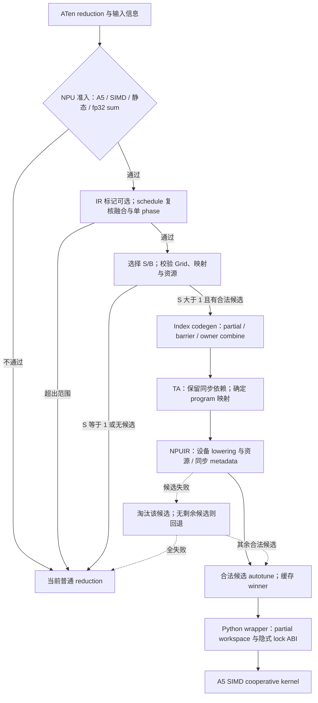
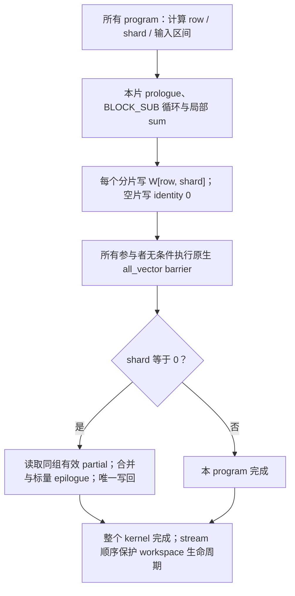

# NPU Cooperative Reduction 初步方案（PyTorch 2.13）

状态：方案草案，待评审。目标、支持范围与验收条件见[需求分析](requirements.md)。
下述 A5 SIMD、Index、静态 fp32 sum 与 owner-only 是候选实现路线，尚未确认为产品首期范围。
本版保留既有方案内容与流程图；性能缺口 G1～G8 的定义及证据见[需求分析第 3.4 节](requirements.md#34-性能缺口)。

## 1. 候选实现路线

### 1.1 首期路线与编译流程

首期在 **NPU Index 路径正向实现 cooperative**，复用现有轴分析、`BLOCK_SUB` 循环、
tile generator、autotuner 和 wrapper。No-linear 先显式使用普通归约，不同时实现两套协议。
原有 `KeyError: 'R'` 要通过 NPU 自身的 cooperative 初始化和索引处理解决；只增加一个字典项
不能证明上游后续 workspace/phase 假设适合 NPU。实现入口见[NPU schedule][N1]与
[Index 初始化][N3]，当前断点见[失败记录][E7]。

下图是建议流程；虚线表示编译期失败后的候选淘汰或普通路径回退。


<details markdown="1">
<summary>流程图 Mermaid 源码</summary>



</details>

IR 与 schedule 共用同一套能力和必要条件判断，但 IR 阶段无法获知全部后续融合信息，所以
schedule 仍需复核。复核不通过时清除 cooperative 状态、workspace/候选及失败尝试的副作用，
构造当前普通归约；不要求本轮引入新的全图规划系统。
Force 在本方案中只绕过收益判断，不绕过 SoC、mode、算子、参与者或内存安全条件。

11 月 19 日补充的同步实现对照支持优先评估 TA 原生同步：同一手写长 sum 使用原始
`x_grid_barrier` 约为 537.085 µs，使用原生同步约为 7.720 µs。该结果是固定 SIMD 原型的
整段 sum 调用耗时，尚未替代上述接入方案的同图验收；条件与边界见
[需求分析第 6.1 节](requirements.md#61-已有性能证据及边界)。

11 月 20 日的分量分析进一步定位：当前 SIMD 返回旧值的 atomic 引入软件锁，锁内部扫描
各参与者并维护 GM 缓存状态；32 个 program 下，不使用返回值为 4.012 µs，使用旧值为
278.324 µs，改用独立地址仍为 278.238 µs，均为完整探针调用耗时。因此直接复用上游
semaphore 协议还依赖 TA/NPUIR 解决这条路径的性能；首期原生同步路线继续按参与者统一、
单 phase 的约束验收。初始化与锁体的占比尚未分别量化，详细证据仍以需求分析为准。

### 1.2 最少需要传递的计划信息

沿用已有 choices、kernel kwargs、`inductor_meta` 和配置对象，不新增独立框架。
以下是语义字段，具体名字在实施时对齐现有接口；已由其他 metadata 表达的信息不重复存储。

| 信息 | 作用与首期约束 |
| --- | --- |
| cooperative 准入状态 | IR 与 Index kernel 一致；普通/no-linear 路径明确为 False |
| `RSPLIT=S`、输出 program 数 `Q` | 将归约分片与输出分核分开；首批 `X=1`，扩展小 `X` 时保持输出 tile 为 1 |
| `BLOCK_SUB=B`、compile mode | 控制分片内循环与局部资源；首期固定 SIMD，非 persistent |
| combine 方式 | 首期 `terminal_owner`：每个输出只有一个分片读取 partial 并输出 |
| partial stride / workspace 大小 | 按候选最大 `S` 分配，行 stride 固定，实际只读当前有效分片 |
| 同步/映射契约 | 原生 `all_vector`、统一单 phase；实际 program 映射由 TA/NPUIR 保证并验证 |

`S/B`、combine 方式、影响映射的 options 及相关能力版本须进入对应代码/候选缓存标识，
cache hit 后恢复同样的 Grid、workspace stride 与 compile options；不能只恢复一个 `R` block。
首期可限定已验证的软件栈和目标架构，不将新增通用 capability 查询服务作为开工前提。

### 1.3 Kernel 内协议与运行流程

设输出 program 数为 `Q=X`，Grid 为 `(S, Q, 1)`。首期仅接 TA 确认的单轮映射，要求
`Q*S` 不超过有效 AIV 数，并确认没有额外 program 循环或 sub-block 改写参与者。
数量检查是必要条件，**不代替后端对物理映射与屏障参与者的确认**。

保留上游调用形式的 NPU helper 原型可以写为：

```python
import triton
from triton.language.extra.cann import extension


@triton.jit
def x_grid_barrier(sem):
    extension.sync_block_all("all_vector", 0)
```

`sem` 在此仅用于兼容调用签名，不读写同步状态；到达登记、atomic 返回旧值和轮询均被
原生全 Vector 屏障替代。完整原型见[NPU helper](../../../scripts/tests/cooperative_reductions/npu_triton_helpers.py)。
该改写要求所有参与者按相同顺序、相同次数执行屏障，并将事件 0 留给此协议。
同一事件编号的连续复用由专门的数据交换探针验证，不能仅根据单次 sum 成功推定。

**本核 partial 的写回如何完成。** `tl.store` 发出写回操作，不代表异步搬出已完成；
这里仍需要本核流水完成与跨核会合两层同步。A5 SIMD 的本次实际产物已包含这两层，
因此 DSL 无需再单独写一个 `tl.debug_barrier()` 来补充本核等待。

对已验证的 `(1,1048576),S=32` 改写版 adapter 和 metadata 进行仅编译导出，
使用受测 NPUIR 提交 `395c9c5646f94119a591794a02961b5801f057c0`。
以下是 partial store 与 peer load 之间的实际关键 IR，仅省略地址、类型和部分属性：

```text
call @store_ubuf_to_gm_1d_float(...)
hivm.hir.set_flag[<PIPE_MTE3>, <PIPE_MTE2>, <EVENT_ID0>]
hivm.hir.pipe_barrier[<PIPE_ALL>]
hivm.hir.sync_block_set[<VECTOR>, <PIPE_MTE3>, <PIPE_S>] flag = 0
hivm.hir.sync_block_wait[<VECTOR>, <PIPE_MTE3>, <PIPE_S>] flag = 0
hivm.hir.wait_flag[<PIPE_MTE3>, <PIPE_MTE2>, <EVENT_ID0>]
call @load_gm_to_ubuf_1d_float_nocache(...)
```

| 操作 | 本次产物中的作用 |
| --- | --- |
| `store_ubuf_to_gm` | 通过 MTE3 将本片结果从核内 UB 搬到其他核可读取的 GM；发出与完成是两件事 |
| `pipe_barrier[PIPE_ALL]` | 约束本核所有流水的前序读写完成，包括前面的 MTE3 搬出；不是等待其他核 |
| `sync_block_set`，生产流水为 MTE3 | 本核前序 MTE3 任务完成后才上报到达，不能只根据标量指令执行位置上报 |
| `sync_block_wait` | 等待所有参与 Vector 核上报完成，之后才允许本核继续下发后续指令 |
| MTE3→MTE2 的 `set_flag/wait_flag` | 维护本核搬出与后续搬入的依赖；这一对本核事件不能单独代替跨核会合 |
| `load_gm_to_ubuf_nocache` | 本次实际生成的 peer 读取路径；随后再同步 MTE2 与 Vector 合并计算 |

流水异步执行：V 负责向量计算，MTE3 负责 UB→GM，MTE2 负责 GM→UB，S 负责标量控制。
标量已经发出 store 时，MTE3 仍可能在搬运，故不能用源码中的先后顺序证明数据已就绪。
`PIPE_ALL` 的本核等待和绑定 MTE3 的跨核通知一起保证“写回完成后才上报”；
全体等待再保证“所有分片上报后才读取”。例如核 0 已写完、核 1 仍在搬出时，
核 0 必须停在跨核 wait，不能因为自己的本核屏障已完成就读取核 1 的 partial。
相关硬件语义见[流水与同步说明][sync-overview]、[PipeBarrier 参数说明][pipe-barrier]和
[CrossCoreSetFlag/WaitFlag 说明][cross-core-sync]。

LLVM IR 中也保留了 `llvm.hivm.BARRIER`、`llvm.hivm.SET.CROSS.CORE` 与
`llvm.hivm.WAIT.FLAG.DEV.PIPE.IMM`，不是只有 adapter 上的抽象 `PIPE_ALL` 字段。
完整证据见[后端 MLIR][native-mlir]、[LLVM IR][native-llvm]与[仅编译记录][native-compile]。
本次未新增运行或计时；前述数据交换检查为运行侧证据，不能将仅编译导出算成一次新的功能验证。

`tl.debug_barrier()` 的 Triton 接口语义是同步一个 block 内的线程，见[接口定义][debug-barrier]；
它不是唯一能表达本核同步的方式，也不能单独同步其他 block。
当前结论限定于已检查的 A5 SIMD 生成路径，不推导其他编译模式具有相同 lowering。

**Inductor 依赖什么保障，而不是如何猜测产物。** 同步原语的接口语义是上层和后端之间的契约。
已安装 TA 的 `sync_block_all` 明确说明，它处理指定核类型之间共享 GM 的 RAW、WAR、WAW
依赖，即写后读、读后写、写后写；不是仅让各核的标量指令到达同一源码位置。
接口定义及参数见[已安装接口片段][installed-sync-api]。

受测 NPUIR 的 `HIVMDecomposeOp.cpp::insertBlockAllVector()` 有如下固定 lowering 规则，
这里仅保留关键语句：

```cpp
auto tpipeAttr = op.getTvectorPipeAttr();
auto pipeAttr = op.getVectorPipeAttr() ? op.getVectorPipeAttr()
                                       : op.getTvectorPipeAttr();
rewriter.create<PipeBarrierOp>(loc, tpipeAttr);
if (tpipeAttr.getPipe() == PIPE::PIPE_ALL) {
  tpipeAttr = PipeAttr::get(ctx, PIPE::PIPE_MTE3);
}
if (pipeAttr.getPipe() == PIPE::PIPE_ALL) {
  pipeAttr = PipeAttr::get(ctx, PIPE::PIPE_S);
}
```

随后 `insertBlockSyncOperations()` 生成跨核 set/wait。当前 adapter 的输入 pipe 为
`PIPE_ALL`，所以这里明确生成本核全流水屏障，再使用 MTE3 通知、S 等待；不是 shape
启发式恰好插入了一条屏障。完整源码见[对应编译器版本的 lowering][sync-lowering-source]。
同步 op 还携带 `HIVMSyncOpTrait`，供分析识别不能随意跨越的同步边界，见
[同步 op 定义][sync-op-source]与[同步边界 trait][sync-trait-source]。
这些是现成的接口、IR 和 lowering 机制；不能据此声称所有自定义优化 pass 都已完成验证。

| 层次 | 应负责的保证 |
| --- | --- |
| Inductor choices/schedule/codegen | 选择合法核集合和模式；partial 先写、同步后读；所有参与者执行一致的屏障序列 |
| TA | 将 DSL 同步原语保留为有同步语义的 IR，维护依赖与执行映射 |
| NPUIR | 按接口语义实现流水完成、跨核通知与等待，优化后仍保持相关内存顺序 |
| launcher/runtime | 正确启动参与者、传递所需 ABI，并满足跨核等待的执行前进条件 |

Inductor 不应在正常编译时解析 LLVM IR 来判断“这次有没有某条 barrier”，也不应把普通
`tl.store` 后的自动依赖分析当成任意跨核通信的保证；应显式发射适用的同步原语。
对接阶段核对 IR 和数据交换探针用于确认实现符合契约，后续后端也可以用等价机制实现该语义，
无需永久保持同一条指令。现有接口不会替 Inductor 自动证明任意 Grid、分支和循环均满足全核会合条件。

**当前改写改变了 helper 的通用语义。** 上游定义是相同 y/z 下的所有 x program 会合，
每组有自己的 semaphore；改写后 `sem` 不参与协议，所有参与 Vector 核共用事件 0。
因此本原型验证的是受限 cooperative 路径的结果交换，不能作为上游 helper 的通用等价替换。
正式接入宜使用表达 NPU 全 Vector 语义的专用 helper，只在已满足条件的 codegen 路径调用，
不全局替换 `triton_helpers.x_grid_barrier`。

例如 `Q=4,S=8` 时，上游四个八分片组可以独立同步；改写后 32 个参与者一起等待。
各组都执行同样八轮交换时可以验证结果等价；若一组提前退出或少执行一轮，全体同步条件
就不再成立。因此这是受约束的 NPU 实现原型，完整接入仍需 schedule/codegen 保证调用条件。

一个说明 helper 语义差异的例子是：只有 `row==0` 的组调用屏障，其他组继续执行。
只要该组所有 x 分片均到达，上游的按组屏障允许这样调用；改成全 Vector 屏障则会等待
根本不调用它的其他组。这是通用替换不成立的反例，不表示当前上游调用点已经生成了该分支。
上游当前在 cooperative 的归约循环结束处、`HAS_RSPLIT` 为真时统一调用，见
[helper 定义][upstream-x-grid]与[codegen 调用点][upstream-barrier-call]。

| 需要保留的条件 | 失去条件的后果与处理 |
| --- | --- |
| 统一的屏障次数与顺序 | 提前退出、按输出组决定是否调用、屏障所在循环次数不同会破坏全体会合；尾块只 mask 数据访问 |
| program 与物理参与者映射明确 | 自动分核、sub-block 或一个核循环处理多个 program 可能改变参与者；仅检查 `Q*S` 不够 |
| 核间事件 0 不被另一协议占用 | 不同 semaphore 原本区分的实例现在合并，需隔离或统一规划核间 flag；本核 event 0 不是同一命名空间 |
| workspace 读者完成后再复用 | 写后读屏障不代表所有核已读完；多 phase 复用需另有读后写依赖保障 |
| 启动与并发满足执行前进条件 | 部分核等待、其余核因资源占用无法启动时可能死锁；CUDA launch 标记不能代替 NPU 启动契约 |
| 评估全局等待与 PIPE_ALL 成本 | 各输出组互相等待，全流水屏障也会约束重叠；即使结果相同，性能也不等价 |

这里要求的是屏障序列一致，各组屏障之前的计算耗时可以不同；归约 tile 循环若不含屏障，
其迭代次数不同本身不构成会合错误。首期 `Q=1`、单 phase、映射已确认时，全 Vector 集合
可对应唯一的分片组；扩展 `Q>1` 则必须复核全体会合条件。并发启动约束见
[跨核同步的执行前进说明][cross-core-sync]，多 phase 的空间复用还要与上游
[workspace 两轮复用规则][upstream-workspace]对齐。


<details markdown="1">
<summary>流程图 Mermaid 源码</summary>



</details>

分片区间沿用已通过原型的形式：`chunk=ceil_div(R, S*B)*B`，分片 `s` 处理
`[s*chunk, min((s+1)*chunk, R))`，load 使用有效元素 mask。每个分片将局部 sum 写入自己的槽；
空片仍写 0 并到达屏障。候选生成尽量排除工作过小或过多空片的配置，mask/identity 保证尾部语义。

**Owner 判断必须位于屏障之后，并包住 peer load、combine 和最终 store。** 只 mask store 会
保留 G3 的重复工作。单 phase 的终结归约在 combine 后没有其他分片继续读取/覆盖 workspace，
因此不额外增加一次全体 barrier；wrapper 在整个 kernel 结束后按 stream 管理空间。

此协议支持纯 prologue 与仅依赖最终归约值的标量 epilogue。Softmax 等消费者还需每个分片获得
最终值并继续处理自己的输入片段；后续再接 all-read/广播以及多 phase 的读者完成屏障，
不能直接使用当前 owner-only 协议。该优化尚未实施或测速，已有原型仍使用 all-read。

### 1.4 Tiling、autotune 与运行时

候选先从 `S` 的小集合与保守 `B` 组合开始，按有效核数、输入区间、UB/活跃值和已确认的映射
契约过滤；数量与范围通过第 4 节实验校准。`S=1` 在准入阶段回到普通 kernel，不分配协议
workspace，也不发出屏障。

Cooperative 候选在相同算法/合法参与者约束下编译和计时；编译或资源检查不通过时淘汰候选，
全失败时走普通路径。Partial workspace 按候选最大需求分配，固定 stride，确保候选预运行和
winner 使用一致的布局。全部有效 partial 由本次写入，无需为 sum 额外清零整个 workspace。

Inductor 管理显式 partial workspace；TA/NPUIR 管理原生屏障所需的隐式 scratch/lock metadata。
两者通过现有 wrapper/launcher ABI 传递，Inductor 不自行猜测锁个数或增加 CUDA semaphore。
Python wrapper 和 NPU Graph 作为首期运行验收，C++/AOT、多 stream 并发在后续阶段单独验收。

### 1.5 对 TA / NPUIR 的周边依赖

下表中“契约确认”表示已有基础但还需明确边界，并非要求从零新增 API；“性能优化”表示需先
定位和建立基线，再决定是否修改下层。TA 指 Triton-Ascend，NPUIR 指实际设备编译器。

| 依赖 | 需要提供或确认的内容 | 责任接口 | 是否阻塞首期 |
| --- | --- | --- | --- |
| D1：参与者与映射契约 | A5 SIMD 的 Grid/AIV 映射、auto-map/sub-block 与屏障一致性、非法配置拒绝 | TA launcher + NPUIR 映射 | 是；合法性未明确时不能发射 |
| D2：GM/event 契约 | 屏障保证 partial 可见；明确重排、event 分配/重用与自动同步的约束 | TA 同步依赖 + NPUIR lowering | 是；受限运行通过后仍需明确边界 |
| D3：owner-only 控制流 | 屏障后 owner 分支读/合并/输出，其他参与者完成；屏障不移入分支 | TA 控制流 + NPUIR 优化 | 是；功能与 G3 优化共同依赖 |
| D4：资源与 ABI | 区分 UB 用量/容量/unknown；返回同步 scratch/lock，保持缓存/Graph ABI | NPUIR metadata → TA → runtime | ABI 影响功能；用量影响配置 |
| D5：同步与小 partial 成本 | 定界 G1/G2/G4/G7/G8；直接复用 semaphore 时解决返回值 atomic 的软件锁成本 | NPUIR 主导，TA 提供固定对照 | 原生同步原型可继续；所选协议的性能影响默认启用 |
| D6：模式与流水 | 验收 SIMD multibuffer/访存优化；后续补齐 pure SIMT 同步 | TA options + NPUIR pipeline | SIMD 组合需验收；pure SIMT 不阻塞首期 |
| D7：分组同步或更轻的归约交换 | 若全 Grid phase 在多输出/多 phase 形态中成为瓶颈，再评估分组或其他交换方式 | TA API/IR + NPUIR 同步实现 | 不阻塞首期；仅作为后续按证据提出的优化 |

交付给 TA/NPUIR 的最小输入是：固定 target/mode/constexpr 的 DSL、参与者/Grid、输入与输出
语义、TTIR/adapter、编译 metadata，以及同算法分阶段计时。已有[探针脚本][P1]、
[编译矩阵][E3]和[adapter IR][E13]可作为起点。
下层返回应包含支持组合、最终映射/资源信息、定位结论与对齐基线的性能数据，不能只返回
“能编译”或一个未经对齐的算子耗时。未确认的能力先采用明确范围保护，不据此默认支持所有 NPU。

## 2. 组件修改清单

“必须改”指实现 A5 SIMD、静态、单归约 phase 的最小范围；“检查/扩展”按验收范围决定。
文件名均相对 `pytorch_new/torch_npu/_inductor/`，上游复用点另行注明。

| 组件 | 需要完成的工作 | 范围判断 |
| --- | --- | --- |
| `choices.py`、配置与 backend capability | 增加 NPU 准入和收益判定；架构/模式/算子不支持时回退；IR 与 codegen 共用判定 | 必须改，中等 |
| `ir.py::num_splits` | cooperative 准入与 IR capability 一致；未准入时保留当前普通路径 | 必须改，中等，影响方案选择 |
| `codegen/npu_combined_scheduling.py` | Index 接 cooperative；no-linear 显式关闭；失败尝试不污染普通回退 | 必须改，中等 |
| `codegen/scheduling.py` | kernel choices、fusion 准入、reduction/pointwise phase 边界、unsupported 组合屏蔽 | 必须改，中到大 |
| `codegen/split_tiling.py` | 为分片安排 program 维度；区分输出分核与归约分片；保证参与者和循环次数合法 | 必须改，大 |
| `codegen/triton.py` | Index 接 shard 区间、workspace、原生屏障、owner combine、尾块；no-linear 先仅做能力保护 | 必须改，大，主工作量 |
| `runtime/tile_generator.py` | 联合选择 `S`、输出 tile 和 `BLOCK_SUB`，按可用核数/局部资源筛选 | 必须改，中到大 |
| `runtime/triton_heuristics.py` | cooperative 候选、Grid、编译参数、实际 winner、cache 恢复；对性能比较明确候选层级 | 必须改，大 |
| 同步/combine helper（`runtime/triton_helpers.py`） | 原生屏障、空片 identity、peer 合并；也可由 codegen 直接发出已有扩展调用 | 协议必须接入；文件按方案改 |
| `codegen/wrapper.py` | 复用 `WorkspaceArg` 分配与释放，核对 stream 生命周期、参数和 runtime Grid | 必须核对，已有基础 |
| `codegen/cpp_wrapper_npu.py` | 同样传递计划、Grid、partial workspace 与编译器隐式 lock ABI | 完整 AOT/C++ 范围需要适配与验证 |
| 测试与 cache/config 接入 | 准入/回退、精度、动态、图捕获、候选一致性；配置进入图缓存与候选缓存键 | 必须改，贯穿各层 |

上游 `WorkspaceArg`、reduction combine helper、schedule marker、autotuner 编译/计时框架可以
复用。现有 NPU wrapper 已有 workspace 和编译器 lock 的处理，不应笼统认定需要重写整个
wrapper，见[C++ wrapper 实现][N7]。同样，正常 `torch.sum` 等 decomposition/ATen lowering 并非首期必须修改项；
只有既有 lowering 已将目标融合链提前拆开时，再按具体图评估。

**工作量是跨多个组件的编译策略与运行时功能，超过局部 codegen patch。** 单阶段 static sum
的受限版本与“上游测试全量通过、动态/多 phase/AOT 全兼容”是不同交付范围；现有证据不足以
给出可靠的行数或人天估算。

## 3. 性能模型与 NPU 触发条件建议

### 3.1 相对当前普通归约建立收益模型

以下是决策模型，不是已测得的硬件公式。记 `Q` 为实际输出方向 program 数，`C` 为该模式下
可用于该 kernel 的物理并行单元数，`L` 为一次 launch 的相关开销。

```text
T_ordinary ≈ L + local_reduce(R, B, live_values) with Q-way parallelism
T_coop     ≈ L + local_reduce(R/S, B, live_values) with Q*S-way parallelism
                 + partial_store + native_barrier + combine + resource/fusion effects
```

本轮要求 cooperative 相对当前普通归约缩短完整图的执行时间；分片计算减少的时间必须覆盖
partial、屏障、合并和可能增加的资源开销。产品收益比较须对齐相同图、输入、dtype 和运行条件，保留普通路径实际选中配置。
连续归约融合还会改变访存和活跃值，需另外测量，不能将单 sum 的收益直接推广到 softmax。

还应区分：

- `R` 很小：即使 `Q` 小，也可能是同步开销主导；
- `Q >= C`：输出方向已有并行度，再分 `R` 的价值变小；
- `S=1`：没有 cooperative 并行收益，应省掉同步和 peer 协议；
- `R/S` 太小：过多分片导致空片或小工作量 program；
- UB/寄存器不够：persistent 的资源风险与 `R`、dtype、融合输入和活跃值相关；
- 全局屏障：不同输出组互相等待，耗时由最慢参与者决定，跨组不均匀会增加尾部代价。

### 3.2 建议的准入顺序

```text
1. capability: SoC、compile mode、原生同步契约已验证
2. legality: 单归约形态、支持的 combine、统一 phase、合法 Grid/映射和 workspace
3. parallelism: 当前 Q 不足，存在 S > 1 且每片有足够工作量
4. resources: B、S、persistent/looping 的 UB 与寄存器资源合法
5. profitability: 预测或实测 cooperative 优于当前普通 reduction
6. 否则回退；force 只绕过第 5 项，不能绕过前四项
```

首期可以静态 shape 和 SIMD 为边界，用保守的配置集比较 `S` 与 `BLOCK_SUB`，逐步建立
按 `X/R/dtype/layout/fusion/graph mode` 区分的收益表。`S` 上限应同时受实际 program 映射、
有效核数与最小分片工作量约束，不能只有 `min(R, 64)`。

CUDA 的 `X<=16`、`32768*X` 和以 SM 为基础的 `S` 不能直接作为 NPU 默认值。
设备属性与 compiler 保留空间也要分开：本卡报告 UB 为 216 KiB，而本地 NPU tile 配置给 A5
设置 256 KiB；这个配置常量不能单独证明一个 cooperative persistent tile 能放下，
见[tile generator 中的容量配置][N8]。

首期由 shape/能力与校准后的收益规则决定 ordinary/cooperative；cooperative 内部搜索合法的
`S/B`。现有 `cached_autotune` 不会自动比较两个不同 generated body 的完整代价，不能把加上
一个 `S` 参数视为已完成普通路径与 cooperative 的自动择优。
在特性开关默认关闭的前提下先完成接入与校准，再确定默认启用范围。

autotune 预运行还应遵守 workspace/隐式 lock 的初始化契约：每个有效 partial 都由本次调用
覆盖；不额外引入 CUDA semaphore，也不让上一候选的状态影响下一候选。

## 4. 性能缺口的验证方法

保持相同 shape、dtype、分片算法和 compile mode，分别检查以下阶段，输出每个版本的结果校验：

| 对照 | 保持/增加的工作 | 用途 |
| --- | --- | --- |
| local partial | 每个 program 读取本片并写出 partial | 分片计算与写回的基线 |
| partial + native barrier | 相同 partial，加全体参与的屏障 | 观察完整代码变化后的同步增量，不将编译优化差异忽略 |
| barrier + owner combine | 指定分片读取同组 partial、合并、写输出 | 首期方案及小 partial 处理成本 |
| barrier + all-read combine | 每个分片均合并，指定分片写输出 | 识别终结归约重复工作；也是后续广播消费者的起点 |

`S` 按 2/4/8/16/32，`B` 按保守合法范围选点；`S=1` 单独使用无协议的普通 kernel。
每个 case 要保证真实参与者合法，区分整除/尾块、冷热缓存、Graph 开关，并在可控负载下配对测量。
如果 profiler 支持，采集实际 AIV 活跃度、各 pipe 等待、GM 事务和 UB 使用；否则先用最终指令、
metadata 与阶段实验限定结论。TA/NPUIR 提供等价原生参考实现后，才能进一步评估编译器带来的性能差距。
这些是后续验证计划，本轮没有新增性能测量，也没有为任一 TA/NPUIR 优化填写未实测的加速比。

### 4.1 流水是什么，以及如何观测

这里的“流水”是 AI Core 内分工执行指令的通路及队列，不是 Inductor 的编译 pass pipeline。
V 做向量计算，MTE2 将 GM 数据搬入 UB，MTE3 将 UB 数据搬出到 GM，S 负责标量控制。
这些单元可以异步并行：例如计算 tile 0 时预取 tile 1；同一 tile 的“搬入→计算→搬出”
仍需依赖控制。`PIPE_ALL` 是选取本核所有流水的同步参数，不是另一种计算单元。
硬件分工与异步下发机制见[同步控制说明][sync-overview]。

| 需要回答的问题 | 证据与工具 | 不能单独证明什么 |
| --- | --- | --- |
| 编译器安排了哪些同步 | 后端 MLIR、LLVM IR，必要时检查设备反汇编 | IR 的文本顺序不能给出各流水实际耗时与重叠 |
| 哪条通路忙、哪条可能受限 | 上板 `PipeUtilization`，结合内存流量与核间负载 | 汇总利用率不是每条指令的执行时间线 |
| 各流水什么时候工作、空闲和重叠 | A5 上板 `PipeTimeline`，在 MindStudio Insight 中查看 | 插桩采集的时间不可直接替代未插桩 Graph + Event 样本 |
| 进一步定位到具体指令 | 支持版本中的上板 `InstrTimeline`；按需保留源码行号 | 不能把未记录通路或未显示指令的空白一律当作 barrier 等待 |
| 分析仿真器中的指令顺序与依赖 | `msprof op simulator` / `msopprof simulator` 导出 trace | 仿真时间不是这块物理卡的实测时间 |

现有结果包含后端 IR 和 Graph + Event 计时，尚未抓取该 kernel 的上板或仿真指令时间线。
要进一步定界 G2，可先抓流水重叠，再关联 MTE3 写回、跨核等待、MTE2 peer 读取；
需要同时看多个参与核，区分本核搬出慢和等待其他核两种来源。
入口与示例命令见[探针 README 的流水采集说明][pipeline-commands]。
工具的 A5 支持、`PipeTimeline`/`InstrTimeline` 参数及两者分开采集的约束见
[MindStudio 算子工具指南][profiler-guide]；Triton 仿真方法见[TA 性能分析指南][ta-profiling]。

## 5. 建议交付阶段与验收

| 阶段 | 交付边界 | 验收依据 |
| --- | --- | --- |
| P0：能力契约 | A5 SIMD，同步参与者/GM/映射/锁契约；pure SIMT 明确排除 | 原生屏障、重复 phase、合法/非法 Grid、缓存与并发约束记录 |
| P1：静态最小接入 | Index、静态单 `R`、fp32 sum、非 persistent、owner-only、简单融合；no-linear 回退 | 分核、精度、协议、命中与回退均验证 |
| P2：性能缺口与选择 | `S/B` 联合选择；普通/cooperative 同图比较，拆分协议成本 | 完成 G1～G8 的归因/范围记录，冷热缓存、Graph 开关、winner 与有效核数齐全 |
| P3：融合与算子 | 连续归约/softmax、极值、类型提升、Welford 等逐项扩展 | tail、NaN/Inf、tie、空片、各 phase 空间与精度验收 |
| P4：动态 | backed dynamic R，再到有安全上界的 X 和 grouped autotune | 同一 callable 跨阈值/尾块复用；Grid、空间与回退合法，记录重编译 |
| P5：完整运行时 | C++ wrapper/AOT、Graph、多 stream、persistent、其他编译模式 | 打包重载与并发回放；能力矩阵与默认回退测试 |

验收不能只检查字符串 `cooperative_reduction` 或 kernel 数为 1。
原用例 `test_reduction_fns` 的 `(1, 1024**2)`、多个 reduction 与 dtype 是回归入口，但还包含
CUDA decorator/launch 假设。NPU 测试应检查自己的计划、partial 形状、同步作用域、store owner
和正确回退；浮点类型的基础硬件支持与 cooperative 功能分别判断。[C1]

最低测试集合应覆盖：`S=1/S>1`、`R<S*B`、非整除 `R`、输出尾块、`X` 超过准入上限、
unsupported 算子/模式回退、同一 kernel 多次调用与 workspace 重用、多个 reduction phase。
不能依赖设备超时来拒绝非法 Grid；不满足同步契约的配置应在编译或候选筛选阶段排除。

## 6. 关联文档与证据

需求价值、NPU 当前实现、上游差异、功能/性能缺口、正交矩阵与验收目标统一见[需求分析](requirements.md)。
源码链接沿用该文档的固定基线；当前方案尚未接入 Inductor，也未新增设备测量。

- [实验脚本与复现方式][P1]。
- [Index 初始化与 no-linear 回退失败记录][E7]。
- [固定配置编译矩阵][E3]、[安装后端契约片段][E1b]、[原型 adapter IR][E13]。

[N1]: https://gitcode.com/luqichao/pytorch_new/blob/961b95d9acb79551c52a77e991db9dd2613d6d86/torch_npu/_inductor/codegen/npu_combined_scheduling.py
[N3]: https://gitcode.com/luqichao/pytorch_new/blob/961b95d9acb79551c52a77e991db9dd2613d6d86/torch_npu/_inductor/codegen/triton.py#L902
[N7]: https://gitcode.com/luqichao/pytorch_new/blob/961b95d9acb79551c52a77e991db9dd2613d6d86/torch_npu/_inductor/codegen/cpp_wrapper_npu.py
[N8]: https://gitcode.com/luqichao/pytorch_new/blob/961b95d9acb79551c52a77e991db9dd2613d6d86/torch_npu/_inductor/runtime/tile_generator.py#L109
[C1]: https://github.com/limbochao/Community-Use-Case-Testing/blob/51830b03317074409a04c0ff167ee0d7ad6c897c/v2.13.0/inductor_npu/test_cooperative_reductions.py
[P1]: ../../../scripts/tests/cooperative_reductions/README.md
[E1b]: ../../../artifacts/npu-cooperative-reductions-20261118/inspect/installed-backend-contracts.txt
[E3]: ../../../artifacts/npu-cooperative-reductions-20261118/compile-fixed/compile.json
[E7]: ../../../artifacts/npu-cooperative-reductions-20261118/index-fallback.log
[E13]: ../../../artifacts/npu-cooperative-reductions-20261118/compile-fixed/cooperative_sum-simd/kernel.ttadapter
[native-mlir]: ../../../artifacts/npu-cooperative-reductions-20261120-allvector/final-native/module.hivm.opt.mlir
[native-llvm]: ../../../artifacts/npu-cooperative-reductions-20261120-allvector/final-native/kernel.ll
[native-compile]: ../../../artifacts/npu-cooperative-reductions-20261120-allvector/final-native/manifest.json
[sync-overview]: https://www.hiascend.com/doc_center/source/zh/canncommercial/850/API/ascendcopapi/atlasascendc_api_07_0179.html
[pipe-barrier]: https://www.hiascend.com/doc_center/source/zh/canncommercial/850/API/ascendcopapi/atlasascendc_api_07_0271.html
[cross-core-sync]: https://asc.gitcode.com/api/SIMD-API/basic_api/sync_control/inter_core_sync/CrossCoreSetFlag_ISASI.html
[debug-barrier]: https://triton-lang.org/main/python-api/generated/triton.language.debug_barrier.html
[installed-sync-api]: ../../../artifacts/npu-cooperative-reductions-20261118/inspect/installed-source-excerpts.txt
[sync-lowering-source]: ../../../artifacts/npu-cooperative-reductions-20261120-allvector/source/HIVMDecomposeOp.cpp
[sync-op-source]: ../../../artifacts/npu-cooperative-reductions-20261120-allvector/source/HIVMSynchronizationOps.td
[sync-trait-source]: ../../../artifacts/npu-cooperative-reductions-20261120-allvector/source/HIVMTraits.td
[upstream-x-grid]: https://github.com/pytorch/pytorch/blob/cf30153c4c131c8164ee7798e5022d810682e2cb/torch/_inductor/runtime/triton_helpers.py#L824
[upstream-barrier-call]: https://github.com/pytorch/pytorch/blob/cf30153c4c131c8164ee7798e5022d810682e2cb/torch/_inductor/codegen/triton.py#L5948
[upstream-workspace]: https://github.com/pytorch/pytorch/blob/cf30153c4c131c8164ee7798e5022d810682e2cb/torch/_inductor/codegen/triton.py#L2716
[pipeline-commands]: ../../../scripts/tests/cooperative_reductions/README.md#流水采集与-ir-导出的区别
[profiler-guide]: https://github.com/Ascend/msopprof/blob/master/docs/zh/user_guide/msopprof_user_guide.md
[ta-profiling]: https://triton-ascend.readthedocs.io/zh-cn/latest/debug_guide/profiling.html
