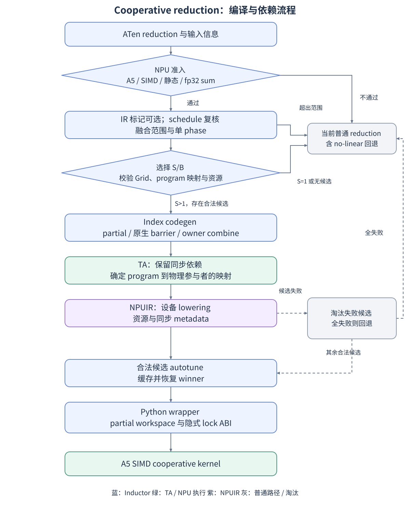
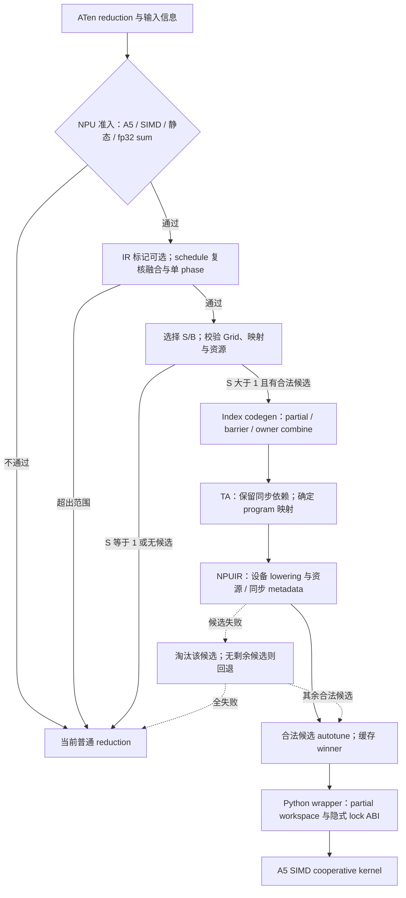
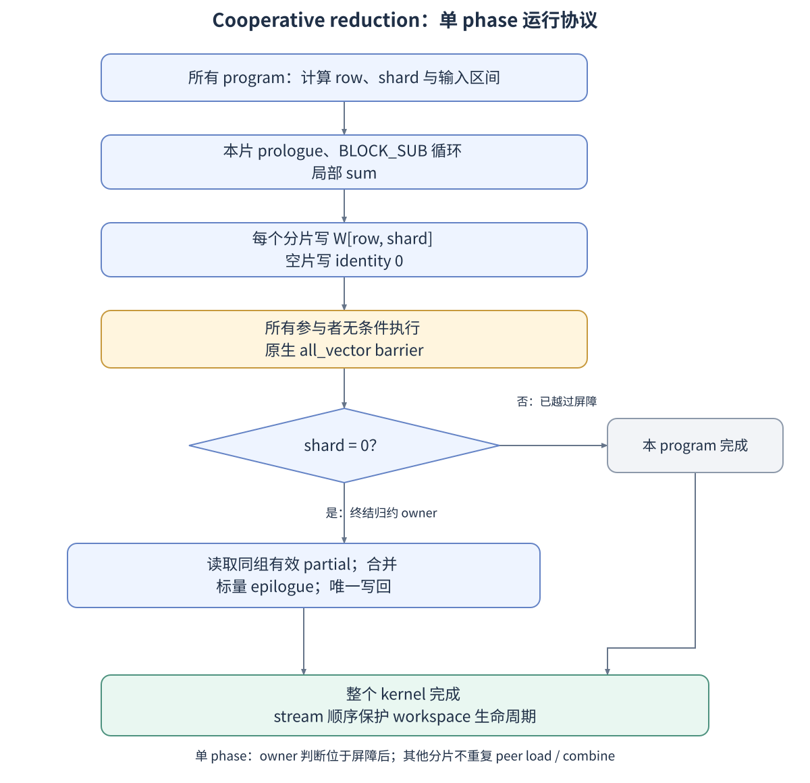
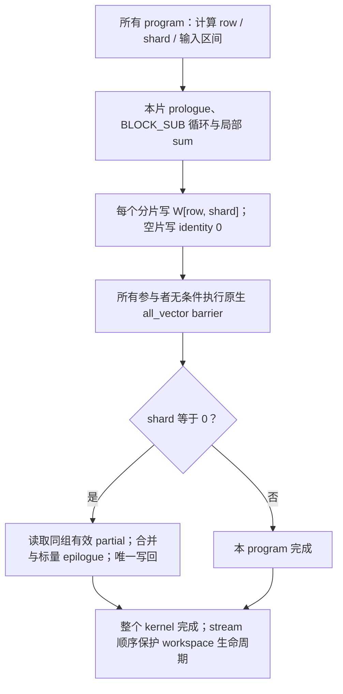

# NPU Cooperative Reductions 需求调研与初步方案（PyTorch 2.13）

## 1. 需求作用与范围

### 1.1 当前要解决什么问题

**目标是在输出少、归约长的场景，让多个 NPU program 在同一个 kernel 内共同完成一次归约，
提高核利用率，并为归约前后融合保留同一 kernel 的执行边界。** 算子的数学语义不变，用户仍调用
`torch.sum`、归约融合图等现有接口；新增的是 Inductor 的执行策略。[U2][U3]

当前 NPU 的实际例子是 fp32 `(a+b).sum(-1)`，shape 为 `(1, 1048576)`：Inductor 生成一个
kernel，但选择的 Grid 为 1，`R0BLOCK_SUB=8192`，在同一 program 内循环处理整个归约。
设备有 56 个 Vector core，输出方向只有一个任务，无法依靠增加输出方向 program 数利用其余核。
“已经融合成一个 kernel”因此不等于“已经有效分核”。[E5]

Cooperative 的做法是将这条长归约划给 `S` 个 program：各自处理输入片段，写 partial 到 GM，
在 kernel 内同步，再合并得到最终结果。对于上述输入，`S=32` 时每个 program 约处理 32768 个
输入，形成归约方向的并行度。分片本身有 workspace、同步和合并成本，必须只在收益成立时启用。

### 1.2 预期作用与目标场景

| 目标场景 | 当前问题 | cooperative 预期作用 | 本轮定位 |
| --- | --- | --- | --- |
| 小输出、长轴 sum，以及带简单 prologue 的 sum | 输出方向并行度不足，归约在少数 program 中循环 | 同一 kernel 内增加归约方向并行度，缩短长归约关键路径 | 首期入口 |
| reduction 后只产生标量/小输出的 epilogue | 完整结果只需一个最终写入者 | 由指定分片合并并执行 epilogue，避免所有分片重复合并 | 首期支持简单形式 |
| softmax、连续 reduction/广播融合 | 多个归约 phase，结果需要再用于各自负责的输入片段 | 在同一 kernel 内交换归约结果，保留后续并行计算和融合机会 | 后续扩展目标，尚未实测收益 |
| 动态长归约 | 当前动态 full reduction 保持 Grid 为 1 | 在有合法 shape 边界与调度契约后提供归约分核 | 后续扩展，首期回退 |

验收要同时回答“是否实际分核”“是否正确”“相对当前普通归约是否有收益”。不能以开关可开启、
decorator 存在或 kernel 数为 1 作为需求完成标准。上游实现依据见 [U2][U3]，NPU 当前行为见 [E5][E6]。

### 1.3 本轮边界与已有结论

本轮聚焦 **cooperative reduction 相对当前普通 reduction 的适配**。Split reduction 的选择策略、
性能优化与方案设计不纳入本轮；IR 中只保留保证 cooperative 准入与回退正确所需的交互说明。
早期探针中的两阶段数据保留在原始证据中，不再作为本轮方案的前置依赖或验收目标。

范围是默认 NPU Inductor → Triton-Ascend（TA）→ AscendNPU-IR/BiShengIR 路径。
下文的 NPUIR 指 Triton 后面的设备编译器，不是 `torch_npu._inductor.ascend_npu_ir` 的
另一条 MLIR Inductor backend；后者及 DVM、AscendC backend 不在本需求内。[N0]

首期方案选择 **A5、SIMD、静态、连续单归约轴、fp32 sum、单 phase**；以 `X=1` 起步验收，
设计中保留静态小 `X` 的表示。实现入口选择 NPU Index 路径；no-linear 路径先明确关闭 cooperative，
承担普通归约回退。动态、persistent、多 phase、其他 dtype/算子和其他编译模式逐项扩展。

现有实验确认 A5 原生同步可支撑受限 SIMD 原型，而 pure SIMT 的同步 lowering 存在明确缺口。
小 `R` 原型也出现性能退化，需要专门处理同步固定开销、重复合并、资源反馈和编译优化问题。
因此适配范围贯通 IR、schedule、tiling、codegen、autotune 和 runtime，见第 3、5、8 节。
本文是需求分析与初步设计，尚未实现产品特性；共享卡实验不用于确定上线阈值。

## 2. Cooperative 机制和 CUDA 对照

### 2.1 普通归约与 cooperative

记 `X` 为归约后保留的元素数，`R` 为每个输出需要归约的元素数，`S` 为每个输出的分片数。
**program/CTA 是逻辑工作单元，不等于物理 AIV 核或 CUDA SM。** 一个物理核可能按编译器的
映射执行多个 program。`XBLOCK` 等 tiling 还会改变实际输出方向的 program 数。

| 术语 | 本文含义 |
| --- | --- |
| AIV / Vector core | NPU 上执行 Vector 计算的物理单元；program 经过后端映射后在其上执行 |
| GM / UB | GM 是核之间交换 partial 的全局存储；UB 是核内局部缓冲，不能直接作为跨核共享 workspace |
| phase | 一轮“局部计算、写 partial、同步、读 partial”的执行阶段；连续归约可有多轮 |
| owner-only / all-read | 前者只由指定分片合并；后者由每个分片读取同组 partial 并合并 |
| optimization hint | 编译选配置使用的代表值，不自动构成动态 shape 的运行时上下界 |

| 路径 | 工作方式 | 适用的资源形态与代价 |
| --- | --- | --- |
| 普通单 program 归约 | 每个输出组由一个 program 在局部完成，可能循环多块 | `R` 小，或输出方向已有足够并行度；没有跨核合并开销 |
| Cooperative reduction | 同一 kernel 内分片，写 partial，同步，读取 peer partial 合并 | 同样需要小 `X`、大 `R` 的并行性；还要求同步参与者能够安全共同推进 |

例如 `(1, 1048576)` 的 sum，`S=32` 时各 program 负责约 32768 个输入：

```text
普通归约：一个 program 循环处理整个 R → final sum → store
cooperative：32 个 program 各处理 R/32 → partial → kernel 内屏障 → combine → store
```

Cooperative 需要 partial workspace。CUDA 实现让各分片读取同组 partial，分别得到完整归约结果，
便于继续融合归约后的逐元素计算，再由指定分片写标量输出。[U2]
如果结果仅用于最终输出，NPU 首期方案可以只让指定分片读取并合并 partial；如果结果还要用于
各分片的后续输入片段计算，则需要 all-read 或其他明确的广播协议，不能直接套用这个简化。

### 2.2 CUDA 的选择规则不能直接搬到 NPU

本次上游基线中，`triton.cooperative_reductions` 默认关闭，可用
`TORCHINDUCTOR_COOPERATIVE_REDUCTIONS=1` 或 config patch 开启。[U0]

上游 `InductorChoices.should_use_cooperative_reduction()` 的普通开关逻辑是：[U1]

| `X` 的 optimization hint | 要求可静态证明的 `R` 下界 |
| --- | --- |
| `X <= 8` | `32768 * X` |
| `8 < X <= 16` | `2097152` |
| `X > 16` | 不选 cooperative |

`force_cooperative_reductions=True` 会绕过该性能选择逻辑；它不是能力检查。
普通开关仍要求 `statically_known_geq(R, threshold)`，不能把一个较大的 shape 样本当作动态
`R` 的已知下界。

CUDA runtime 再按 SM 数、`X` hint 和 `TRITON_MAX_RSPLIT=64` 选择 `S`，为每个配置加入
`RSPLIT`。它明确限制同步 CTA 的数量，并使用 cooperative launch；其 `x_grid_barrier`
依赖返回旧值的 uint32 atomic、release/acquire 及局部 barrier。[U3][U4]
当前 runtime 给所有候选加入同一个 `S`，主要搜索局部 reduction 配置，并没有默认搜索多个
`S`；因此适配 autotune 也不能仅理解为补一个相同名字的 decorator。

这套设计同时涉及 **IR 不做多 kernel 拆分、schedule 的 phase 边界、kernel 内 workspace、
Grid、候选配置和 launch**。因此即使 Triton 已能编译一个 barrier，也没有自动完成该特性。

## 3. 现有实现、上游差异与修改范围

### 3.1 当前有两条代码生成路径需要一起处理

`NPUCombinedScheduling` 先尝试 `NPUTritonScheduling / NPUIndexTritonKernel`；失败后可回退到
`NPUNoLinearTritonScheduling / NPUTritonKernel`。前者使用 NPU 自己的多轴、`BLOCK_SUB` 和循环
代码生成；后者复用更多上游 TritonKernel 逻辑。[N1][N2]

本次受测普通归约由输出轴安排 program，`R` 在 program 内通过 `BLOCK_SUB` 循环或 persistent
形式处理；本次静态 `X=1` 的实际 winner 为 Grid 1，`X=32` baseline 为 Grid 32。
`X=1` 的动态普通归约也保持 Grid 1，同一 callable 可复用不同 `R`。[E5][E6]

两条代码生成路径均未完成 cooperative 接入：

- Index 路径 `_get_heuristic()` 明确只返回 pointwise、reduction、persistent_reduction；
  它重写了 reduction、store、body 和 signature 生成，不能只复用上游初始化代码。[N3]
- 本次强制静态 sum 的 Index 尝试，已在继承的 `init_cooperative_reduction()` →
  `_has_constant_mask()` → `TRITON_MAX_BLOCK[prefix.upper()]` 处出现 `KeyError: 'R'`；
  NPU 轴体系与上游假设不匹配。这是首个已复现断点，修复它不代表后续协议已接通。[E7]
- No-linear 路径可能生成上游 `@triton_heuristics.cooperative_reduction`，但 imports 已替换为
  NPU runtime，后者没有这个 decorator。本次静态实验实际在此抛出 `AttributeError`。
- NPU helpers 通过 `import *` 继承了上游 `x_grid_barrier`，但这仍是 CUDA 风格 semaphore 协议，
  没有变成 NPU 原生同步实现。即使补上 decorator，workspace、peer combine、合法 Grid、
  store owner 和同步协议仍需贯通。[N4][N9]

安装环境的符号检查也确认了上述继承关系，以及 cooperative heuristic 缺失，见 [E10]。

**回退必须是一个明确的普通 reduction 方案。** 不应让 Index 失败后进入另一条同样不支持
cooperative 的路径，再以 decorator 缺失结束编译。

### 3.2 与 CUDA 上游的差异

| 维度 | CUDA 上游已有实现 | NPU 当前实现 | 本轮需要补齐 |
| --- | --- | --- | --- |
| 归约并行模型 | 为同一输出增加 `RSPLIT` 维度，kernel 内合并 | 受测普通路径按输出分核；full reduction 的实际 Grid 可为 1 | 将输出 program 与归约分片分开表示 |
| 选择策略 | `should_use_cooperative_reduction()` 按 `X/R` 判断，runtime 按 SM 取 `S` | 继承上游开关/部分 predicate，缺少 NPU 能力与性能策略 | SoC、模式、资源及 `S/B` 联合选择 |
| schedule 与 phase | 有 cooperative reduction、pointwise phase flush、workspace 生命周期处理 | NPU 有独立 Index codegen、多轴循环和 tiling，未接通上述协议 | 首期接单 phase；后续单独适配多 phase |
| 轴与代码生成 | cooperative 初始化按上游 range tree/axis 假设工作 | Index 强制路径触发 `KeyError: 'R'`；大量 reduction/store/body 方法已覆盖 | NPU 自己构造分片索引、尾块和 store owner |
| runtime heuristic | 已有 `cooperative_reduction` decorator、候选和 Grid | NPU runtime 没有该 decorator，no-linear 回退在 module load 失败 | 接 NPU 候选与 Grid，先保护 no-linear 回退 |
| 同步协议 | `x_grid_barrier` 使用 semaphore 和 acquire/release，配 cooperative launch | helper 继承 CUDA 实现；TA 同时提供 NPU 原生 `sync_block_all` | 首期采用原生同步，按后端契约限制参与者 |
| 最终合并 | 每个分片都可获得最终值，服务后续融合；指定分片写标量 | 未形成 Inductor cooperative combine | 终结归约先采用 owner-only；广播消费者后续扩展 |
| 底层资源模型 | SM、warp、寄存器/共享内存与 CUDA launch | AIV、UB、SIMD/SIMT 模式和 TA program 映射 | 独立建模，不能照搬 CUDA 阈值 |

上游依据见 [U1][U2][U3][U4]；NPU 代码依据见 [N1][N2][N3][N4][N6]，已复现断点见 [E5][E7]。
其中 owner-only 是本轮建议方案，不是 NPU 当前已支持的能力。

### 3.3 IR 决策与普通路径回退

NPU `num_splits()` 被 patch 到公共 `Reduction.num_splits`。其判断使用
`BackendFeature.REDUCE_TO_SINGLE_ELEMENT`；继承的上游 `get_backend_features()` 在 cooperative
开关开启时就加入这个 capability，而 NPU 的 IR 判断没有上游“本次归约实际选中 cooperative”
这一层 predicate。[N5][U5]

因此，**开启配置可能先抑制 split，即使该 shape、算子或 codegen 路径最终不能执行 cooperative**。
能力声明和逐归约选择应共用可实现的准入逻辑，而不是将一个全局 flag 当作每个 reduction 的
最终执行计划。

另一个 NPU 特点是：`X=1`、归约组恰有一个动态归约轴时，当前 `num_splits()` 返回 1；
`SplitTiling.select_split_axis()` 对动态 full reduction 保持 `grid=1`，避免没有跨核合并时覆盖
标量输出。这是后续动态 cooperative 值得优化的入口，也是必须保留的正确性回退。[N5][N6]

本轮只修正“cooperative 选中与否”和 IR 声明的一致性，不设计其他归约路径的拆分策略。
调度后如发现融合形态超出首期范围，必须明确关闭 cooperative 并重建普通 kernel；不能把
Index 失败后沿用同一 cooperative 状态的 no-linear 编译当作正常回退。

### 3.4 组件修改清单

“必须改”指实现 A5 SIMD、静态、单归约 phase 的最小范围；“检查/扩展”按验收范围决定。
文件名均相对 `pytorch_new/torch_npu/_inductor/`，上游复用点另行注明。

| 组件 | 需要完成的工作 | 范围判断 |
| --- | --- | --- |
| `choices.py`、配置与 backend capability | 增加 NPU 准入和收益判定；架构/模式/算子不支持时回退；IR 与 codegen 共用判定 | 必须改，中等 |
| `ir.py::num_splits` | cooperative 准入与 IR capability 一致；未准入时保留当前普通路径 | 必须改，中等，影响方案选择 |
| `codegen/npu_combined_scheduling.py` | Index 接 cooperative；no-linear 显式关闭；失败尝试不污染普通回退 | 必须改，中等 |
| `codegen/scheduling.py` | kernel choices、fusion 准入、reduction/pointwise phase 边界、unsupported 组合屏蔽 | 必须改，中到大 |
| `codegen/split_tiling.py` | 为分片安排 program 维度；区分输出分核与归约分片；保证参与者和循环次数合法 | 必须改，大 |
| `codegen/triton.py` | Index 接 shard 区间、workspace、原生屏障、owner combine、尾块；no-linear 先仅做能力保护 | 必须改，大，主工作量 |
| `runtime/tile_generator.py` | 联合选择 `S`、输出 tile 和 `BLOCK_SUB`，按可用核数/局部资源筛选 | 必须改，中到大 |
| `runtime/triton_heuristics.py` | cooperative 候选、Grid、编译参数、实际 winner、cache 恢复；对性能比较明确候选层级 | 必须改，大 |
| 同步/combine helper，可落在 `runtime/triton_helpers.py` | 选择原生屏障，处理空分片 identity 与 peer 合并；也可由 codegen 直接发出已有 extension 调用 | 协议必须接入，helper 文件按方案改 |
| `codegen/wrapper.py` | 复用 `WorkspaceArg` 分配与释放，核对 stream 生命周期、参数和 runtime Grid | 必须核对，已有基础 |
| `codegen/cpp_wrapper_npu.py` | 同样传递计划、Grid、partial workspace 与编译器隐式 lock ABI | 完整 AOT/C++ 范围需要适配与验证 |
| 测试与 cache/config 接入 | 准入/回退、精度、动态、图捕获、候选一致性；配置进入图缓存与候选缓存键 | 必须改，贯穿各层 |

上游 `WorkspaceArg`、reduction combine helper、schedule marker、autotuner 编译/计时框架可以
复用。现有 NPU wrapper 已有 workspace 和编译器 lock 的处理，不应笼统认定需要重写整个
wrapper。[N7] 同样，正常 `torch.sum` 等 decomposition/ATen lowering 并非首期必须修改项；
只有既有 lowering 已将目标融合链提前拆开时，再按具体图评估。

**工作量是跨多个组件的编译策略与运行时功能，超过局部 codegen patch。** 单阶段 static sum
的受限版本与“上游测试全量通过、动态/多 phase/AOT 全兼容”是不同交付范围；现有证据不足以
给出可靠的行数或人天估算。

## 4. 特性正交性与准入边界

“可组合”表示语义上可设计实现；不表示当前 NPU Inductor 已支持。以下是建议的接入契约。

| 特性 | 上游/现有实现的约束 | NPU 接入要求与建议 |
| --- | --- | --- |
| 普通 pointwise prologue/epilogue | CUDA 支持融合，所有分片可获得最终归约值 | 首期支持简单 prologue 和标量 epilogue；只允许指定分片写唯一输出 |
| reduction → pointwise → reduction | CUDA 利用 phase flush、屏障和 workspace 周期 | 需要独立 phase/liveness 适配；workspace 重用前还要保证旧读者完成，不能只插一次 barrier |
| Softmax / chained softmax | 包含 max、sum、广播，可能有多个同步阶段 | 是有价值的目标场景；首期不以单 sum 原型代替其验收 |
| persistent reduction | CUDA cooperative 可以与 persistent 组合 | 需按 `R/S`、活跃输入、UB/寄存器重新判断；上游阈值乘数不能直接复用 |
| multi_kernel | CUDA 可在部分同一 schedule 的候选间选择 | NPU `create_kernel_choices()` 没有接完整上游候选流程；首期不依赖它完成策略选择 |
| max_autotune / symbolic grouped autotune | NPU tile 与 group 已有自己的 schema | 候选与缓存键必须携带 `S`、同步方式、模式和合法 Grid；不同 group 不能生成不可推进的参与者集合 |
| 动态 `R` | 上游普通 predicate 要求静态证明下界；force 绕过性能判断 | 可设计非 persistent 循环版；尾块、空分片、变小 `R` 及 fallback 都需验证 |
| 动态 `X` | CUDA `S` 按 hint 选，runtime Grid 仍随 `X` 变化 | 必须约束实际参与 program 数；不可把样本 `X` 或样本 workspace 大小作为运行时上界 |
| unbacked SymInt | 不能将未知 shape 等同有 hint 的 backed symbol | 首期回退；如扩展，需要上界、workspace 与 launch 可合法计算的完整证明 |
| 多个逻辑归约轴 | 可先合并成一个 `R`；CUDA cooperative 不支持任意 tiled R 维 | 可合并且索引正确的场景再准入；nested/tiled reduction 首期排除 |
| Welford / var / std | CUDA cooperative 要合并完整 mean、M2、weight | NPU 已有自己的 variance 路径；不能平均 partial mean 或丢弃空片 count，需要专门适配 |
| argmin/argmax、min/max 返回 index | 多分片涉及全局 index、tie-breaking 和 NaN | 首期回退；不能只合并局部 value/index 而不修正分片偏移 |
| any/all、prod、极值 | 各自有 identity、mask、dtype 语义 | sum 后逐类扩展；尾块必须用正确 identity，NaN/Inf 与整型行为单独看护 |
| sort / scan | CUDA 为 sort、scan 关闭 cooperative；NPU scan 也显式关闭 | 保持排除，避免把 scan carry 误当普通归约合并 |
| foreach / combo kernel | 上游明确 `override_cooperative_reduction=False` | 保持排除；不同子 kernel 的 dispatch 分支不保证共同到达全局屏障 |
| mix-order reduction | 上游相关测试显式关闭 cooperative | 首期排除，需独立设计访存/phase 顺序后再开放 |
| deterministic | NPU 会绕过 reduction 计时，按规则选择 tile | `S` 改变运算树；需要稳定候选顺序、选择规则和精度契约，不承诺跨配置 bitwise 一致 |
| NPU Graph、多个 stream | 原型 graph replay 通过，完整 Inductor 尚未接入 | workspace/隐式锁应按 invocation/stream 隔离；capture/replay 不得依赖未捕获的初始化 |
| C++ wrapper / AOTInductor | launch ABI、Grid 与 workspace 路径不同 | 不能以 Python wrapper 成功代替验证；需打包后、重载后和动态参数回放验收 |
| SIMD / template SIMT / pure SIMT | 本次前两者编译通过，pure SIMT 失败 | 首期限制到已完成运行验收的 SIMD；后续按模式单独开放 |
| NDDMA / multibuffer / VF 优化 | NPU 编译存在访存和异步 pipeline 优化 | 跨核同步必须具有正确的副作用/内存依赖，禁止将相关 GM 读写跨 barrier 移动；逐组合验证 |

代码依据：CUDA phase flush、Welford、feature overrides、combo 与 runtime 候选见 [U2][U3][U6]；
NPU scan 排除、tile 资源约束、deterministic 选择、grouped/C++ 路径见 [N2][N4][N8]。
上表关于后续接入的内容是设计要求，不是对当前支持状态的推断。

### 动态 shape 的关键区别

`dynamic=True` 不等于不能走 cooperative；它也不等于一定会选中 cooperative。
至少要分别检查：

1. **选择是否成立**：能否证明 `R` 足够大、输出方向并行不足，或有合法的 runtime dispatch。
2. **执行是否安全**：实际 `X` 改变后，Grid、workspace、参与者和 barrier phase 是否仍有效。
3. **配置是否适配**：原来的 `S/BLOCK_SUB` 对新的 `R` 是否仍有收益，是否需要 group 或回退。

例如 `X` 从 1 变成 128，而 `S` 仍为 32，就不能继续把 `128*32` 个逻辑 program 当成可同时
同步的一组。可以保持固定物理 worker 数并让各 worker 循环处理多个输出，但这是另一套明确的
调度与同步协议，不是简单保留当前 Grid 公式。

## 5. Triton-Ascend / NPUIR 能力评估

### 5.1 功能能力与缺口

| 能力 | 本次证据 | 判断与归属 |
| --- | --- | --- |
| 原生全 Vector 核同步 API | 安装包 `extension.core.sync_block_all`；TTIR/adapter 中有 `ALL_VECTOR` | 已有，不需要从零增加 Python API |
| SIMD 模式 GM 写 → 同步 → peer 读 | 1/2/8 program、8 phase 检查及 sum 原型运行正确 | A5 受测范围可用；仍需更大覆盖证明完整协议 |
| SIMD/SIMT template 的原生同步编译 | 固定 target/constexpr 编译成功 | 有编译基础，运行未由该结果证明 |
| 纯 SIMT 的原生同步 lowering | `hivm.hir.sync_block` legalization 失败 | 本安装栈的明确缺口；Triton/NPUIR 联合定位，或先禁止组合 |
| CUDA semaphore helper 编译 | SIMD、template 成功；pure SIMT 在 bisheng 报 `MaxThreads out of range` | pure SIMT 失败原因未定，不能直接归为同步原语缺失 |
| atomic 返回旧值、acquire/release 的完整语义 | TTIR 保留语义；adapter 变为 copy 旧值 + atomic store，未显式保留相同属性 | 尚未证实满足 CUDA 协议，需 compiler owner 确认及小型并发语义验证 |
| 任意输出组的独立 barrier | 原生 API scope 是 all_vector 等，未提供按 row/program group 的参数 | 不能直接替代 CUDA 的每个 y/z 组 semaphore；可先设计全 Grid 一致 phase |
| cooperative launch/驻留能力声明 | `launch_cooperative_grid` 出现在 options；Ascend driver 未见同名消费 | 字段存在不等于 CUDA 的 cooperative launch 保证；需明确后端契约 |
| program → 物理 block 映射 | driver 将三维 Grid 展平，auto-map 时可限制实际 block 数 | 必须纳入合法性检查，不能仅检查逻辑 `S <= AIV` |
| 编译器隐式 lock/workspace ABI | driver、C++ wrapper 已有 lock 数、初始化和分配流程 | 已有基础；原生同步、graph、C++ 和并发仍需一致验收 |

安装包 API 声明 `all_cube`、`all_vector`、`all`、`all_sub_vector`，event ID 为 0～15，
并描述 GM RAW/WAR/WAW 同步；这些 scope 不是“任意 program 子组”。本次只运行
`all_vector`。见[已安装源码片段][E1a]和[后端 launch/编译接口片段][E1b]。
公开 NPUIR 集成文档也列出了同步扩展和 Triton load/store 到 memref 的转换；实际能力边界以
本次安装栈和受测参与者为准，文档中的 scope 描述不能代替 program 到物理参与者的契约。[T2]

公开上游 issue 的维护者也区分了 Ascend 950 与早期 910 的支持状态。该 issue 已关闭，
不能把 910B2 的历史超时直接作为 A5 不支持的证据。[T1]

### 5.2 性能缺口与责任边界

这里将“执行结果正确”与“能产生有收益的 cooperative kernel”分别评估。
**实测退化**说明完整受测配置存在性能问题；**IR 可见开销**说明可以识别额外工作；
**待 profile**说明还没有足够证据判断其耗时占比。后两者不能写成已经确认的下层性能 bug。

| 编号 | 性能缺口/问题 | 证据与当前判断 | 初步处理与责任边界 |
| --- | --- | --- | --- |
| G1 | 小工作量下 cooperative 原型退化 | 实测：`X=1,R=4096,S=32` 为 4.683 µs，普通原型为 1.013 µs；`R=32768` 也退化。测到的是完整协议，尚未分离 barrier、访存和空片成本 [E4] | Inductor 先过滤小分片与 `S=1`；TA/NPUIR 配合拆出同步和协议成本，不能直接将差值记为 barrier 延迟 |
| G2 | 同步粒度偏粗，可能限制流水重叠 | IR 可见：原生调用生成 `ALL_VECTOR`，发送/接收管线均为 `PIPE_ALL`；API 只有 mode/event，没有按输出组或数据依赖选择管线的参数 [E1a][E13] | NPUIR 确认是否可在满足 GM 可见性的前提下缩小 drain 范围、合并冗余同步；TA 保留依赖。粗粒度的实际成本待 profile |
| G3 | 终结归约重复读取 partial、重复合并 | IR 可见：当前原型在 `shard==0` 的 store 判断之前，所有分片都执行 peer load 与 reduce；每输出逻辑读取 `S²` 个 partial 元素 [E13][P1] | Inductor 为终结归约生成 owner-only，逻辑读数降至 `S`；TA/NPUIR 保持分支内 load/reduce，避免再次无条件展开。这是算法/codegen 改进点，不直接归责下层 |
| G4 | 小 partial 搬运与局部 reduce 的 lowering 效率未建立基线 | IR 可见：scalar partial 经 tensor materialize 写出；peer 数据经过 `memref.copy`、to-tensor、reduce。尚无最终设备代码/计数器证明有多余拷贝或 spill [E13] | TA/NPUIR 对照最终指令和等价原生实现，检查小 GM 事务、对齐、tensor 转换和 reduce 指令；优化冗余转换，保留必需的 GM 交换 |
| G5 | 资源反馈不足，难以可靠筛选 `S/B` | 已确认：受测成功配置的 `required_ub_bits` 均为 0，已安装 compiler 片段将它初始化为 0；NPU autotuner 会读取该字段。不能将 0 理解为未占用 UB [E3][E1b][N4] | TA/NPUIR 反馈实际 UB/保留空间、单位及 unknown 状态；Inductor 对未知值采用保守估算，避免把 216 KiB 的容量字段误当实际用量 |
| G6 | 分核、编译模式与 multibuffer 的组合未调优 | 已确认：原型固定 SIMD、`B=1024`，`S` 来自核数比例；未搜索。当前普通 Inductor winner 使用 template 与 multibuffer [E4][E5] | Inductor 搜索合法 `S/B`；TA/NPUIR 检查 barrier 两侧的 buffer 生命周期和流水，不将 SIMD 原型与不同模式的普通 kernel 直接归因比较 |
| G7 | 原生同步是否附带额外锁/初始化任务尚未定界 | 待 profile：compiler/launcher 有 lock layout ABI，但 native 探针的返回 metadata 没有显式 layout；CUDA helper 探针有该字段 [E3][E1b] | TA/NPUIR 解释 native 屏障实际实现、隐式 scratch 与初始化；分别量测 Graph 内 device 时间和非 Graph 端到端时间，不预设原生屏障一定使用软件锁 |

G1 中 `R=4096,B=1024,S=32` 按原型公式得到 `chunk=1024`，只有 4 个分片包含输入，
其余 28 个仍参加协议；这首先暴露分片策略问题。`R=32768` 没有这种空片仍退化，
但尚未分离协议各阶段成本。[P1][E4]

G3 的 `S² → S` 是逻辑数据量和合并工作量的变化，不等于实际 HBM 流量或总耗时按相同比例下降；
L2、事务粒度和其他阶段都会影响结果。G2 的 `PIPE_ALL` 也不能仅凭名称证明实现过度同步。
本次 `kernel.source` 和 adapter 仍是中间 IR，没有采集最终设备指令与 profiler，G2/G4/G7 的
归因需下层进一步确认。功能编译通过不能消除这些性能问题，性能不佳也不能直接归为 NPUIR 缺指令。

### 5.3 性能缺口的验证方法

保持相同 shape、dtype、分片算法和 compile mode，分别检查以下阶段，输出每个版本的结果校验：

| 对照 | 保持/增加的工作 | 用途 |
| --- | --- | --- |
| local partial | 每个 program 读取本片并写出 partial | 分片计算与写回的基线 |
| partial + native barrier | 相同 partial，加全体参与的屏障 | 观察完整代码变化后的同步增量，不将编译优化差异忽略 |
| barrier + owner combine | 指定分片读取同组 partial、合并、写输出 | 首期方案及小 partial 处理成本 |
| barrier + all-read combine | 每个分片均合并，指定分片写输出 | 识别终结归约重复工作；也是后续广播消费者的起点 |

`S` 按 2/4/8/16/32，`B` 按保守合法范围选点；`S=1` 单独使用无协议的普通 kernel。
每个 case 要保证真实参与者合法，区分整除/尾块、冷热缓存、Graph 开关，并在可控负载下配对测量。
如果 profiler 支持，采集实际 AIV 活跃度、各 pipe 等待、GM 事务和 UB 使用；否则先用最终指令、
metadata 与阶段实验限定结论。TA/NPUIR 提供等价原生参考实现后，才能进一步评估编译器带来的性能差距。
这些是后续验证计划，本轮没有新增性能测量，也没有为任一 TA/NPUIR 优化填写未实测的加速比。

### 5.4 推荐的底层合作边界

首期优先 **NPU 原生 barrier + 全 Grid 统一 phase**，不把复现 CUDA semaphore 自旋协议作为
前置条件。它避免依赖尚未证实的 atomic 旧值和 release/acquire 契约，但需要明确：

- 哪些 SoC、compile mode 和 kernel 类型允许该同步；
- barrier 的物理参与者、Grid 映射、auto-map/sub-block 绑定和超额 program 的规则；
- GM 写/read 的重排与缓存可见性保证，多个 event 的重用规则；
- 全部参与者每个 phase 都到达 barrier，包括无效输出/空分片，不能放到不同步的条件分支；
- 多 stream、graph replay、隐式锁初始化和 C++ ABI 的一致性。

其中纯 SIMT lowering 失败是**已复现的功能缺口**；能力查询、分组同步、驻留和内存序契约属于
**待确认/需产品化的接口要求**。不能仅凭 Python 层错误把全部工作归到 NPUIR，也不能把一个
编译成功的 kernel 等同于正确的并发协议。
对于受限 A5 SIMD 首期方案，已有原生同步可以作为起点，目前没有证据要求先新增底层同步指令；
扩大到 pure SIMT 则需要解决已复现的 lowering 缺口。

## 6. 实测与证据

### 6.1 版本、环境与复现方法

日期：2026-11-18。Docker 内 `/home/l30023782/PTA_213`，conda `pta_213_case`。
经用户授权共享物理卡 2，通过 `ASCEND_RT_VISIBLE_DEVICES=2` 使用逻辑卡 0。
`aclrtGetPhyDevIdByUserDevId(0)` 返回物理 2，见[设备映射][E8]。
没有修改已安装的包，没有操作其他进程。

| 项目 | 实际值 |
| --- | --- |
| 设备 | Ascend950PR_9579，28 Cube / 56 Vector core，128 MiB L2，设备报告 UB 216 KiB |
| PyTorch | `2.13.0+cpu`，`torch.version.git_version=cf30153c4c131c8164ee7798e5022d810682e2cb` |
| torch_npu package metadata | `2.13.0+git76443ac` |
| torch_npu version.py | `2.13.0+gitefc05dd`，`efc05dd90b5fe31717d5f13e51fb3e49035bea30` |
| Triton / Triton-Ascend | `3.6.0` / `3.6.0+dev20261112182052` |
| 实际设备编译器 | Triton 包内 BiShengIR `2.0.0`，AscendNPU-IR `395c9c5646f9`，2026-11-12 |
| CANN / bisheng | `cann-9.1.0`；pure SIMT 诊断中的 bisheng 版本为 2026-07-30 |

本次未设置 `NPU_DEVICE_LIMIT`；Inductor 与 Triton 查询的有效 Vector core 数均为 56，见 [E11]。

`pip metadata`、`version.py` 与部分已安装 Python 源码不完全对应；因此同时保留
[源码 SHA256 与版本信息][E1]以及[本地源码对应检查][E1c]，不能只用 `pip show` 的版本号追溯。
`PATH` 上还存在 BiShengIR 1.2.0，实际 Triton 使用的是包内 2.0.0，见
[实际 compiler 路径][E2]。本地 Triton-Ascend checkout 较旧，仅用于追踪结构，不用于宣称
安装版本的实现状态。

源码分析基线：本地 CUDA PyTorch `887a5ee68a4`，NPU `pytorch_new`
`961b95d9acb79551c52a77e991db9dd2613d6d86`，用例仓
`51830b03317074409a04c0ff167ee0d7ad6c897c`。
实验相关 PyTorch choices/triton、NPU ir/triton/split_tiling/runtime 与安装文件的对应关系
见证据目录；scheduling 有差异，分析以安装片段和实际 generated code 为准。

运行脚本及参数说明见 [probe README][P1]。本次编译与首轮静态/原型实验使用脚本提交
`a2e29924870987a2f88c0594baca8e4e13d59a7f`；预热后原型计时使用 `1b18319`，
最终动态复用、固定 4 warps 编译和回退诊断使用 `ebfeedb`。
[阶段提交映射][E9]和各目录 `command.json` 保留完整参数。

### 6.2 Inductor 行为

计算为 fp32 `(a+b).sum(-1)`，`R=1048576`，`fullgraph=True`。
`enabled` 是普通 cooperative 开关；`forced` 同时设置 force。

| Shape/模式 | baseline | enabled | forced |
| --- | --- | --- | --- |
| 静态 `X=1` | PASS，1 kernel | FAIL，decorator 缺失 | FAIL，decorator 缺失 |
| 静态 `X=32` | PASS，1 kernel | PASS，普通 reduction | FAIL，decorator 缺失 |
| 动态 `R`、`X=1` | PASS，普通 reduction | PASS，普通 reduction | FAIL，decorator 缺失 |

静态记录见 [inductor.json][E5]，动态记录见 [dynamic-reuse/inductor.json][E6]。
强制路径的两个断点是：Index 初始化的 `KeyError: 'R'`，随后 no-linear module 加载阶段的
`AttributeError: ... triton_heuristics ... cooperative_reduction`。后者尚未进入该 cooperative
kernel 的设备编译，不能拿它证明 NPUIR 不支持归约或同步。

实际 winner 也说明当前的性能基线：静态 `X=1` 选择 `R0BLOCK=1048576`、
`R0BLOCK_SUB=8192`，Grid 为 1，在同一 program 中循环；`X=32` baseline 选择输出方向
`X0BLOCK=1`、归约子块 8192。普通开关下 `X=32` 的 generated code 已变为 no-linear
`Grid1D` 路径，依然不是 cooperative。不能只根据执行成功或 kernel 数判断路径。

最终动态复用实验从 `R=1048576` 首次编译，再直接连续调用同一 callable，输入 `R=32768`
和 `R=1048593`；baseline 与 enabled 均正确，`new_kernels=0`，原代码保留 runtime `R`。
这验证了**当前普通归约的动态复用**，没有验证 NPU cooperative 的动态支持。
复用阶段没有调用会重置 Dynamo 的 `run_and_get_code()`；源码采集通过无 reset 的 hook 完成。

### 6.3 固定配置编译与原生同步

| 探针 | SIMD | SIMD/SIMT template | pure SIMT | launch |
| --- | --- | --- | --- | --- |
| native cooperative sum | PASS | PASS | FAIL：sync_block legalization | 编译探针均未 launch |
| native 8-phase visibility | PASS | PASS | FAIL：sync_block legalization | 编译探针均未 launch |
| 上游 `x_grid_barrier` | PASS | PASS | FAIL：`MaxThreads out of range` | 未 launch semaphore 自旋协议 |

上表使用显式 `GPUTarget("npu", "Ascend950", 0)`，固定 `num_warps=4`。
初次使用后端默认 32 warps 的记录另存 `compile/`；显式改为 4 后，semaphore 探针仍在 bisheng
报同一线程数错误，其来源未进一步定位，不据此提出“需要新增 atomic/barrier 指令”的结论。
原生屏障的失败则明确指向 pure SIMT 的 `sync_block` legalization。
另用实际设备型号 `Ascend950PR_9579`、4 warps 复核 pure SIMT，三项结果及错误类型一致，
见 [compile-simt-exact/compile.json][E12]。

原始 [compile-fixed/compile.json][E3] 保留 signature、constexpr、模式、编译 metadata 和完整 traceback；
对应目录保留未改格式的 TTIR、adapter 和 pre-failure IR。

单独的设备运行只使用原生 SIMD `all_vector`：1、2、8 program 的每阶段 peer 读取与期望一致，
覆盖 8 phase；sum 原型覆盖非整除尾块和多输出组，使用 NPU Graph 重复回放，均通过精度检查。
这证明受测协议可作为接入起点，不证明任意 Grid、任意 phase/control-flow 或其他架构都支持。

### 6.4 性能方法与结果

表中是手写 `sum(a)` 原型，**不是已接通的 Inductor cooperative kernel**，也不能直接与上面
两输入 `a+b` 的耗时比较。以下两种策略固定 SIMD、fp32、`B=1024`，没有搜索最优 tiling；
cooperative 的 `S` 取不超过 `min(64, 56/X)` 的 2 次幂。
“单 program”列是每个输出一 program，并非全表都只使用一个物理核。

计时在 NPU Graph 中捕获 32 次计算，先预热 3 次 replay，再用 device event 计时 10 次 replay，
折算单次耗时；5 组样本取中位数。各方案分别 warm up，所有结果通过 `atol=0.02`、
`rtol=0.0002` 的 fp32 检查。原始样本与配置见 [bench-warm/bench.json][E4]。

| `X × R` | `S` | 单 program/输出（µs） | 原生 cooperative（µs） |
| --- | --- | --- | --- |
| `1 × 4096` | 32 | 1.013 | 4.683 |
| `1 × 32768` | 32 | 3.533 | 4.881 |
| `1 × 1048576` | 32 | 90.667 | 7.531 |
| `1 × 16777216` | 32 | 2623.762 | 124.551 |
| `8 × 1048576` | 4 | 93.649 | 27.878 |
| `32 × 1048576` | 1 | 255.201 | 258.221 |
| `1 × 1048593` | 32 | 90.832 | 7.539 |

本次观测支持以下判断：

- CUDA 在 `X=1、R=32768` 已达到普通 cooperative 阈值，但该 NPU 原型比单 program 慢。
  相同阈值不适合作为 NPU 的直接默认配置。
- `X=1、R=1048576` 的 cooperative 原型相对普通原型有明显收益，说明这个形态值得接入；
  它还没有证明集成后的 `(a+b).sum` 或真实模型获得相同加速。
- `X=32、S=1` 没有 cooperative 分片收益，应绕过协议，避免给普通归约引入同步和 workspace。

边界：共享卡有其他任务；跨轮 `X=32` 的单 program 中位数曾约 96～255 µs，说明负载或缓存
状态会改变观测。多数输入不超过本卡 128 MiB L2，重复 graph replay 也是热数据，不能据此推算
HBM 峰值带宽。当前未测独占卡、冷数据、最优 tiling、CANN 算子性能或真实 softmax 融合收益，
所以这些数据用于排除错误假设和指导后续选点，**不用于发布性能承诺或生产阈值**。

## 7. 性能模型与 NPU 触发条件建议

### 7.1 相对当前普通归约建立收益模型

以下是决策模型，不是已测得的硬件公式。记 `Q` 为实际输出方向 program 数，`C` 为该模式下
可用于该 kernel 的物理并行单元数，`L` 为一次 launch 的相关开销。

```text
T_ordinary ≈ L + local_reduce(R, B, live_values) with Q-way parallelism
T_coop     ≈ L + local_reduce(R/S, B, live_values) with Q*S-way parallelism
                 + partial_store + native_barrier + combine + resource/fusion effects
```

本轮要求 cooperative 相对当前普通归约缩短完整图的执行时间；分片计算减少的时间必须覆盖
partial、屏障、合并和可能增加的资源开销。比较须对齐相同图、输入、dtype、mode 和计时方法。
连续归约融合还会改变访存和活跃值，需另外测量，不能将单 sum 的收益直接推广到 softmax。

还应区分：

- `R` 很小：即使 `Q` 小，也可能是同步开销主导；
- `Q >= C`：输出方向已有并行度，再分 `R` 的价值变小；
- `S=1`：没有 cooperative 并行收益，应省掉同步和 peer 协议；
- `R/S` 太小：过多分片导致空片或小工作量 program；
- UB/寄存器不够：persistent 的资源风险与 `R`、dtype、融合输入和活跃值相关；
- 全局屏障：不同输出组互相等待，耗时由最慢参与者决定，跨组不均匀会增加尾部代价。

### 7.2 建议的准入顺序

```text
1. capability: SoC、compile mode、原生同步契约已验证
2. legality: 单归约形态、支持的 combine、统一 phase、合法 Grid/映射和 workspace
3. parallelism: 当前 Q 不足，存在 S > 1 且每片有足够工作量
4. resources: B、S、persistent/looping 的 UB 与寄存器资源合法
5. profitability: 预测或实测 cooperative 优于当前普通 reduction
6. 否则回退；force 只绕过第 5 项，不能绕过前四项
```

首期可以静态 shape 和 SIMD 为边界，用保守的配置集比较 `S` 与 `BLOCK_SUB`，逐步建立
按 `X/R/dtype/layout/fusion/graph mode` 区分的收益表。`S` 上限应同时受实际 program 映射、
有效核数与最小分片工作量约束，不能只有 `min(R, 64)`。

CUDA 的 `X<=16`、`32768*X` 和以 SM 为基础的 `S` 不能直接作为 NPU 默认值。
设备属性与 compiler 保留空间也要分开：本卡报告 UB 为 216 KiB，而本地 NPU tile 配置给 A5
设置 256 KiB；这个配置常量不能单独证明一个 cooperative persistent tile 能放下。[N8]

首期由 shape/能力与校准后的收益规则决定 ordinary/cooperative；cooperative 内部搜索合法的
`S/B`。现有 `cached_autotune` 不会自动比较两个不同 generated body 的完整代价，不能把加上
一个 `S` 参数视为已完成普通路径与 cooperative 的自动择优。
在特性开关默认关闭的前提下先完成接入与校准，再确定默认启用范围。

autotune 预运行还应遵守 workspace/隐式 lock 的初始化契约：每个有效 partial 都由本次调用
覆盖；不额外引入 CUDA semaphore，也不让上一候选的状态影响下一候选。

## 8. 初步方案设计

### 8.1 首期路线与编译流程

首期在 **NPU Index 路径正向实现 cooperative**，复用现有轴分析、`BLOCK_SUB` 循环、
tile generator、autotuner 和 wrapper。No-linear 先显式使用普通归约，不同时实现两套协议。
原有 `KeyError: 'R'` 要通过 NPU 自身的 cooperative 初始化和索引处理解决；只增加一个字典项
不能证明上游后续 workspace/phase 假设适合 NPU。[N1][N3][E7]

下图是建议流程；虚线表示编译期失败后的候选淘汰或普通路径回退。



<details markdown="1">
<summary>流程图 Mermaid 源码</summary>



</details>

IR 与 schedule 共用同一套能力和必要条件判断，但 IR 阶段无法获知全部后续融合信息，所以
schedule 仍需复核。复核不通过时清除 cooperative 状态、workspace/候选及失败尝试的副作用，
构造当前普通归约；不要求本轮引入新的全图规划系统。
Force 在本方案中只绕过收益判断，不绕过 SoC、mode、算子、参与者或内存安全条件。

### 8.2 最少需要传递的计划信息

沿用已有 choices、kernel kwargs、`inductor_meta` 和配置对象，不新增独立框架。
以下是语义字段，具体名字在实施时对齐现有接口；已由其他 metadata 表达的信息不重复存储。

| 信息 | 作用与首期约束 |
| --- | --- |
| cooperative 准入状态 | IR 与 Index kernel 一致；普通/no-linear 路径明确为 False |
| `RSPLIT=S`、输出 program 数 `Q` | 将归约分片与输出分核分开；首批 `X=1`，扩展小 `X` 时保持输出 tile 为 1 |
| `BLOCK_SUB=B`、compile mode | 控制分片内循环与局部资源；首期固定 SIMD，非 persistent |
| combine 方式 | 首期 `terminal_owner`：每个输出只有一个分片读取 partial 并输出 |
| partial stride / workspace 大小 | 按候选最大 `S` 分配，行 stride 固定，实际只读当前有效分片 |
| 同步/映射契约 | 原生 `all_vector`、统一单 phase；实际 program 映射由 TA/NPUIR 保证并验证 |

`S/B`、combine 方式、影响映射的 options 及相关能力版本须进入对应代码/候选缓存标识，
cache hit 后恢复同样的 Grid、workspace stride 与 compile options；不能只恢复一个 `R` block。
首期可限定已验证的软件栈和目标架构，不将新增通用 capability 查询服务作为开工前提。

### 8.3 Kernel 内协议与运行流程

设输出 program 数为 `Q=X`，Grid 为 `(S, Q, 1)`。首期仅接 TA 确认的单轮映射，要求
`Q*S` 不超过有效 AIV 数，并确认没有额外 program 循环或 sub-block 改写参与者。
数量检查是必要条件，**不代替后端对物理映射与屏障参与者的确认**。



<details markdown="1">
<summary>流程图 Mermaid 源码</summary>



</details>

分片区间沿用已通过原型的形式：`chunk=ceil_div(R, S*B)*B`，分片 `s` 处理
`[s*chunk, min((s+1)*chunk, R))`，load 使用有效元素 mask。每个分片将局部 sum 写入自己的槽；
空片仍写 0 并到达屏障。候选生成尽量排除工作过小或过多空片的配置，mask/identity 保证尾部语义。

**Owner 判断必须位于屏障之后，并包住 peer load、combine 和最终 store。** 只 mask store 会
保留 G3 的重复工作。单 phase 的终结归约在 combine 后没有其他分片继续读取/覆盖 workspace，
因此不额外增加一次全体 barrier；wrapper 在整个 kernel 结束后按 stream 管理空间。

此协议支持纯 prologue 与仅依赖最终归约值的标量 epilogue。Softmax 等消费者还需每个分片获得
最终值并继续处理自己的输入片段；后续再接 all-read/广播以及多 phase 的读者完成屏障，
不能直接使用当前 owner-only 协议。该优化尚未实施或测速，已有原型仍使用 all-read。

### 8.4 Tiling、autotune 与运行时

候选先从 `S` 的小集合与保守 `B` 组合开始，按有效核数、输入区间、UB/活跃值和已确认的映射
契约过滤；数量与范围通过第 5.3 节实验校准。`S=1` 在准入阶段回到普通 kernel，不分配协议
workspace，也不发出屏障。

Cooperative 候选在相同算法/合法参与者约束下编译和计时；编译或资源检查不通过时淘汰候选，
全失败时走普通路径。Partial workspace 按候选最大需求分配，固定 stride，确保候选预运行和
winner 使用一致的布局。全部有效 partial 由本次写入，无需为 sum 额外清零整个 workspace。

Inductor 管理显式 partial workspace；TA/NPUIR 管理原生屏障所需的隐式 scratch/lock metadata。
两者通过现有 wrapper/launcher ABI 传递，Inductor 不自行猜测锁个数或增加 CUDA semaphore。
Python wrapper 和 NPU Graph 作为首期运行验收，C++/AOT、多 stream 并发在后续阶段单独验收。

### 8.5 对 TA / NPUIR 的周边依赖

下表中“契约确认”表示已有基础但还需明确边界，并非要求从零新增 API；“性能优化”表示需先
定位和建立基线，再决定是否修改下层。TA 指 Triton-Ascend，NPUIR 指实际设备编译器。

| 依赖 | 需要提供或确认的内容 | 责任接口 | 是否阻塞首期 |
| --- | --- | --- | --- |
| D1：参与者与映射契约 | A5 SIMD 的 Grid 如何映射实际 AIV；auto-map/sub-block 与屏障是否一致；合法 Grid 的拒绝规则 | TA driver/launcher + NPUIR 映射 | 是；合法性不明确时不能发射 |
| D2：GM 可见性与 event 契约 | partial store 在屏障后对 peer load 可见；编译重排、event 分配/重用、自动同步不会破坏顺序 | TA extension/IR side effect + NPUIR sync lowering | 是；现有运行通过是基础，需要明确支持边界 |
| D3：owner-only 控制流 | 屏障后允许 owner 分支执行 peer load/reduce/store，其他参与者完成；不将屏障移入分支 | TA 控制流 lowering + NPUIR 优化 | 是；首期功能与 G3 优化共同依赖 |
| D4：资源与 ABI 反馈 | 区分实际 UB 使用、容量和 unknown；返回原生同步需要的 scratch/lock 信息，保持 cache/Graph ABI 一致 | NPUIR metadata/callback → TA → NPU runtime | ABI 是功能依赖；完整用量反馈是性能依赖，可先用保守候选 |
| D5：低成本同步与小 partial 路径 | 拆分 G1/G2/G4/G7 成本，检查 pipe drain、冗余同步、微小 GM 事务和转换/合并效率 | NPUIR 主导，TA 提供固定 DSL/IR 对照 | 不阻塞原型接入；阻塞相应性能结论和默认启用范围 |
| D6：编译模式与流水组合 | 验证 SIMD 下 multibuffer/访存优化对屏障的约束；后续解决 pure SIMT sync legalization | TA compile options + NPUIR pass pipeline | SIMD 组合需验收；pure SIMT 不阻塞首期 |
| D7：分组同步或更轻的归约交换 | 若全 Grid phase 在多输出/多 phase 形态中成为瓶颈，再评估分组或其他交换方式 | TA API/IR + NPUIR 同步实现 | 不阻塞首期；仅作为后续按证据提出的优化 |

交付给 TA/NPUIR 的最小输入是：固定 target/mode/constexpr 的 DSL、参与者/Grid、输入与输出
语义、TTIR/adapter、编译 metadata，以及同算法分阶段计时。已有 [P1][E3][E13] 可作为起点。
下层返回应包含支持组合、最终映射/资源信息、定位结论与对齐基线的性能数据，不能只返回
“能编译”或一个未经对齐的算子耗时。未确认的能力先采用明确范围保护，不据此默认支持所有 NPU。

## 9. 建议交付阶段与验收

| 阶段 | 交付边界 | 验收依据 |
| --- | --- | --- |
| P0：能力契约 | A5 SIMD，同步参与者/GM/映射/锁契约；pure SIMT 明确排除 | 原生屏障、重复 phase、合法/非法 Grid、缓存与并发约束记录 |
| P1：静态最小接入 | Index、静态单 `R`、fp32 sum、非 persistent、owner-only、简单融合；no-linear 普通回退 | 实际分核、结果正确、partial/屏障/owner 控制流符合设计，命中与回退图均验证 |
| P2：性能缺口与选择 | `S/B` 联合选择；普通/cooperative 同图比较，拆分协议成本 | 完成 G1～G7 的归因/范围记录，冷热缓存、Graph 开关、winner 与有效核数齐全 |
| P3：融合与算子 | repeated reduction/softmax、min/max、dtype promotion、Welford 等逐项扩展 | tail、NaN/Inf、tie、空片、各 phase workspace 与精度验收 |
| P4：动态 | backed dynamic R，再到有安全上界的 X 和 grouped autotune | 同一 compiled callable 跨阈值/尾块复用，合法 Grid、workspace 与回退，记录 recompile |
| P5：完整运行时 | C++ wrapper/AOT、Graph、多 stream、persistent、其他编译模式 | 打包重载与并发回放；能力矩阵与默认回退测试 |

验收不能只检查字符串 `cooperative_reduction` 或 kernel 数为 1。
原用例 `test_reduction_fns` 的 `(1, 1024**2)`、多个 reduction 与 dtype 是回归入口，但还包含
CUDA decorator/launch 假设。NPU 测试应检查自己的计划、partial 形状、同步作用域、store owner
和正确回退；浮点类型的基础硬件支持与 cooperative 功能分别判断。[C1]

最低测试集合应覆盖：`S=1/S>1`、`R<S*B`、非整除 `R`、输出尾块、`X` 超过准入上限、
unsupported 算子/模式回退、同一 kernel 多次调用与 workspace 重用、多个 reduction phase。
不能依赖设备超时来拒绝非法 Grid；不满足同步契约的配置应在编译或候选筛选阶段排除。

## 10. 源码与实验索引

源码链接固定到本次分析基线；CUDA 链接采用各文件最近修改的公开提交，文件内容与本地基线相同。
安装版本差异以证据快照为准。公开接口说明 [T2] 是查询时的文档，不代表本次安装包版本。

- [U0] CUDA 配置默认值；[U1] `choices.py`：cooperative/persistent 启发式。
- [U2] CUDA `TritonKernel`：cooperative 初始化、peer combine、phase barrier、store owner。
- [U3] CUDA `triton_heuristics.py`：RSPLIT 候选与 Grid。
- [U4] CUDA `x_grid_barrier`：semaphore 协议。
- [U5] CUDA `Reduction.num_splits`：capability 与实际选择的联合判断。
- [U6] CUDA SIMD schedule、combo 等约束的主入口。
- [N0] NPU backend loader；[N1] combined scheduling 与回退。
- [N2] NPU scheduling；[N3] 两类 NPU Triton kernel。
- [N4] NPU runtime heuristics；[N5] IR split patch；[N6] split tiling。
- [N7] NPU C++ wrapper；[N8] tile generator 与局部资源约束。
- [N9] NPU helpers 对上游 helper 的继承与自身覆盖。
- [C1] 用户指定的 2.13 cooperative 用例。
- [P1] 实验脚本；[E1] 安装栈和源码快照；[E2] 实际 NPUIR 编译器；[E3] 编译记录。

[U0]: https://github.com/pytorch/pytorch/blob/e3966c93e0ae877c1150f9fceaab6055109ce1c8/torch/_inductor/config.py#L1997
[U1]: https://github.com/pytorch/pytorch/blob/521f9d784733cb2f4571804b0f6e4687fb7a91be/torch/_inductor/choices.py#L390
[U2]: https://github.com/pytorch/pytorch/blob/1b62beb3a54792e6d6ee0c7ac4f1af46a097e231/torch/_inductor/codegen/triton.py#L3229
[U3]: https://github.com/pytorch/pytorch/blob/521f9d784733cb2f4571804b0f6e4687fb7a91be/torch/_inductor/runtime/triton_heuristics.py#L4632
[U4]: https://github.com/pytorch/pytorch/blob/ac6173be20bb4214950e667e2bb7a75ea47c293c/torch/_inductor/runtime/triton_helpers.py#L824
[U5]: https://github.com/pytorch/pytorch/blob/98b772f8ab86176b8e0b572d88f4e09510c1b587/torch/_inductor/ir.py#L1387
[U6]: https://github.com/pytorch/pytorch/blob/d18f5dcab258c3cc62901e3bf8996ad7bc86abc9/torch/_inductor/codegen/simd.py#L787
[N0]: https://gitcode.com/luqichao/pytorch_new/blob/961b95d9acb79551c52a77e991db9dd2613d6d86/torch_npu/_inductor/__init__.py
[N1]: https://gitcode.com/luqichao/pytorch_new/blob/961b95d9acb79551c52a77e991db9dd2613d6d86/torch_npu/_inductor/codegen/npu_combined_scheduling.py
[N2]: https://gitcode.com/luqichao/pytorch_new/blob/961b95d9acb79551c52a77e991db9dd2613d6d86/torch_npu/_inductor/codegen/scheduling.py#L173
[N3]: https://gitcode.com/luqichao/pytorch_new/blob/961b95d9acb79551c52a77e991db9dd2613d6d86/torch_npu/_inductor/codegen/triton.py#L902
[N4]: https://gitcode.com/luqichao/pytorch_new/blob/961b95d9acb79551c52a77e991db9dd2613d6d86/torch_npu/_inductor/runtime/triton_heuristics.py
[N5]: https://gitcode.com/luqichao/pytorch_new/blob/961b95d9acb79551c52a77e991db9dd2613d6d86/torch_npu/_inductor/ir.py#L80
[N6]: https://gitcode.com/luqichao/pytorch_new/blob/961b95d9acb79551c52a77e991db9dd2613d6d86/torch_npu/_inductor/codegen/split_tiling.py#L100
[N7]: https://gitcode.com/luqichao/pytorch_new/blob/961b95d9acb79551c52a77e991db9dd2613d6d86/torch_npu/_inductor/codegen/cpp_wrapper_npu.py
[N8]: https://gitcode.com/luqichao/pytorch_new/blob/961b95d9acb79551c52a77e991db9dd2613d6d86/torch_npu/_inductor/runtime/tile_generator.py#L109
[N9]: https://gitcode.com/luqichao/pytorch_new/blob/961b95d9acb79551c52a77e991db9dd2613d6d86/torch_npu/_inductor/runtime/triton_helpers.py#L5
[C1]: https://github.com/limbochao/Community-Use-Case-Testing/blob/51830b03317074409a04c0ff167ee0d7ad6c897c/v2.13.0/inductor_npu/test_cooperative_reductions.py
[P1]: ../../scripts/tests/cooperative_reductions/README.md
[E1]: ../../artifacts/npu-cooperative-reductions-20261118/inspect/stack.json
[E1a]: ../../artifacts/npu-cooperative-reductions-20261118/inspect/installed-source-excerpts.txt
[E1b]: ../../artifacts/npu-cooperative-reductions-20261118/inspect/installed-backend-contracts.txt
[E1c]: ../../artifacts/npu-cooperative-reductions-20261118/inspect/source-comparison.json
[E2]: ../../artifacts/npu-cooperative-reductions-20261118/inspect/actual-npuir-compiler.json
[E3]: ../../artifacts/npu-cooperative-reductions-20261118/compile-fixed/compile.json
[E4]: ../../artifacts/npu-cooperative-reductions-20261118/bench-warm/bench.json
[E5]: ../../artifacts/npu-cooperative-reductions-20261118/inductor/inductor.json
[E6]: ../../artifacts/npu-cooperative-reductions-20261118/dynamic-reuse/inductor.json
[E7]: ../../artifacts/npu-cooperative-reductions-20261118/index-fallback.log
[E8]: ../../artifacts/npu-cooperative-reductions-20261118/device-map.json
[E9]: ../../artifacts/npu-cooperative-reductions-20261118/validation-provenance.json
[E10]: ../../artifacts/npu-cooperative-reductions-20261118/inspect/runtime-symbols.json
[E11]: ../../artifacts/npu-cooperative-reductions-20261118/inspect/effective-cores.json
[E12]: ../../artifacts/npu-cooperative-reductions-20261118/compile-simt-exact/compile.json
[E13]: ../../artifacts/npu-cooperative-reductions-20261118/compile-fixed/cooperative_sum-simd/kernel.ttadapter
[T1]: https://github.com/triton-lang/triton-ascend/issues/1738
[T2]: https://github.com/Ascend/AscendNPU-IR/blob/master/docs/source/en/developer_guide/conversion/triton_interface.md
