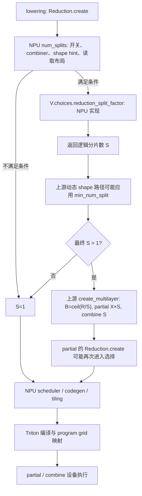
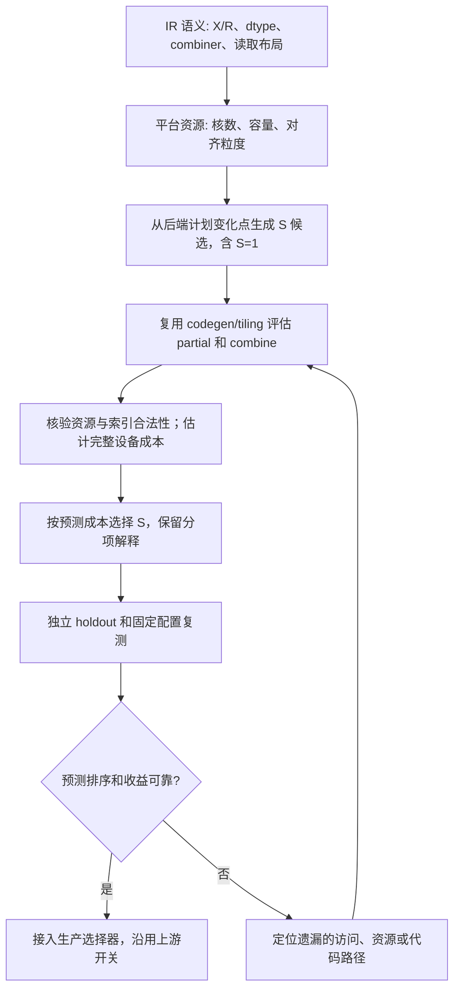

# NPU Split Reduction：S 的机制证据与算法设计

更新日期：2026-11-28。当前产品代码为
[11ca25313](https://gitcode.com/luqichao/pytorch_new/commit/11ca253135d7a2e76f1066976134784030ea4891)，
本文给出策略研究结果，**不把扫描中的最快 S 当成已经验收的生产算法**。
当前产品启发式需要修改；本轮先完成机制验证、可复现实验和设计约束，没有用另一组经验阈值替换它。

## 场景和问题

对 X 个输出，每个输出规约 R 个元素。split reduction 把每组输入分成 S 片，先产生 X×S 个 partial，
再沿 S 合并成 X 个输出。用户举出的 `[1,128,128]` 是说明拆分可能改善性能的例子，
不意味着 S 应固定为 128，也不意味着必须保持输入 shape 的某一维作为 S。

需要解释的是：为什么这个输入应拆、为什么选择这个 S、为什么更小或更大的 S 不合适。
仅依据某次测速设置 `R>=262144`、`S<=核数`、`X>C/4 不拆`，不能回答这些问题。
原 quick 数据每个场景仅比较一个固定候选和 S=1，不能排除更大的 S 获益。

本轮在 Ascend950PR_9579、56 Vector 核、Torch 2.13 / torch_npu 2.13、Triton 3.6、CANN 9.1.0 上验证。
原始数据位于本机 `data/npu_num_splits_dev/`，远端均在已有 NPU_A5 容器的
`/home/l30023782/PTA_213/npu-split-redesign-20261128-*` 目录。
最终摘要见 [S 机制实验结果](assets/npu-split-factor-evidence-20261128.json)，
复现入口见 [search_s.py 使用说明](../../../scripts/tests/npu_split_calibration/README.md#研究-s-与底层实现的关系)。

源码核验入口（均对应当前实现提交）：

| 证据 | 代码位置 |
| --- | --- |
| NPU 选择入口和读取布局 | [ir.py](https://gitcode.com/luqichao/pytorch_new/blob/11ca253135d7a2e76f1066976134784030ea4891/torch_npu/_inductor/ir.py)，`num_splits` / `_reduction_hint` |
| 当前 S 规则和 patch 接线 | [choices.py](https://gitcode.com/luqichao/pytorch_new/blob/11ca253135d7a2e76f1066976134784030ea4891/torch_npu/_inductor/choices.py)，`reduction_split_factor` / `patch_inductor_choices` |
| 平台预算与有效核数 | [config.py](https://gitcode.com/luqichao/pytorch_new/blob/11ca253135d7a2e76f1066976134784030ea4891/torch_npu/_inductor/config.py)，`ub_size` / `_obtain_and_limit_cube_vector_core_num` |
| 32 字节粒度、BLOCK/SUB、program 计算 | [tile_generator.py](https://gitcode.com/luqichao/pytorch_new/blob/11ca253135d7a2e76f1066976134784030ea4891/torch_npu/_inductor/runtime/tile_generator.py)，`aligned_numel_32byte` / `calculate_total_programs` / `fill_config` |
| persistent 阈值与生成路径 | [codegen/triton.py](https://gitcode.com/luqichao/pytorch_new/blob/11ca253135d7a2e76f1066976134784030ea4891/torch_npu/_inductor/codegen/triton.py)，`should_use_persistent_reduction` |
| 编译器 UB 报告、grid 和 CostModel 接口 | [runtime/triton_heuristics.py](https://gitcode.com/luqichao/pytorch_new/blob/11ca253135d7a2e76f1066976134784030ea4891/torch_npu/_inductor/runtime/triton_heuristics.py)，`required_ub_bits` / `_interpret_args_grid` / `NPUCostModelAutotuner` |

实验实际使用的已安装后端与本地 `config.py`、`tile_generator.py`、`triton_heuristics.py` 已核对内容一致。
已安装 Triton 源码与 CANN 平台文件另外保存在本机 `data/npu_num_splits_dev/backend-evidence/`，
不把工具包二进制或全量生成代码提交到文档仓库。

## S 从哪里产生，何时使用

旧版 `b91c0f0d` 中，NPU `ir.py` 自己定义了同名局部函数，计算非 1 规约维度的最小值；
`num_splits` 在函数体内直接绑定并调用它。只 patch `Reduction.num_splits` 就可以接入，
不需要另外 patch 上游 Choices。它不是 CUDA 的 `InductorChoices.reduction_split_factor`。
旧版还对“标量输出且只有一个动态规约轴”返回 S=1。

旧局部函数对 `[128,128]` 返回 128，对 `[16384]` 返回 16384。
后一种是退化分片：每片只有一个元素，本轮实际生成代码中第一阶段被消去，只剩一个 reduction kernel。
因此不能把旧返回值 16384 描述为实际发射了 16384 个 partial program。

当前版接入上游已有的 `InductorChoices.reduction_split_factor(device,R,X,inner_reduction)` 扩展点：



普通、静态、通过准入检查的原始归约，其候选 S 来自 Choices。不是所有最终 S 都只由这个函数决定：
准入检查可直接返回 1；动态路径会用上游 `min_num_split` 调整；partial 的递归构造也会再次进入选择。
S 是 IR 算法分片数，不是 UB tile 长度，也不是 launch grid。

CUDA 也实现同名 Choices 接口，但使用 SM/warp/线程限制等 GPU 执行模型。
NPU 应保留接口、开关和 multilayer 构造，自己解释目标设备的执行成本。
本轮实验通过进程内 hook 控制候选，没有引入产品 force 参数或新配置。

## 底层证据支持哪些约束

### 1. 硬件与 SDK 参数确定容量、粒度和并行资源，不直接给出最优 S

目标机的 `torch.npu.get_device_properties()` 返回 56 个 Vector 核。
CANN 的 `Ascend950PR_9579.ini` 与之对应：

```ini
[SoCInfo]
cube_core_cnt=28
vector_core_cnt=56
l2_size=134217728
[AICoreSpec]
ub_size=253952
ubblock_size=32
```

这分别提供并行资源、128 MiB L2、平台暴露的 248 KiB UB 和 32 字节 UB 块粒度。
注意，NPU `config.ub_size` 和 Triton 架构表使用 256 KiB 原始容量；
Triton 图优化还使用原始容量的 80% 作为保守预算。**三个数字属于不同软件层的口径**，
本轮没有证明平台差额的具体保留用途，不能混用为“每片最多规约多少元素”。

资源可行性最终需要编译器分配报告核验。FP32 sum、X=1、R=1048576、S=2048 的 partial，
实际报告 49216 字节 UB；combine 为 8224 字节。
报告由 `ENABLE_PRINT_UB_BITS=1` 使下层编译器输出 `UB size = ... bits` 后取得。
未输出时 metadata 默认 0；本轮将其标为“未知”，没有解释成零占用。

32 字节粒度同时能在 `runtime/tile_generator.py::aligned_numel_32byte` 中找到。
它可以支持对齐候选生成，但不证明“非对齐 S 必然慢”或“S 必须为 2 的幂”。
实际地址由 B、输入 stride、dtype 和 tile 共同决定。

### 2. S、逻辑 program、设备发射块和物理核数必须区分

上游 `create_multilayer` 先计算 `B=ceil(R/S)`。对于连续输入，partial 地址可写为：

```text
input[x*R + s*B + r]，其中 0<=s<S、0<=r<B，并用 mask 处理尾部。
```

NPU 后端再决定两个量：`BLOCK` 控制每个逻辑 program 的工作范围，
`BLOCK_SUB` 控制单次循环处理的 tile。
`TileGenerator.calculate_total_programs` 对 split axes 计算 `Π ceil(axis_numel/BLOCK)`。
lowering 返回 S 时，这些量还没有选出。

FP32 sum、X=1、R=65536 的独立配对复测中：

| S | B | partial XBLOCK | partial XBLOCK_SUB | partial R_SUB | profiler partial Block Num | 完整耗时 μs |
| ---: | ---: | ---: | ---: | ---: | ---: | ---: |
| 1 | 65536 | — | — | 8192 | 1 | 4.0475 |
| 128 | 512 | 8 | 8 | 512 | 16 | 2.4050 |
| 256 | 256 | 16 | 16 | 256 | 16 | 2.3392 |
| 512 | 128 | 32 | 32 | 128 | 16 | 2.3807 |
| 1024 | 64 | 64 | 64 | 64 | 16 | 2.4394 |
| 2048 | 32 | 128 | 128 | 32 | 16 | 2.6038 |
| 4096 | 16 | 256 | 256 | 16 | 16 | 3.0672 |

这里 S 从 128 到 4096，设备实际发射块数一直是 16。
每块处理的元素数相同，但二维计算形状、横向规约、partial 写出和 combine 长度改变。
这直接否定了“S 就是并行核数”的解释，也否定了“填满 56 核后更大 S 没有意义”的剪枝。
反过来，S=4096 也没有继续获益。

Triton-Ascend 还可能应用 program-grid mapping / AutoBlockify。
脚本分别记录 Inductor 逻辑 grid、compiler metadata 和 profiler `Block Num`；
`Block Num` 本身也不表示同时驻留核数。

### 3. 局部循环与 persistent 路径是 S 影响性能的另一条链路

`codegen/triton.py::should_use_persistent_reduction` 在 A5 上对 INNER/DEFAULT 使用基础阈值 4096，
OUTER 使用 64，并结合输入压力等条件修正。这是后端软件策略，不能当作芯片规格。
在本轮 X=1、R=1048576 的连续 FP32 sum 中，S=128 时 B=8192，partial 仍有规约循环；
S=256 时 B=4096，partial 切换为 persistent。S 更大时，核内二维 tile 和打包方式继续改变。

| S | partial 路径 | partial 发射块数 | partial μs | combine μs | 完整 μs |
| ---: | --- | ---: | ---: | ---: | ---: |
| 56 | loop | 56 | 6.202 | 0.815 | 7.014 |
| 128 | loop | 32 | 3.870 | 0.826 | 4.692 |
| 256 | persistent | 43 | 3.639 | 0.872 | 4.497 |
| 1024 | persistent | 43 | 2.943 | 0.860 | 3.812 |
| 2048 | persistent | 43 | 2.716 | 0.902 | 3.614 |
| 4096 | persistent | 43 | 2.845 | 1.076 | 3.930 |
| 8192 | persistent | 43 | 2.808 | 1.869 | 4.678 |

各分项和完整耗时分别取批次中位数，因此分项中位数相加不保证恰好等于完整中位数。
8192 时 combine 又进入 loop 路径。S=2048 是本次候选中的最低值，
它支持“需要考虑局部规约和 combine”的机制，不能推导成所有标量归约都取 2048。

同样的 R，FP16/BF16 在本轮 S=1024 的 partial 分别约 8.40/9.00 μs，
S=4096 分别约 2.97/3.60 μs；amax 的最佳候选则是 S=1024。
这说明只输入 X/R/INNER 布尔值不足以表达 dtype、累加类型和算子的执行代价。
FP16/BF16 的 partial 沿用上游 FP32 中间结果，不能用输入的 2 字节直接估算 partial 大小。

### 4. 对齐、stride 和 codegen 路径变化会制造性能突变

把 R=65536 改成 65537，S=256 的 B 从 256 变成 257。
同一实验族完整耗时从约 2.34 μs 变成约 3.98 μs；后者 S=1 约 4.41 μs。
生成的索引、mask、tile 和代码路径随之变化。这个对照证明尾块必须进入模型，
尚不能把全部差异单独归因于某一个访存对齐指令。

FP32 outer、X=14、R=262144 的现象更明显：S=4 约 238.94 μs，S=256 约 19.33 μs。
S=4 生成三维 index 路径并选 SIMT template；S=256 则进入现有 no-linear codegen，
最终选 `simt_only`。其生成 load 为：

```python
tmp0 = tl.load(in_ptr0 + (x0 + 14*r0_2 + 14336*x1), r0_mask & xmask, eviction_policy='evict_first', other=0.0)
```

两者 partial 发射块数都是 56，收益不能解释为“多用了核”。
S=512 的 partial 约 14.06 μs，但 combine 约 5.49 μs；S=4096 总耗时又升至约 53.44 μs。
不能把现有 codegen fallback 带来的收益拟合成通用 `R/S` 阈值；需要继续区分 indexing/调度限制和算法本身。

### 5. 历史回退必须在相同 kernel 配置下复现，才能成为规则证据

旧 probe 的 X=28、R=1048576、S=2 测得约 140.80 μs，新粗扫约 33.40 μs。
已确认两阶段 DSL body 一致；旧缓存中 partial 的 `R2BLOCK_SUB=8192`，新粗扫为 16384，
两次测试的 autotune/cache 设置也不同。

本轮直接重放同一生成 DSL、同一卡和同一输入，固定其它参数及 combine：
8192 tile 为 39.07 μs，16384 tile 为 32.66 μs，两者精度通过。
所以 tile 差异能解释部分变化，**不能解释旧 140.80 μs 的全部回退**。
同样，重新测试 `max_autotune=False/True` 都能让 S=2 获益，不能简单归因于该开关。
旧异常还缺少设备状态、输入地址/cache 状态等证据，不能据此写全局 `4*X>C → S=1`。
128 MiB L2 的平台参数也提示 hot 工作集需要单独记录；容量大小本身不能证明 cache 命中率。

## 最终算法应该优化什么

目标是从计算语义与执行计划得出 S；扫描用于检验解释和发现模型遗漏。
建议把决策对象定义为 **S 和该 S 下可达的 tiling/代码路径**：

```text
S* = argmin over legal S, including S=1:
       min over legal tilings θp, θc:
         Tpartial(S, θp) + Tcombine(S, θc)
```

S=1 使用单阶段实际计划，不能把它机械代入“两次 launch”。
这是设备 kernel duration 的优化目标；若要宣称端到端收益，还需要另计 host dispatch、同步和框架成本。
本轮的 profiler 数据没有计入这些间隙。

每阶段成本可以分解为以下可检验项，而不是给 shape 配一个固定 S：

```text
Tstage ≈ 固定设备任务成本 + 调度成本(P)
         + 各个执行批次中最慢块的 {
             pipeline_overlap(实际访存字节/有效带宽, 局部算子/规约代价)
             + tile 循环与索引/mask 代价
           }
```

`P` 来自后端 grid/映射，不用 X×S 代替；`ceil(P/C)` 只能作为简单 wave 估计，
实际还受每块工作量不均、runtime 映射和带宽共享影响。
`pipeline_overlap` 由执行路径和 multibuffer 决定，不能无证据地统一取 max 或直接相加。
有效带宽必须区分访问布局和 cache 条件，不把 SDK 配置里的 rate 数字直接当作实测 GB/s。

| 模型项 | 能从哪里得到 | 本轮证据支持的用途 |
| --- | --- | --- |
| R、X、dtype、combiner、读取 stride | NPU `num_splits` 已有参数及 dependency 分析 | 原始工作量、累加类型、连续/离散访问和尾块 |
| B=ceil(R/S)、partial 元素数 | 上游 multilayer IR | 每片工作、mask、combine 长度 |
| partial 字节数 | X×S×上游 partial dtype 字节数 | 写出与读回共约 2XSd 字节；多输出归约逐项计数 |
| BLOCK/SUB、循环次数、grid | 复用 NPU split/tiling 逻辑 | 打包、局部循环、发射块数及负载不均 |
| UB/局部资源 | 编译器实际报告与目标平台预算 | 合法性、路径差异；不能用 B×输入字节代替活跃缓冲区总量 |
| persistent / no-linear / SIMT 路径 | 现有 codegen 与编译配置 | 解释阶段切换；不是新增 selector 白名单 |
| 访存与算子代价 | 低层 IR、现有 CostModel、固定配置微基准 | 可解释预测；需要校准和独立验证 |
| 不拆收益基准 | 同一输入的单阶段计划 | 决定额外阶段是否值得，而非固定 R 门槛 |

候选生成应围绕可解释的变化点：后端合法 tile 粒度、B 的整除/尾块变化、
persistent/loop 的已有边界、program 打包和循环数变化、combine 的已有边界。
必须包含 S=1，允许 S>C；不能把上界设为核数，也不能预先排除 X≥C。
候选剪枝需要下界或已验证的预测误差，不能因为某个小 S 慢就删掉所有大 S。
非线性的代码路径意味着单调二分搜索并不成立。



这里的成本分解、候选生成原则是**待验证的设计**，还不是一个已校准的时间预测器。
现有 NPU `NPUCostModelAutotuner` 已经能为候选 tile 生成 TTIR，调用
`triton.backends.ascend.runtime.costmodel_runtime.costmodel_bench` 做静态预测；
它目前只用于单个 kernel 的 tiling 预筛选，没有比较不同 S，也没有覆盖完整 partial/combine 图的决策。
可以复用该能力做候选评分实验，不能把“已有 CostModel”视为预测准确性的证明。

已安装 `costmodel_runtime.py` 还暴露了一个具体限制：默认硬件配置搜索的是 `ascend_910b.json`，
且 `_build_costmodel_extra_args` 在存在 `arg_bindings` 时只向 in-process parser 传递绑定，
不同时传递 `hardware_config`。因此本轮不能确认它按这台 A5 的硬件参数完成预测。
在验证实际生效的硬件模型、局部执行路径和完整阶段成本前，不应直接拿这个预测值决定产品 S。

## 对代码结构的要求

当前 Choices 只接收 `device/R/X/inner`，而上述证据要求 dtype、读取布局、代码路径、tile 与 combine 资源。
如果仍把全部决策压进这个四参数函数，就必须接受它只是有限的近似，不能声称掌握实际 kernel 成本。

实现阶段应先确定在哪里取得这些信息：

1. 轻量静态方案：在现有 NPU `num_splits` 分析语义，复用可共享的后端资源/tiling 估计器，
   再通过上游接口完成 multilayer 构造。避免复制一套 dtype、算子或 persistent 阈值表。
2. 若静态估计不能可靠预测代码路径，就需要在已有编译选择设施中比较少量候选完整计划，
   并限制编译成本、保留单阶段对照。当前单 kernel 的 tiling autotune 无法直接替代这项图级选择。

两种接入都沿用上游 `split_reductions`、`min_num_split` 和既有 autotune 配置，
不增加 NPU mode/policy/force 参数。最终选哪种结构，需要预测器在独立数据上证明收益后决定；
本轮不把尚未实现的计划枚举描述成现有功能。

## 当前验收状态

已完成 20 个 FP32 sum 场景的粗扫，共 148 个变体；另完成 10 个定向场景、62 个变体，
以及相同 S=2 的两个固定 tile 重放。定向场景覆盖 S 最大 8192、尾块、FP16/BF16、amax、outer 和编译选项。
定向测量全部 device CSV 行通过 kernel 序列/任务数检查，精度通过；CSV 与生成代码已按 SHA256 收回本机。
最终脚本补齐 profiler 发射块数与后端源码指纹后，另以 current/S=1/S=256 三个变体做设备 smoke，
1440 条 device CSV 行校验通过；S=256 记录 partial/combine 为 16/1 块、UB 为 49280/1056 字节。
脚本语法、CLI、文档相对链接与 Git diff 检查通过。

明确支持的结论是：当前最小 R 门槛、按 X 限制拆分和以 C 限制 S 的策略都不足；
S 必须与实际 tiling、代码路径、局部资源和 combine 成本联合解释。
尚未完成跨型号 NPU、融合图、动态 shape、普通归约全 dtype/op 矩阵，以及预测算法冻结后的独立 holdout。
本轮最佳候选不作为新生产阈值；不能宣称已得到跨场景最优 S 算法。
