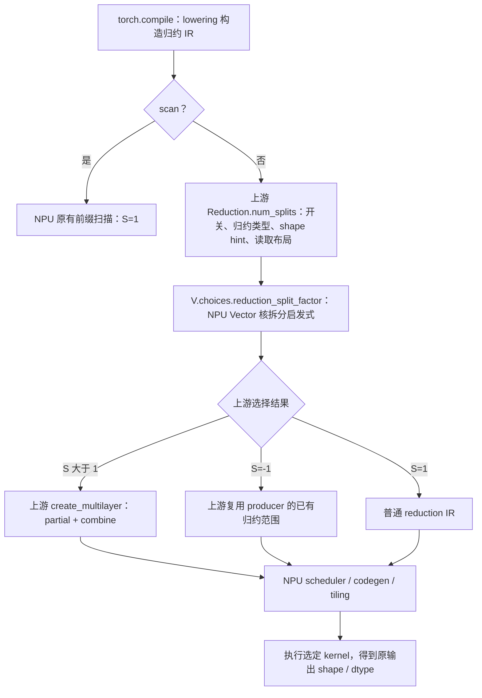

更新日期：2026-11-27。实现分支：`pytorch_new/feat/npu-num-splits`，未合入主干。
代码版本：[bc0838ae1](https://gitcode.com/luqichao/pytorch_new/commit/bc0838ae1)。
本页描述当前调用链；[需求规格](npu-split-reduction-requirements.md)中的性能指标仍须独立验收。
实验采集方式见[测试脚本说明](../../../scripts/tests/npu_split_calibration/README.md)。

# NPU Split Reduction 当前实现

NPU 通过上游已有的 `InductorChoices.reduction_split_factor(device, R, X, inner_reduction)`
接口选择拆分数，直接复用 `Reduction.num_splits` 的通用逻辑，以及 `create_multilayer` /
`create_multilayer_helper` 的 partial/combine 构造。用户开关沿用上游 `split_reductions`。
本实现没有新增 NPU split 配置、策略表、selector 版本标记、dtype 或 FX 节点白名单。

## 调用流程



这项选择发生在编译期。NPU 后端加载时安装已有 choices 接口的实现，
选择路径不再判断 `device.type`，也不另做 backend 环境变量分派。
scan 保留原来的单 program 前缀传递；它与普通 reduction 的两阶段拆分是不同算法。
上游 SplitScan 依赖另一套 look-back workspace/atomic 协议，本次不扩展该能力。

## 与上游的职责对应

| 职责 | 实现位置 |
| --- | --- |
| 总开关、归约类型规则、符号尺寸 hint、INNER/OUTER 分类、producer 范围复用 | 直接调用上游 `torch._inductor.ir.Reduction.num_splits` |
| NPU 的 S 启发式 | [choices.py](https://gitcode.com/luqichao/pytorch_new/blob/feat/npu-num-splits/torch_npu/_inductor/choices.py)：同签名替换 `InductorChoices.reduction_split_factor` |
| scan 适配及选择入口接线 | [ir.py](https://gitcode.com/luqichao/pytorch_new/blob/feat/npu-num-splits/torch_npu/_inductor/ir.py) |
| 分片索引、尾块 mask、单位元、中间 dtype、合并与动态 `min_num_split` | 上游 `Reduction.create` / `create_multilayer*` |
| 实际 kernel、局部 tiling 和融合 | 现有 NPU scheduler / codegen / runtime |
| 选择器与设备验证 | [test_npu_num_splits.py](https://gitcode.com/luqichao/pytorch_new/blob/feat/npu-num-splits/test/_inductor/test_npu_num_splits.py) |

`reduction_split_factor` 是上游现有扩展点，不是新增配置。CUDA 的实现会读取 SM 数、warp 大小、
每 SM 线程数和架构阈值，返回一个 S。NPU 在同一个接口读取有效 Vector 核数；
不复制 CUDA 的线程执行模型，也不复制上游已有的归约定义。

上游的归约类型排除条件直接执行原函数，不在 NPU 中维护另一份列表。
合法 dtype、单位元和 partial dtype 继续由 lowering / 上游 IR / NPU codegen 处理。
移除 selector 白名单不代表所有 ATen 算子都会改变 lowering：已有 fallback 注册继续决定其路径。
动态维度按上游 sizevars 规则使用 hint 和符号索引，不再因为含符号就统一返回 S=1。
融合 producer/consumer、多归约和非连续读入也不再受额外的 FX 单节点条件限制。

## 配置与示例

```python
import torch
import torch_npu

compiled = torch.compile(
    lambda x: x.sum(-1),
    fullgraph=True,
    options={"split_reductions": True},
)
```

`split_reductions=True` 允许上游选择拆分，并不保证每个归约的 S 都大于 1；
`split_reductions=False` 关闭普通 reduction 拆分。
默认值、`TORCHINDUCTOR_SPLIT_REDUCTIONS` 和动态 shape 的 `min_num_split` 均由上游管理。
NPU 未增加其他开关或配置注册，也未添加 split 专属的图缓存补丁。

令 X 为输出数量、R 为每个输出的归约元素数、C 为目标设备有效 Vector 核数。
C 通过既有核数查询获得，遵守仓库已有的 `NPU_DEVICE_LIMIT`。当前启发式为：

```text
S = max(1, min(ceil(C / X), floor(R / 256)))
```

X 小于 1 或 R 小于 512 时直接返回 1。256 是每片最小工作量的启发式常量，
不是配置、UB 容量限制或已证明的收益边界。inner 与 outer 当前使用同一估计，
上游仍保留不同的 ReductionHint，交给 NPU codegen。

例如输入 `[14, 65536]` 沿末维求和，C=56 时，S=4：

```text
输入 [14, 65536]
  → partial：每个输出拆成 4 片，每片 16384 个元素
  → 中间结果 [14, 4]
  → combine：沿 4 个 partial 再归约
  → 输出 [14]
```

partial 的输出量变成 X*S，归约长度变成 ceil(R/S)。该公式使下一层 partial 已有足够输出，
或每片工作量已不足以继续拆分，因此不需要增加递归深度开关。
实际 program 数取决于后续 tiling，`X*S` 只是逻辑 partial 数，不等于实际 grid。

## 当前数据说明的性能边界

已有 Ascend950PR_9579、56 Vector 核的 hot quick 数据共 574 条有效结果：
237 WIN、244 REGRESSION、21 UNCERTAIN、72 NO_SPLIT。
数据使用实验 ordinary_ir lowering 与当时的编译环境，比较固定候选和 S=1；
不能作为当前产品路径所有布局、dtype 和融合上下文的性能验收。

同一 sum FP32、X=28、S=2 的例子中，R=262144 时由 16.52 μs 降至 12.13 μs，
R=1048576 时却由 55.32 μs 增至 142.36 μs。
这说明只按核数补足并行度不足以保证收益，且 R 增大不意味着收益单调增加。
应继续改进既有 choices 接口内的 NPU 启发式，并验证完整 forward 的 partial+combine 耗时；
实验表用于分析，不是用户需要提供的产品配置。此次接口修正不构成性能验收通过。

## 验证

```bash
python test/_inductor/test_npu_num_splits.py
```

选择器测试覆盖上游开关与特殊归约规则、无额外 dtype 白名单、INNER/OUTER 和融合读取、
符号 shape、scan 及 patch 接线。设备用例覆盖 FP16/BF16/FP32 partial dtype 与尾块、
动态 shape、开关对照、融合前后计算、outer reduction、标量和多归约、Welford。
设备结果与相同输入的 eager 对比；测试不引入额外产品配置。

2026-11-27 验证结果：本地 7 项选择器/接线测试通过；NPU_A5 容器的
Ascend950PR_9579、Torch 2.13.0 环境通过 12 项测试（同样的 7 项加 5 项真实编译执行），
并通过 4 项既有 scan 选择/codegen 回归。语法、FLAKE8、SPACES、TABS、NEWLINE 和 diff 检查通过。
设备验证使用 SHA256 核对后的进程内源码覆盖，复用已安装的后端和二进制，未重建 wheel。

另外检查了动态 sum 和 Welford 的实际生成代码：两者均保留 partial/combine 两次 kernel launch，
动态 sum 中间张量为 `[s97, 28]`，Welford 为三份 `[2, 28]` 状态。
这两个用例的 index codegen 分支仍会产生诊断异常，随后由仓库已有的
`NPUCombinedScheduling.codegen_node` 切换到 no-linear codegen 并成功执行。
因此上述 PASS 证明当前成功路径的语义，不代表 index codegen 的该项限制已经修复。
本次未重跑完整 hot 性能矩阵，也未声明所有 shape、dtype 或设备均已验收。
