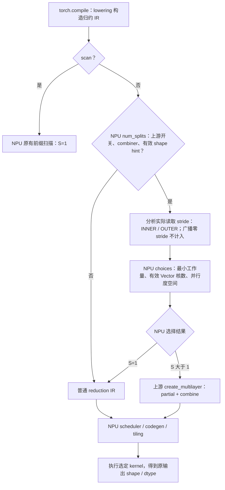

更新日期：2026-11-28。实现分支：`pytorch_new/feat/npu-num-splits`，未合入主干。
代码版本：[11ca25313](https://gitcode.com/luqichao/pytorch_new/commit/11ca253135d7a2e76f1066976134784030ea4891)。
本页描述 NPU 独立选择流程；[需求规格](npu-split-reduction-requirements.md)中的性能指标仍须独立验收。
实验采集方式见[测试脚本说明](../../../scripts/tests/npu_split_calibration/README.md)，本轮汇总见[验证与性能结果](assets/npu-split-redesign-20261128.json)。

# NPU Split Reduction 当前实现

NPU 自己实现 `Reduction.num_splits` 的选择流程，通过上游已有的
`InductorChoices.reduction_split_factor(device, R, X, inner_reduction)` 接口计算拆分数。
上游 `create_multilayer` / `create_multilayer_helper` 负责 partial/combine IR 构造。
用户开关沿用上游 `split_reductions`。
本实现没有新增 NPU split 配置、策略表、selector 版本标记、dtype 或 FX 节点白名单。

## 调用流程



这项选择发生在编译期。NPU 后端加载时安装已有 choices 接口的实现，
选择路径不再判断 `device.type`，也不另做 backend 环境变量分派。
scan 保留原来的单 program 前缀传递；它与普通 reduction 的两阶段拆分是不同算法。
上游 SplitScan 依赖另一套 look-back workspace/atomic 协议，本次不扩展该能力。

## 与上游的职责对应

| 职责 | 实现位置 |
| --- | --- |
| 总开关与普通归约定义 | 引用上游 `config.split_reductions`、`REDUCTION_COMBINE_FN` |
| 符号尺寸和读取依赖 | 使用上游 `sizevars`、`dependencies.extract_read_writes` 基础工具 |
| NPU 支持条件、INNER/OUTER 分类和拆分决策 | NPU `ir.py::num_splits`；不调用上游选择函数 |
| NPU 的 S 启发式 | [choices.py](https://gitcode.com/luqichao/pytorch_new/blob/11ca253135d7a2e76f1066976134784030ea4891/torch_npu/_inductor/choices.py)：同签名替换 `InductorChoices.reduction_split_factor` |
| scan 适配及选择入口接线 | [ir.py](https://gitcode.com/luqichao/pytorch_new/blob/11ca253135d7a2e76f1066976134784030ea4891/torch_npu/_inductor/ir.py) |
| 分片索引、尾块 mask、单位元、中间 dtype、合并与动态 `min_num_split` | 上游 `Reduction.create` / `create_multilayer*` |
| 实际 kernel、局部 tiling 和融合 | 现有 NPU scheduler / codegen / runtime |
| 选择器与设备验证 | [test_npu_num_splits.py](https://gitcode.com/luqichao/pytorch_new/blob/11ca253135d7a2e76f1066976134784030ea4891/test/_inductor/test_npu_num_splits.py) |

`reduction_split_factor` 是上游现有扩展点，不是新增配置。CUDA 的实现会读取 SM 数、warp 大小、
每 SM 线程数和架构阈值，返回一个 S。NPU 在同一个接口读取有效 Vector 核数；
不复制 CUDA 的线程执行模型，也不复制上游已有的归约定义。

上游 `num_splits` 还包含 `num_sm * 2 * 32` 等硬件判断，不能整体当作通用流程调用。
NPU 选择器不读取 GPU SM/warp 属性。普通归约直接引用上游 combiner 字典；
dot 保留原有路径，Welford 使用上游独立的多输出构造器，scan 保留 NPU 单 program 算法。
当前选择器只返回 S≥1，不使用上游的 S=-1 producer 范围复用捷径，避免绕开 NPU 的工作量判断。
合法 dtype、单位元和 partial dtype 继续由 lowering / 上游 IR / NPU codegen 处理。
移除 selector 白名单不代表所有 ATen 算子都会改变 lowering：已有 fallback 注册继续决定其路径。
动态维度按上游 sizevars 规则使用 hint 和符号索引，不再因为含符号就统一返回 S=1。
融合 producer/consumer、多归约和非连续读入也不再受额外的 FX 单节点条件限制。

## 配置与示例

```python
import torch
import torch_npu

compiled = torch.compile(
    lambda x: x.sum(-1),
    fullgraph=True,
    options={"split_reductions": True},
)
```

`split_reductions=True` 允许 NPU 选择拆分，并不保证每个归约的 S 都大于 1；
`split_reductions=False` 关闭普通 reduction 拆分。
默认值、`TORCHINDUCTOR_SPLIT_REDUCTIONS` 和动态 shape 的 `min_num_split` 均由上游管理。
NPU 未增加其他开关或配置注册，也未添加 split 专属的图缓存补丁。

令 X 为输出数量、R 为每个输出的归约元素数、C 为目标设备有效 Vector 核数。
C 通过既有核数查询获得，遵守仓库已有的 `NPU_DEVICE_LIMIT`。当前启发式为：

```text
R < 262144 或 X < 1 或 X >= C：S = 1
INNER 且 4*X > C：S = 1
否则：
S = max(1, min(ceil(C / X), floor(R / 4096)))
```

262144 用于摊薄第二个 kernel 的开销，4096 避免过小分片。
这些是基于 A5 数据的内部启发式常量，不是用户配置或 UB 容量。
S 以填满有效核数为目标；逻辑 partial 数 X*S 可能略超过 C，实际 grid 由 tiling 决定。
inner 额外要求至少四倍输出并行度空间，以避免仅补足剩余一半核的已测回退；
outer 保留 X<C 的条件，并使用不同 ReductionHint。
X 不能代替实际 program 数，尤其 outer/fused 归约可能由一个 program 处理多个输出。
这版没有声称对 X≥C 的 outer 归约完成性能优化。

例如输入 `[14, 1048576]` 沿末维求和，C=56 时，S=4：

```text
输入 [14, 1048576]
  → partial：每个输出拆成 4 片，每片 262144 个元素
  → 中间结果 [14, 4]
  → combine：沿 4 个 partial 再归约
  → 输出 [14]
```

partial 的输出量变成 X*S，归约长度变成 ceil(R/S)。进入拆分时 R≥262144，
常规 NPU 核数下 X*S 已达到 C，下一层不再拆分；核数异常大时也会因工作量缩小而停止。
不增加递归深度开关。
实际 program 数取决于后续 tiling，`X*S` 只是逻辑 partial 数，不等于实际 grid。

## 当前数据说明的性能边界

已有 Ascend950PR_9579、56 Vector 核的 hot quick 数据共 574 条有效结果：
237 WIN、244 REGRESSION、21 UNCERTAIN、72 NO_SPLIT。
数据使用实验 ordinary_ir lowering 与当时的编译环境，比较固定候选和 S=1；
不能作为当前产品路径所有布局、dtype 和融合上下文的性能验收。

同一 sum FP32、X=28、S=2 的例子中，R=262144 时由 16.52 μs 降至 12.13 μs，
R=1048576 时却由 55.32 μs 增至 142.36 μs。
这说明只按核数补足并行度不足以保证收益，且 R 增大不意味着收益单调增加。
新实现据此增加最小工作量和 inner 并行度条件。quick hot 中 R=65536 的 72 个组合有
50 REGRESSION、19 WIN、3 UNCERTAIN，R=262144 则为 63 WIN、8 REGRESSION、1 UNCERTAIN。
因此最小工作量是保守取舍，不能推导出所有 op/dtype 达到该值都获益。
补点数据有 89 条 PASS，部分环境指纹与 quick 不同，未把它们混为同一性能样本。
实验表用于设计和回归选点，产品不会读取该表。

在这 574 条 hot 记录上仅按新条件做静态筛选，会保留 142 个拆分点：
130 WIN、9 REGRESSION、3 UNCERTAIN；不再选择的 432 个点包含 235 REGRESSION、
107 WIN、18 UNCERTAIN 和 72 NO_SPLIT。这是对已测候选的筛选统计，不是新版本全量复测。
它说明这版明确偏向保守，也说明规则仍不能保证所有 dtype/算子获益。

同卡定向实验还比较了更多分片：FP32 inner 的 X=28、R=1048576，S=1/2/32
分别为 55.10/140.80/88.40 μs；X=14、R=1048576，S=1/4/32
分别为 53.65/18.52/20.62 μs。因此没有加入按目标分片长度不断增加 S 的规则。
这些实验通过进程内测试 hook 固定候选，产品没有固定 S 或 force 配置。

已知收益覆盖缺口：X=128、R=262144 的 FP32 outer，定向实验中 S=1 为 1844.81 μs，
S=8 为 94.82 μs，但当前保守的 X<C 条件不会选中它。优化这类场景需要估计每个 program
处理多少输出；不能把 X 直接当作实际 grid。当前实现先保留这一性能边界。

## 验证

```bash
python test/_inductor/test_npu_num_splits.py
```

选择器测试覆盖上游开关与特殊归约规则、无额外 dtype 白名单、INNER/OUTER 和融合读取、
符号 shape、scan 及 patch 接线。设备用例覆盖 FP16/BF16/FP32 partial dtype 与尾块、
动态 shape、开关对照、融合前后计算、outer reduction、标量和多归约、Welford。
设备结果与相同输入的 eager 对比；测试不引入额外产品配置。

2026-11-28 本地 9 项选择器/接线测试通过，测试显式禁止访问 GPU DeviceProperties。
设备测试额外覆盖动态标量单归约轴、动态标量加静态归约轴、strided/broadcast 输入和整数累加。
最终源码在 NPU_A5 容器的 Ascend950PR_9579 / Torch 2.13.0 环境通过 22 项测试：
9 项选择器/接线、9 项真实编译执行、4 项既有 scan 回归，零失败和跳过。
动态标量加静态轴的用例显式 `mark_static`，避免将两个轴都动态化而遗漏原保护条件。
设备测试使用 SHA256 核对的进程内源码覆盖，复用已安装的后端和二进制，没有重建 wheel。
本地语法、FLAKE8、NEWLINE、SPACES、TABS 和 diff 检查通过。

最终 selector 的 FP32 inner 直接对照如下。每个编译后完整 forward 重复执行，
按 profiler 的 device kernel duration 求和，包含 partial/combine；输入复用采用 hot。
每侧 3 批，每批 20 次；表中为批均值的中位数。没有使用 NPU Graph、Event 或 host 耗时。
测试捕获实际编译 callable、选择结果、最终 tiling 和生成代码，并禁止计时期间重编译。

| X | R | 新选择 S | 关闭 split（μs） | NPU 自动选择（μs） | 本轮观察 |
| ---: | ---: | ---: | ---: | ---: | --- |
| 1 | 65536 | 1 | 4.06 | 4.03 | 保持单阶段 |
| 14 | 262144 | 4 | 19.81 | 18.82 | 批间波动，未达到原标定的 8% 裕量 |
| 14 | 1048576 | 4 | 53.63 | 18.40 | 本轮约 2.91 倍 |
| 28 | 1048576 | 1 | 55.12 | 55.19 | 保持单阶段，避免原 S=2 的明显回退 |

按最终 tiling 和 launch 实参计算，X=14、R=1048576 的 partial 为 56 个 program，combine 为 1 个 program。
X=28、R=1048576 两侧都只有一个 kernel，最终 tiling 相同。
这些定向数据用于验证决策与已知回退，不能替代完整性能矩阵和独立 holdout。

动态归约与 Welford 仍可能触发现有 index codegen 限制，再由已有的
`NPUCombinedScheduling.codegen_node` 切换到 no-linear codegen 执行。
本次没有新增回退机制；测试通过不表示这些 index codegen 限制已经修复。
未重跑全部 op/dtype/布局性能矩阵，也未完成跨设备性能验收。
