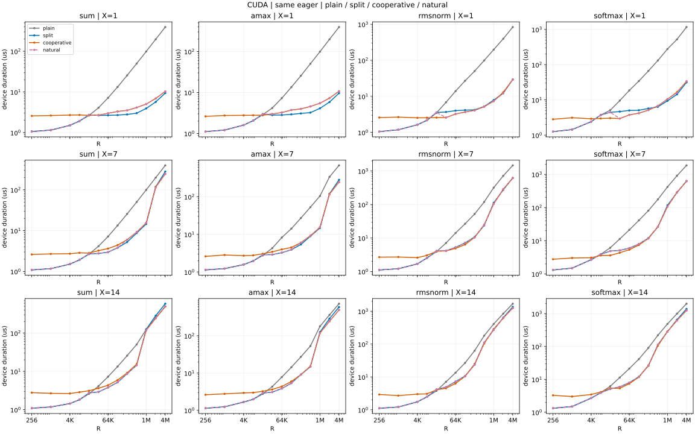
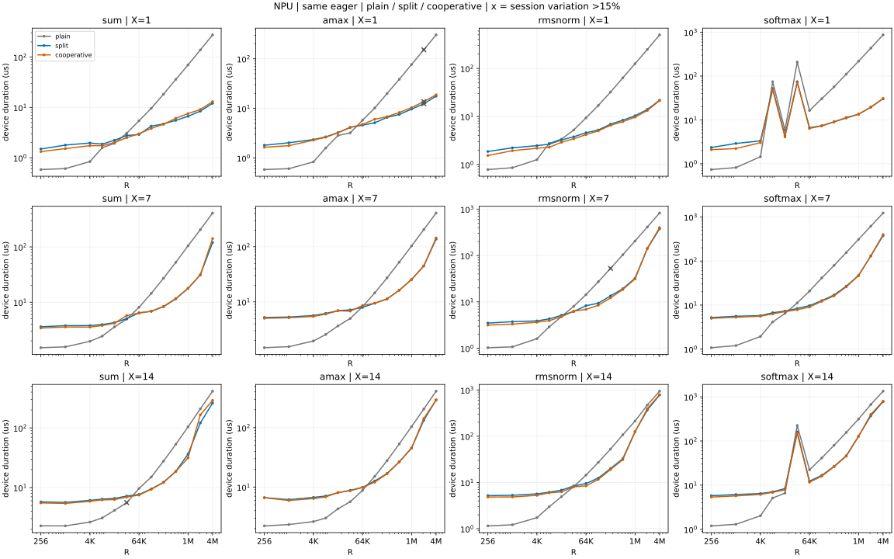
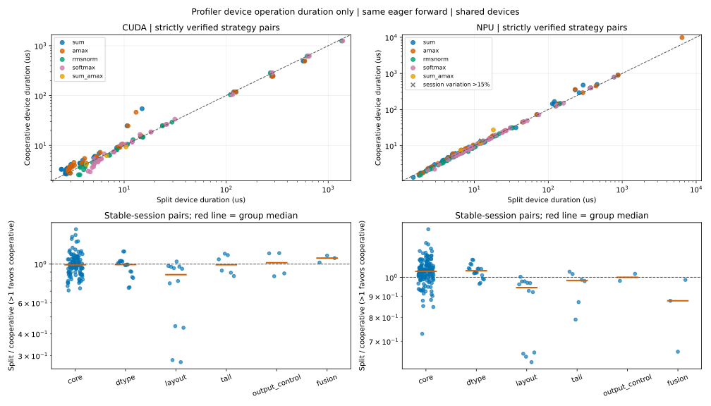
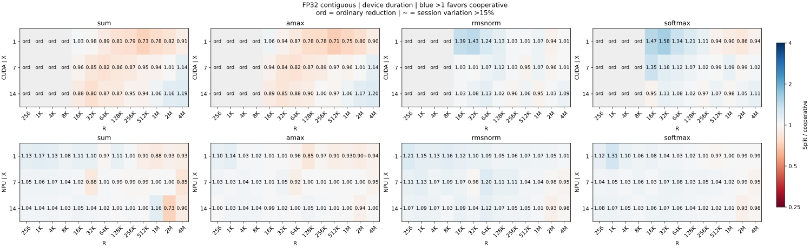

# Split 与 cooperative reduction：GPU/NPU profiler 对照

**GPU 与 NPU 的 199 组共用 eager forward 均已完成，包含关闭 split/cooperative 的 `torch.compile` 基线，以及 R=256 到 4194304 的 13 档主体扫描。** GPU 测量原生 Inductor 路径；NPU 测量原生编译基线及独立 SIMD DSL 原型。

结果支持按完整 forward 选择策略。GPU 的 sum/amax 更多由 split 获胜，短规模 RMSNorm/softmax 有明确的 cooperative 收益；NPU 原型的收益也随算子和形状变化。小 R 下关闭两项特性的基线往往更快。cooperative 是需要与 split 和基线一起评估的候选能力。

| 实现 | 完整用例 | 严格 split/cooperative 配对 | cooperative 胜 | split 胜 | 接近或方向变化 | 会话波动 >15% |
| --- | ---: | ---: | ---: | ---: | ---: | ---: |
| CUDA 原生 Inductor | 199 | 151 | 45 | 60 | 46 | 0 |
| NPU SIMD DSL 原型 | 199 | 197 | 60 | 28 | 108 | 1 |

“胜”要求 `split/cooperative>1.05`，且三个独立会话的方向一致；小于 0.95 且方向一致判 split 胜。任一参与策略的最大/最小会话中位数比超过 1.15 时，单列为 noisy，不计稳定胜负。这是预先定义的判定规则，没有构造统计置信区间。

稳定严格配对的 `split/cooperative` 几何均值为 CUDA **0.959**、NPU **1.011**。它们只描述这份人工构造的用例矩阵，不是模型集加速比。完整结果见 [398 行配对 CSV](assets/final/results.csv) 和 [JSON](assets/final/results.json)。

## 相同 forward 与完整 R 扫描

输入先在 CPU 以相同随机种子生成，再转换为指定 dtype。两端实际输入的字节摘要也进行了独立核对：55 个不同 shape/dtype 组合、213/214/215 三个种子，共 165 对输入、330 个 tensor 摘要完全一致，覆盖全部 199 个 forward。核验结论见[最终验证摘要](assets/final/validation-summary.json)。

eager 显式计算 `z=a.float()+b.float()`，再执行 sum、amax、RMSNorm、softmax 或同时返回 sum/amax，输出均为 fp32。sum 的参考在 fp32 加法后使用 CPU fp64 累加；amax 要求完全一致；RMSNorm/softmax 检查逐元素误差。fp16/bf16 用例测输入带宽和转换，不测试低精度累加。

| 类别 | 用例数 | 范围 |
| --- | ---: | --- |
| 主体 | 156 | 4 个算子，X=1/7/14，fp32 连续输入，13 档 R |
| dtype | 18 | fp16/bf16，X=1/7/14，R=262144，sum/RMSNorm/softmax |
| layout | 12 | stride-2、转置 view，X=1/7/14，R=262144，sum/amax |
| 尾块 | 6 | X=1 的 R=32767/32769；X=7 的 229375/229377；X=14 的 2097151/2097153 |
| 输出轴控制 | 4 | X=28/56，R=32768/1048576，sum |
| 多统计量 fusion | 3 | X=1/7/14，R=262144，同时返回 sum/amax |

主体 R 为 `256,1024,4096,8192,16384,32768,65536,131072,262144,524288,1048576,2097152,4194304`。X=1 的转置 view 实际仍连续，作为布局控制保留；X=7/14 的真实 stride 不同。

下图包含 plain、requested split、forced cooperative；CUDA 另含 natural。全部点均来自本次 profiler，横纵轴为对数坐标，单位 µs。叉号标记会话变化超过 15% 的策略测量。





## 环境与测量口径

| 项目 | CUDA | NPU |
| --- | --- | --- |
| 设备 | RTX 4090，128 SM，物理卡 6/7 | Ascend950PR，本实验有效 56 Vector 核 |
| 环境 | `GPU_4090` 的 `pytorch-dev-gpu67` 容器 | `NPU_A5` 的 `pta_213_case` conda 环境 |
| PyTorch | 2.13.0+cu126，`cf30153c4c13` | 2.13.0+cpu，同一提交 |
| 后端 | Triton 3.7.1，CUDA 12.6 | torch_npu 2.13.0+git93d7d01，Triton 3.6.0 |
| 路径 | plain、split、forced cooperative、natural | plain、调优 split、调优 debug cooperative |

CUDA 每个策略从同一 eager 直接 `torch.compile`：静态 fullgraph、`max_autotune=True`，禁用 Inductor 自动 CUDA Graph。plain 关闭两项特性；split 仅开启 split；cooperative 关闭 split 并 force；natural 同时开启两项而不 force。NPU plain 也关闭两项特性，DSL 原型另行编译，不把上游 CUDA 开关解释成已经接入 NPU 的优化。

两端都在正常编译、精度检查和预热后用外部 Graph 批量提交。每个确认策略使用 3 个独立 profiler 会话，每会话 3 批，每批 5 次完整 forward；`X*R>33554432` 的 case 两端统一减为每批 3 次，以控制 Graph 输出保留内存。策略顺序交替，最终取三个会话中位数的中位数。

**指标为一次完整 forward 内全部必要 device operation duration 的和。** CUDA 包含 cooperative semaphore 初始化；NPU 从 Level0 `kernel_details.csv` 读取设备 duration。CPU duration 仅辅助归属，不进入性能数据。计时不含 kernel 间空隙，不能据此量化减少 launch 的 CPU 或端到端收益。

CUDA 按同步包围的标签归属 device events。NPU host/device 时钟有偏移，因此按单 stream 的完整设备顺序严格匹配 split 的 `partial,finish`、cooperative 的单 kernel 及 baseline 的重复模式。多余、缺失或次数不符均报错。CUDA 采集器的独立 `pk-primer` 预热明确排除于计时之外，原始 trace 与排除列表保留。

输入固定地址热调用；不同 R 的工作集大小不同。每个 case 的全部策略同卡配对，跨 case 的卡号可不同。GPU 卡 6 执行 110 组，卡 7 执行 89 组；卡 7 全部满足 `X*R<=1048576`，allocator 限制为 3.5%，卡 6 为 20%。实际物理卡映射已独立核验。

编译元数据记录自初始 `run_and_get_code`，CSV 的 `*_config_phase` 明确标为 `initial_compile`；NPU 手写候选为 `dsl_launch`。初始 capture 使用 `no_grad`，后续默认 grad context 的预热可能再次编译。额外检查了两端各两个 plain 代表点，unique graph 从 1 增至 2，前后配置与输出一致。这些检查不进入性能数据。所有计时均来自预热后的实际 Graph；CUDA 全量另按 profiler 核对 49,581 个 Triton 事件的名称与 thread block，以及 12,618 个 cooperative grid，错误为 0。内部 R tile 不能仅由 trace launch 参数确认；相关结论汇总在[最终验证摘要](assets/final/validation-summary.json)。

## CUDA 完整结果

199 组、796 个策略记录均 PASS。48 组 R≤8192 的 requested-split 实际为 ordinary reduction，保留在基线表与 CSV，不计严格 split/cooperative 胜负。其余 151 组确实生成 split 与 RS>1 cooperative。

| 计算 | 严格配对 | cooperative 胜 | split 胜 | 接近或方向变化 |
| --- | ---: | ---: | ---: | ---: |
| sum | 49 | 9 | 33 | 7 |
| amax | 33 | 5 | 21 | 7 |
| RMSNorm | 33 | 12 | 1 | 20 |
| softmax | 33 | 17 | 5 | 11 |
| sum+amax | 3 | 2 | 0 | 1 |

自然 heuristic 实际命中 cooperative 的 **85** 个严格配对中，cooperative 胜 **23**、split 胜 **35**、接近或方向变化 **27**。这里使用 natural 自身的 profiler 数据，没有用 forced 时间代替自然选择。shape 阈值命中不能证明该策略更快。

与关闭两项特性的 plain 对照，split 在 199 组中胜 136 组、plain 胜 7 组、其余 56 组接近或方向变化；cooperative 胜 139 组、plain 胜 51 组、其余 9 组接近或方向变化。natural 对 plain 的计数为 136/7/56。完整配置见[最终 CSV 的 CUDA 行](assets/final/results.csv)。

以下 fp32 连续输入使用相同 eager，时间含全部设备操作：

| 用例 | plain（µs） | split（µs） | forced cooperative（µs） | natural（µs） |
| --- | ---: | ---: | ---: | ---: |
| sum，X=1，R=256 | 1.056 | 1.069，ordinary | 2.572 | 1.055，ordinary |
| sum，X=1，R=262144 | 25.504 | 2.789 | 3.520 | 3.520 |
| sum，X=1，R=1048576 | 98.823 | 3.923 | 5.024 | 5.030 |
| RMSNorm，X=1，R=32768 | 6.842 | 3.680 | 2.573 | 2.579 |
| softmax，X=1，R=32768 | 9.523 | 4.652 | 2.944 | 2.963 |
| softmax，X=1，R=2097152 | 521.120 | 14.323 | 16.570 | 15.872 |

R=1M 的 sum 中，两种跨核策略都显著改善 plain，但 split 更快；R=256 的 sum 则由 plain 更快。R=32768 的 softmax，cooperative 相对 split 约 **1.58 倍**，到 R=2M 时改由 split 更快。

### 完整设备操作解释具体收益

`sum X=1,R=262144` 的 split 是 partial+combine 两个 kernel；cooperative 是 semaphore fill+主 kernel，也有两个设备 kernel。某一次原始调用为：

```text
split:       partial 1.888 µs + combine 0.865 µs
cooperative: fill    0.800 µs + main    2.688 µs
```

这是单次 invocation 摘录，不要求与跨会话中位数精确相加一致。cooperative 主 kernel 内还包含 workspace 交换、同步和 peer 合并；上述序列已按生成代码与实际设备事件核对。

`softmax X=1,R=32768` 的 split 是 online-softmax partial、统计量合并、pointwise 输出三个 kernel；cooperative 是 fill+融合 persistent 主 kernel，共两个设备 kernel。某次调用分别约为 `2.720+0.832+1.088 µs` 与 `0.800+2.144 µs`。该短规模 cooperative generated DSL 在 barrier 后继续使用局部加载的数据完成输出，存在明确的阶段融合和局部数据复用。

该代码与设备事件对应关系已在独立原始数据中核对，原始数据保存在项目外。

布局会影响实际配置与收益。`sum X=7,R=262144` 的转置 view 中，split/cooperative 为 **10.669/24.645 µs**，两种并行路径仍都快于 plain 的 173.084 µs。本实验保存实际 tiling 与 stride，没有采集访存硬件计数器，因此不把差距全部归因于某一种访存机制。

## NPU 原型、搜索与确认结果

split 和 cooperative 使用同一套局部统计、peer 合并与输出 helper。split 为两个 kernel，允许多 wave、连续或交错分片，并单独选择最终输出并行度 E。cooperative 为一个 kernel，采用指定的同步实现：

```python
@triton.jit
def x_grid_barrier_debug(sem):
    tl.debug_barrier()
    extension.sync_block_all("all_vector", 0)
    tl.debug_barrier()
```

cooperative 的 S≤56 且 X*S≤56，使用 `launch_cooperative_grid=True`。这些是本实验的候选过滤规则，Grid 上限不能替代实际驻留与并发前进性契约；X=56 没有满足单 wave 约束的 S>1 配置，两组记录 NOT_APPLICABLE，plain/split 仍完整测试。NPU 原型在源码中重新读取输入生成 RMSNorm/softmax 的逐元素输出，采用的算法与 CUDA 短规模 persistent kernel 不同。

初筛 S=2/4/8/14/28/56/112；通常 BLOCK=512/2048，R≤4096 时用 64/256/512 并过滤过度分片。每种策略前两名继续探索 BLOCK=256/1024/4096；split 另试交错分片和独立 E。只有正确候选进入 profile，最后在各策略入围候选中选最快正确配置。该选择只覆盖公布的有限分阶段搜索空间，没有穷举所有算法与分片。

主搜索的 199 组快照先对四个非 PASS 用例完整重跑，再按预先声明的清单执行 97 组固定入围候选确认（47+50 组）。随后对仍有任一策略会话变化超过 15% 的 40 组加控制点，预先声明 43 组追加确认（16+27 组）。全部清单都已完成；追加确认的四个 ERROR 以相同冻结源码和相同候选集合完整重跑，原始错误保留。汇总无论速度变快或变慢都采用完整清单结果，97 个最终 case 有确认来源链，其中 43 个经过两轮固定候选确认。

严格配对中的 noisy 从首轮确认快照的 38 组降至最终 1 组：`amax X=1,R=2097152`。该点 split 的会话变化比仍为 2.034，cooperative 为 1.434，原样单列。与 plain 的对照另有 4 个 noisy case，包含 plain 波动较大但 split/cooperative 配对稳定的点。两轮固定清单、主搜索和中间快照保存在项目外；最终 CSV 保留每个 case 的确认来源链。

| 计算 | 严格配对 | cooperative 胜 | split 胜 | 接近或方向变化 | noisy |
| --- | ---: | ---: | ---: | ---: | ---: |
| sum | 59 | 11 | 14 | 34 | 0 |
| amax | 45 | 3 | 8 | 33 | 1 |
| RMSNorm | 45 | 31 | 2 | 12 | 0 |
| softmax | 45 | 15 | 2 | 28 | 0 |
| sum+amax | 3 | 0 | 2 | 1 | 0 |

与 plain 的对照为：split 胜 126、plain 胜 62、接近或方向变化 7、noisy 4，共 199 组；cooperative 在适用的 197 组中分别为 127/60/6/4。完整配置与来源链见[最终 CSV 的 NPU 行](assets/final/results.csv)。

以下给出小 R、大 R 和逐元素输出的具体配置。S 为规约分片，B 为 BLOCK，E 为 split 的输出分片；I=1 表示交错分片，I=0 表示连续分片。cooperative 的输出分片由 S 决定。

| 用例 | plain（µs） | split（µs；S/B/E/I） | cooperative（µs；S/B） | 当前判定 |
| --- | ---: | --- | --- | --- |
| sum，X=1，R=256 | 0.584 | 1.494；2/256/1/1 | 1.325；2/256 | cooperative 胜 |
| sum，X=1，R=262144 | 18.283 | 4.698；14/2048/1/0 | 4.629；14/2048 | 接近或方向变化 |
| sum，X=1，R=1048576 | 69.840 | 6.660；112/2048/1/1 | 7.552；56/4096 | split 胜 |
| RMSNorm，X=1，R=32768 | 5.236 | 3.784；8/2048/8/1 | 3.435；8/2048 | cooperative 胜 |
| softmax，X=1，R=32768 | 208.532 | 74.496；8/2048/8/1 | 71.432；8/2048 | 接近或方向变化 |
| softmax，X=1，R=2097152 | 433.383 | 19.432；56/2048/56/1 | 19.613；56/2048 | 接近或方向变化 |
| sum，X=7，R=262144，转置 | 1447.767 | 231.215；112/512/1/1 | 351.530；8/512 | split 胜 |
| sum+amax，X=1，R=262144 | 25.685 | 6.547；28/2048/1/1 | 7.461；28/2048 | split 胜 |
| sum，X=56，R=1048576 | 286.223 | 298.031；56/4096/1/0 | NOT_APPLICABLE | cooperative 不适用 |

`softmax X=1,R=32768` 的 71.432 µs 来自卡 1，三个会话内 variation 未超过 15%，但绝对时长高于邻近规模。原因尚未定界；会话稳定不能排除持续干扰或配置影响。本报告保留该点，不用跨 case 的绝对曲线建立统一 R 阈值。

原型及基线均通过初始输入、变化输入、连续调用与实际 Graph 输出检查；cooperative 另检查两个 epoch、四个 phase 的严格整数交换。完整实现见[源码](../../../scripts/tests/reduction_strategy_pk/npu_kernels.py)。

NPU 主搜索的原始记录中出现过输入分配 OOM、向量核 timeout/trap，以及一个未得到有效 plain 的 case；四组均以完整重跑补齐，原失败记录保留。

追加确认的首个失败阶段如下，四组均已在卡 6 按原候选完成完整重跑：

| 用例 | 首个失败阶段 | 完整重跑结果 |
| --- | --- | --- |
| RMSNorm，X=7，R=262144 | 严格整数交换在 `npu.synchronize()` 报 507034 Vector timeout；后续 plain 重编译同步报错是同一进程的错误延续。 | `npu-final-confirm-retry-exchange`：PASS |
| RMSNorm，X=1，R=2097152 | Graph 捕获/预热重放后的同步报 507011 model execution failed；此前 plain 与两个 split Graph 输出通过，接下来是 cooperative 确认。 | `npu-final-confirm-retry-other`：PASS |
| RMSNorm，X=7，R=2097152 | 第三个确认会话的 profiler 导出缺少 `kernel_details.csv`，日志包含 `TASK` 表缺失。 | `npu-final-confirm-retry-other`：PASS |
| RMSNorm，X=14，R=262144 | 首个确认会话的 profiler 导出缺少 `kernel_details.csv`，日志包含 `TASK` 表缺失；五个候选的采集前 Graph 输出通过。 | `npu-final-confirm-retry-other`：PASS |

首次整数交换失败的 case 使用 X=7、S=8，即 56 个 program。对应 TTIR 和 adapter IR 保存在项目外；TTIR 保留 `gpu.barrier → hivm.hir.sync_block[ALL_VECTOR,0] → gpu.barrier`。与成功重跑只替换 source filename 的 location 注解后，两阶段 IR 一致，原型源码摘要也一致。尚未把 device PC 映射到首个失败 epoch 的二进制位置，不能据此定界超时根因。

重跑通过不能证明核超时或同步并发契约已经定界；这套 debug DSL 的性能实验不构成通用生产同步实现的验收。

## 证据与采用边界

两端所有最终配置都有实际 profiler、生成代码或 DSL/IR、选中参数和精度结果。证据审计核对完整 case 清单、开关、输入 stride、三会话统计、Graph 实际输出、原始摘要及 NPU 固定候选来源，另外从原始搜索/细筛 profiler 核对入围配置及最终最快正确候选。

最终审计核对 **45,173** 个 manifest 覆盖的归档文件、重算 **1,617** 个确认 profiler 会话和 **400** 个 NPU 搜索/细筛会话，错误为 0。十份 manifest 自身另由归档包 SHA256 覆盖。输入、启动和入口验证的最终结论见[验证摘要](assets/final/validation-summary.json)；离线重算命令见[运行说明](../../../scripts/tests/reduction_strategy_pk/README.md)。

本仓库仅发布最终配对表、统计、图表、测试脚本及说明。全量 profiler、生成代码/IR、日志、缓存、原始证据包和中间快照保存在项目外的独立数据目录。最终表中的来源字段记录历史运行位置；克隆仓库后可直接阅读最终结果，重新审计历史采集需要另行取得原始数据。

其他机器可用[一键测试入口](../../../scripts/tests/reduction_strategy_pk/ONE_CLICK_README.md)执行相同 199 组 forward，并自动汇总、绘图、打包和审计。入口按所选 NPU 的有效 Vector 核数约束分片；默认全程 no_grad，也提供 `--legacy-grad-context` 复跑本次初始编译与后续默认 context 的口径。新运行记录这些参数，比较时应对齐。

入口已在 RTX 4090 与 Ascend950PR 上完成 smoke，并验证实际中断续跑、14 Vector 限核、正式搜索、自动绘图与独立包运行；验证结论汇总在[最终验证摘要](assets/final/validation-summary.json)，不进入本报告的性能矩阵。测试的默认输出位于项目外，显式指定项目内目录会被入口拒绝。





采用时应评估完整 forward 的 plain、split 与 cooperative，而不只比较两个规约 kernel。split 可以用多 wave 处理更多分片，并独立安排后续输出；cooperative 增加驻留约束、同步与 peer 合并，在能够融合后续逐元素计算和复用局部数据的片段中有收益机会。

这份矩阵证明了具体的正反例，也表明 shape 阈值不足以决定胜负。布局、dtype、fusion、初始化和可用并行度都影响选择。模型中的时间占比、端到端收益和共享负载下的可靠性需要另行验证；当前局部 profile 不等价于整网加速，也不提供新的通用默认阈值。
